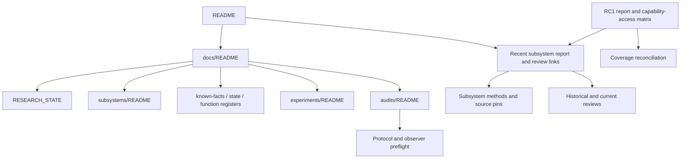

# Navigation and historical authority

**Subsystem reports are reachable, but the best cross-subsystem roadmap is
not indexed.** A short current authority layer would help more than moving
the archive. No restructuring or status correction is performed by RR1.

## Actual routes and link audit

The [link inventory](link-inventory.csv) records 6,034 occurrences with source
line, target, resolved file, case/HEAD status and anchor status. In the initial
tracked Markdown scan, 5,929 point to HEAD files and 105 to locally existing
ignored files. No file-target absence or case mismatch was detected in that
parsed set; 146 anchors match, and one does not. Manual inspection confirms
`continuous-beacon-preview/sources.md:21` points to `#sor-p-0001`, which is a
permission table-row ID rather than an existing heading/HTML id. This is a
real anchor repair candidate, not an absent permission record.

This graph resolves inline links, reference definitions and HTML href/src;
it excludes fenced examples and external URLs. It is not a CommonMark/GFM
renderer, browser click test or whole-internet availability check. Plain CSV
paths and prose-code locators receive separate treatment in
[source-pin-inventory.csv](source-pin-inventory.csv). CSV path suffixes such as
`:source` identify fields inside receipts and must not be called missing files.
Slugs with unusual Unicode or repeated headings need manual confirmation.

A supplementary CSV scan inspects all **264 tracked CSV files**, finding
789 Markdown-style or path-like Markdown-cell references: 600 literal HEAD
resolutions, 85 local-only and 104 needing namespace interpretation; no case
mismatch or explicit anchor occurs in that parsed subset. Local `csv-links.json`
retains every row and the detection method. Of the 104, ten are root-level
inventory paths (AGENTS/README/credits/policy/workflow) rather than relative
hyperlinks; 92 are technical-register shorthand for existing inorganic,
organic and fabricator reports. The remaining two are historical `project040`
origin labels in ship-relocation-050 sources rows 274/279, not promises that
those names are present relative to the CSV. Exact historical origin snapshot
resolution remains a B3 provenance task. None of the 104 is silently labelled
a broken tracked document; the namespace ambiguity is part of the audit result.

The graph is based on actual outgoing links, not a proposed extra edge from
AuditIndex to RC1. The two latest audit packages have no incoming reachable
route from README under this graph; neither main documentation index names
them. `docs/audits/README.md` was read directly to confirm that deficiency.
Local `navigation.json` lists the exact unreachable Markdown set; some tool
READMEs also lack direct document links, although directory browsing can find
them. Reachability is not a finding that every such file is abandoned.

## Three newcomer journeys

| Reader objective | Working route today | Missing or confusing step | Proposed bounded route |
|---|---|---|---|
| Learn current outpost model | Root recent reports → subsystem report/review; docs index → subsystem map | Multiple chronology feeds; old “current stage” and initial All OPEN table; RC1 not indexed | Root current overview → one subsystem/status table → accepted scoped report and limits → RC1 gap crosswalk. |
| Find technical definitions/native/save/Papyrus detail | docs index → function/state registers → individual ledgers and methods | General Papyrus/capability matrix hard to discover; many exact helpers remain local | Overview → RC1 capability/access and Papyrus interfaces → actual native/save/definition ledger → source pin and method availability tier. |
| Challenge evidence and negative results | Report → review/methods → historical source receipts | Original receipts often private; no standard current-successor map | Claim → decisive selected evidence → negative/counterexample ledger → historical review and current disposition, with local-only access explicit. |

## Status and supersession inventory

| Family / actual record | Disposition visible in evidence | Newcomer assessment |
|---|---|---|
| Static exhaustion dependency ledger | FALSIFIED_OR_IRRELEVANT child branches, resolved siblings, unfinished parents; final table authoritative | Strong internal preservation model; malformed pipe row obscures one key expression. |
| EXP0002A final-software audit and SOR-D-0021 | Deferred native-save acquisition; manual research remains viable | Deferred is visible, but root “next active” language from October 7 needs a historical wrapper. |
| Event-latency thread-control final review | Abandoned external-debugger acquisition approach, not falsified outpost position model | Clear distinction once reached; retained failure history valuable. |
| Local-readiness reassessment/review | Earlier engineering ACCEPT superseded for live authorization; scientific NO-GO, candidate unadopted | Good explicit successor wrapper; preserve both ACCEPT and NO-GO contexts. |
| Position v1/v2 and cross-session reports | Replaced/qualified frame interpretations; useful saved center/conditional XY retained | Current position specification routes through the history; do not erase old Z counterexamples. |
| Power Save29 plan → authority/review | Repeated-load PASS; later C/STRONG ordinary-load mechanism, writer NO-GO retained | Chronology can look contradictory without one current entry; these are separate questions. |
| D1 disappearing deposits | Partially discriminated historical incident/root cause | Unresolved event attribution is a reported limit, not grounds to discard scoped code/save results. |
| B1/BM1/BM2/LO1 report/reviews | Accepted bounded offline mechanisms with loaded/paired/exceptional limits | Recent report links work; RC1 synthesis should be a first-class route. |
| Coverage original A01–A60 → RC1 reconciliation | Original dispositions preserved; later resolved claims and child gaps explicit | Good crosswalk internally; inaccessible through current index graph. |
| Subsystem initial agenda and old L1/C1/S2 summaries | Initial All OPEN and “future” follow-ons coexist with subsequently completed work | Existing historical qualifiers help; a consistent current versus historical summary is still needed. |

No unsupported scientific supersession is newly declared. Historical run cards
can remain downloadable as records, but should visibly link their actual
execution/withdrawal/replacement before readers encounter commands. Existing
checksums and review ACCEPTs apply to named snapshots, not every later edit.

## Architecture proposal, not implementation

Keep a compact root overview, one current subsystem reader index, the RC1
capability/access matrix and a small claim-to-evidence-access table. Each row
should identify current scope/build, report/review, technical ledger/method,
known limits and predecessor/successor. Preserve chronological experiment,
decision and review files as immutable history with clear entry wrappers.

Do not require every historical Windows path to become relative. A path to an
original installed executable is provenance; a present instruction depending
on an untracked helper is a reproducibility dependency. Label both. Promote
only reviewed owned method source, and retain protected local evidence labels.
B1 adds the current navigation layer; B2 handles contextual prose/encoding;
B3 closes selected method prerequisites. File moves are unnecessary for B1.
