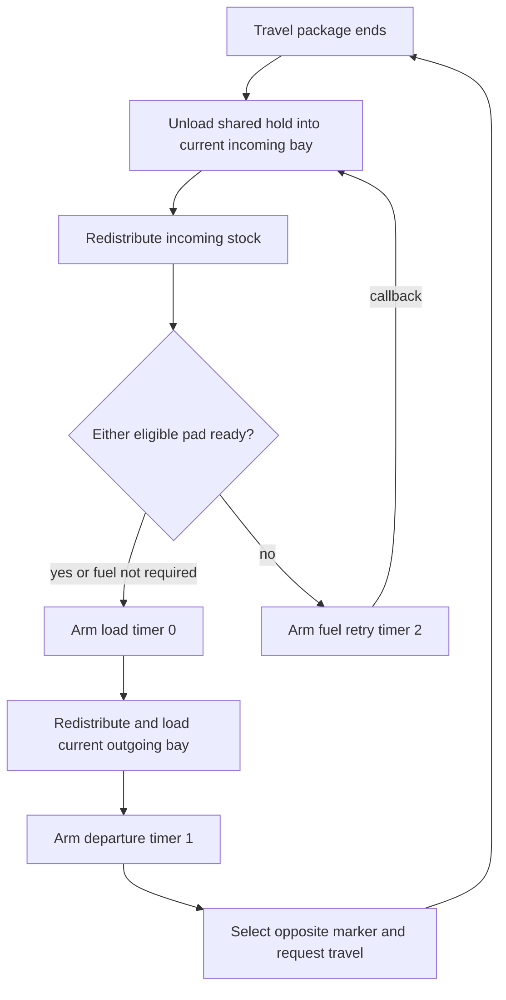

# Endpoint asymmetry and recovery stages

[Answer](report.md), [charge and consumption](native.md), [time](time.md).
This is the ordinary installed two-pad route, with valid bound scripts,
resolvable ship/bays, successful movement/package completion and no concurrent
unlink. A and B denote endpoints, not permanent export/import roles.

Define F(A) as A's current non-mission `CanProduceForWorkshop()` result. It can
mean charged admission or a complete currently accessible recipe; “fueled” in
the table means **this predicate passes**, not merely that a snapshot shows
some He-3. Earlier invalid/halt/power/category gates still apply. Physical stock
0–4/5+ alone cannot decide F without charge and eligibility. The quest enumerates
reverse LinkShip references and stops on its first qualifying pad; its unused
atOutpost01 parameter does not confine the query to the physical departure end.

| F(A) | F(B) | Ship arrives at | Receipt / unload | Next load, reverse freight and departure | Fuel / retry |
|---|---|---|---|---|---|
| true | false | A | Unload to A.in, then redistribute | Timer 0 loads A.out, timer 1 selects B and evaluates travel | No voyage debit; native A production independently withdraws eligible fuel |
| true | false | B | Unload to B.in, then redistribute | A admits timer 0; B.out may load and ship may return to A | B needs no local fuel to receive or send reverse freight under this predicate |
| false | true | A | Unload to A.in, then redistribute | B admits loading A.out and travel to B | The ship can resume while physically at the unfueled end |
| false | true | B | Unload to B.in, then redistribute | Load B.out and travel to A | Native B consumption is separate from loading/departure |
| true | true | A | Same receiving operation | Load A.out and travel to B | Both pads can consume their independent fuel cycles; readiness query itself consumes none |
| true | true | B | Same receiving operation | Load B.out and travel to A | No double voyage fee; two periodic consumers can still double fuel demand |
| false | false | A | Unload still attempted; refused freight stays aboard | No new load timer admitted | Timer 2; next callback repeats unload/query at A |
| false | false | B | Unload still attempted; refused freight stays aboard | No new load timer admitted | Timer 2; replenishing either eligible pad can admit next load at B |
| RequiresFuel false | irrelevant | either | Same ordinary capacity-limited receipt | Load and departure timers admitted without fuel test | Ordinary-link negative control; no fueled-pad recipe debit introduced |

These rows apply at arrival/retry admission. If either F changes **after**
timer 0 has been armed, timer 0 still loads and arms timer 1. Timer 1 changes
Current and evaluates the package without a second fuel query. Both supplies
can therefore disappear during loading/travel and that already admitted leg
can still finish. At its arrival receipt again precedes the next readiness
decision. Current is the selected destination during flight, not a physical
location oracle.

Retry does not clear, duplicate or discard the hold. Each ordinary unload tries
capacity-respecting ship → current incoming transfer, requests local downstream
redistribution, then queries readiness and sends the unload event. If an earlier
unload was partial and downstream movement later frees room, a retry can remove
more retained stock. If no room opens it leaves the remainder aboard. There is
no separate manifest splitting return exports from refused cargo. On eventual
departure, both share the same remaining hold, preserving C2's returned-freight
mechanism.

Changing supply during travel affects periodic fuel use and the next arrival
query; there is no continuous midflight cancellation predicate in these scripts.
Replenishment while timer 2 is pending has polling latency. It can pass mode 0
before withdrawal; if production consumes the last five and marks charged, that
charge can instead permit admission until the next due shortage clears it.
If both endpoints become unready between polls, the next arrival attempt stalls.

The stock graph can use delivered He-3: arrival unloads and redistributes before
checking fuel. However, ingredient access can also draw directly from a reachable
incoming container, and no callback guarantees that unrelated local stock was
moved merely because time passed. No event-triggered wake-up was found in the
complete shipped marker/ship/quest fuel handlers; this is a bounded negative,
not a claim that no external quest or mod can send events.

A mission pad carrying OutpostCargoLinkMission cannot satisfy the either-pad
query. A paired ordinary eligible endpoint must do so for such a route. Mission
SpecificCargo/Max also changes transfer selection. The eight ordinary rows are
not claims about unqualified mission inventories or malformed extra endpoints.
