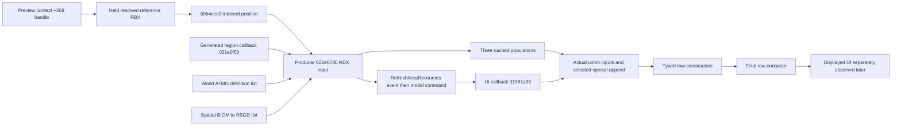

# Native dependencies and chosen observation boundaries

2026-10-15. [Contract](contract.md), [source lineage](sources.md).
All addresses below are **RVA**, base `0x140000000` in the static PE. Runtime
addresses must use the actual session module base. Retail 1.16.244.0 SHA256:
`7e9adb1414a8e1b325e5e1f097b9b17b78deb7eebeda37a333351a43a60f9d28`.
Original `FUN_` names survive in raw exports; role names are research aliases,
OBSERVED-INTERNAL, never validated integration APIs.

The event and UI command contain no evaluation position/vector snapshot. Their
delivery may consume a later producer's vectors. Content-correspondence candidates
remain plural; no nearest-timestamp or pointer-equality rule selects an ancestor.

| Hook RVA → target RVA | Source-backed operand / purpose |
|---|---|
| 021b26bc / 021b42e3 / 021b6931 → 021e07d0 | All three known natural producer CALLs. RCX=query state, RDX=24-byte indexed XYZ/frame/domain, XMM2=radius, XMM3=separate geometry. Capture before and return three populations, raw operands and AL refresh predicate. Preview bridge additionally captures held RBX reference. |
| 015784a0 → 022cdf60 | Model queue allocation result. Record command-pointer allocation invocation; not a resource epoch. |
| 01581a96 → 01578500 | Actual UI application: RCX=command, RDX=owning model. Scope parents actual consumer and constructor events; before/after population snapshots remain non-atomic. |
| 015785c9 / 015785e8 → 021f8120 | Exact first and second ranges in RDX/R8 at consumption boundary. Pointer deduplication in first-occurrence order. R9 is local fold, retained raw before/after. |
| 0157862e → 0042e250 | Every actually selected special resource append. Full third population is also separately sampled; direct unselected loop operands have no per-entry hook. Special appends are not pointer-deduplicated. |
| 015787e9 / 015787fc → 0157fcf0 / 0157fde0 | Both typed row construction branches. Assembly captures RDI=resource and RSI=payload. Existing-capacity destination is RDX; growth returns inserted destination in RAX. |

These ten complete CALL replacements avoid prologue theft and return-address
substitution. Three producers cover their known direct call census; two union
calls capture actual consumed populations; both constructors are necessary for
capacity/growth. The queue observation distinguishes allocation from application.
No terrain-generation, extractor-footprint or save-write hooks are introduced.

Before constructor, capture row ordinal `(payload.end-payload.start)/0x170`.
Fast branch increments end **after** the CALL returns. Growth can relocate earlier
rows. Final UI-return census associates constructor operands to committed ordinals,
rather than requiring the earlier address to survive growth. Final rows have
display fields; no FormID is inferred from those fields. Resource FormIDs come
from resource+0x28, type at +0x2e. Unreadable IDs remain UNKNOWN.

Concrete model+0x30 vtable `0x04c75ce8`, slot+0x58 `0x04c75d40`, contains
getter `0x0038a050`, bytes `488d4128c3`: returns model+0x58. Final vector
start/end/capacity are model+0x90/+0x98/+0xa0, searched byte model+0xe8.
Getter/vtable must be guarded before use; the observer reads rather than calls it.

The indexed domain is accepted for native types 0x49/0x56 or replaced by a
sentinel. Record its raw header/type/FormID; runtime pointer is not a stable site
ID. Preview actor/base and cell/world headers are independent non-atomic samples.
Raw reference+0x8c XYZ is not substituted for evaluation-time indexed XYZ.

Producer-only overlap counters do not cover constructor 021adb00, destructor
021ae260→021ae590 or direct end resets 021b6a10/021d0650. Descriptor rereads
cannot prove absence of in-place ABA. Captured actual consumer operands and final
rows support scoped reconciliation; universal shared-cache revision attribution
is explicitly unavailable. AL indicates refresh/update, not a changed set.

Primary evidence: existing resource-availability ui06/07/08/09/15/16/17 plus fresh
`.local-work/recon/continuous-preview-specialist-01/02/03.tsv` and logs. Specialist
audit and seal retain exact selectors/hashes and 15 unchanged analysis-project
files. All exports used existing program read-only/no-analysis. One long function's
instructions cap at 600, with complete decompilation; decisive windows and PE byte
guards, not a capped census alone, support claims. No database edits occurred.
