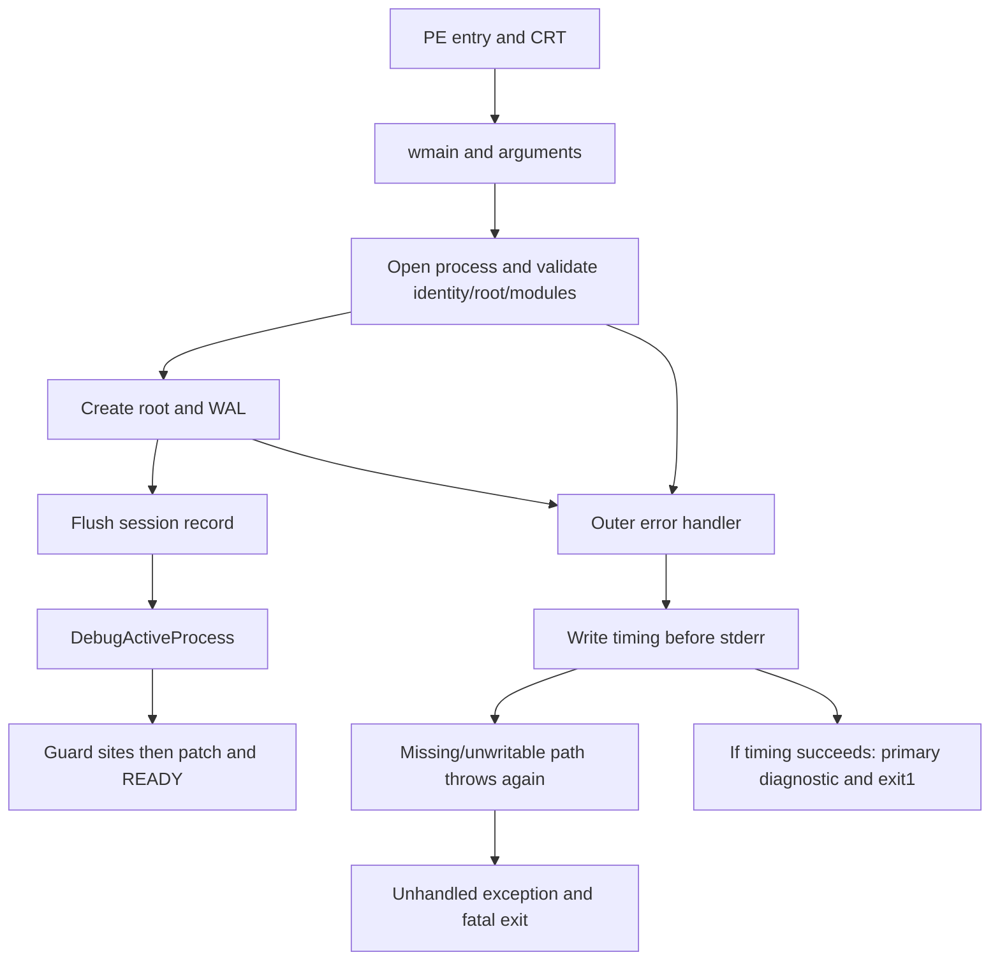

# Startup dependency and fault-path map — exact0.1.3

SOR-EXP-0027 / SOR-EV-0035;2026-10-11 Australia/Sydney.
[Investigation](startup-failfast-investigation.md), [qualification](startup-014-qualification.md).
All RVAs below belong to approved adapter SHA
`b0751a86655b0a4759932f0b90cfcd7aeb9314f9a03b5a52d4522ba5bd1c1eb3`.
They are not game RVAs or transferable live VAs.

| Stage in normal path | Evidence basis | Failure/output boundary |
|---|---|---|
| PE AMD64/CUI entry RVA1F480, cookie/CRT initialization | Exact PE/disassembly; installed MSVC source consultation | Loader failures, CRT initialization fail-fast, initializer exception are platform routes; not observed in useful repro |
| C++ constructors, profiler/container state, wmain | Source plus successful original --version/missing-argc executions | No profiler file output during static initialization |
| --version / argc / mode | Source and compiled execution |0/2 exits; version stdout is earliest intentional output on that branch |
| stoul PID/root assignment outside try | Exact source; invalid/overflow PID repro | Unhandled conversion exception can terminate before a catch/output |
| OpenProcess ALL_ACCESS, RVA1BED4 | Import/disassembly and denied/invalid disposable probes | Handle open can precede all evidence; failure enters catch. This is not attachment |
| QueryFullProcessImageNameW, RVA1BF30 | Import/disassembly; disposable probes | Image failure enters catch |
| Absolute/normalized/no-reparse root; executable basename/hash; mode/site plan | Source; relative/bad-hash/rejected-retail controls | No guard bypass or game-name spoofing; possible pre-output rejection |
| Target module snapshot, ntdll file/hash and DbgBreakPoint address | Source; successful genuine-fixture path | Module/API/hash failures precede root creation; no target code patch |
| create_directories(root), then evidence directory/WAL CREATE_NEW | Source, disassembly and fresh-root/sentinel controls | First adapter-created filesystem objects on normal acquisition path; no root deletion code |
| EpochWriter session WriteFile/FlushFileBuffers | Exact writer source and valid fixture WAL | First acknowledged durable adapter acquisition record; per-record chain/hash unchanged |
| DebugActiveProcess, RVA1DC77 | Import/disassembly; valid fixture runtime trace | Attachment occurs after durable session, not at OpenProcess |
| Kill-on-exit policy; initial debug event; both center32 guards; INT3 patches; ready event/READY file | Source and fixture captures/qualification | Target memory reads/patch/control occur here; READY requires guarded installation |
| Capture/replay/retirement | Existing qualified protocol, plus new retained counterexample | Native association and target survival are separate outcomes |

The compiled outer handler calls profiler-save at RVA21836 (runtime return
2183B), **before** primary stderr. Failed profiler output throws through RVA17B56;
the observed disposable trace reads `profile_write` and reaches unhandled C++ EH.
An existing output directory permits timing.json and makes the original stderr
reachable. This branch is a diagnostic error route, not normal evidence creation.
RVA16EB4/1BEFC belongs to the observed primary require/OpenProcess error chain.

The diagram describes verified source/compiled/repro relationships. It is not a
trace of the original live process. Its original first failing stage, stack,
fast-fail parameter and fault address remain absent. Directory absence supports
a pre-creation failure; it does not prove every earlier API was skipped or rule
out an external filesystem actor. No evidence supports silently moving the
original failure into the attach or game-code stages.

Candidate0.1.4 moves parsing into try and reverses the diagnostic dependency:
primary stderr/flush → optional guarded timing in its own catch → controlled exit1.
It does not defer raw memory reads or WAL durability, change breakpoint handling,
remove site guards or implement a watchdog. Actual tests and residual runtime
safety issue are in the qualification report.
