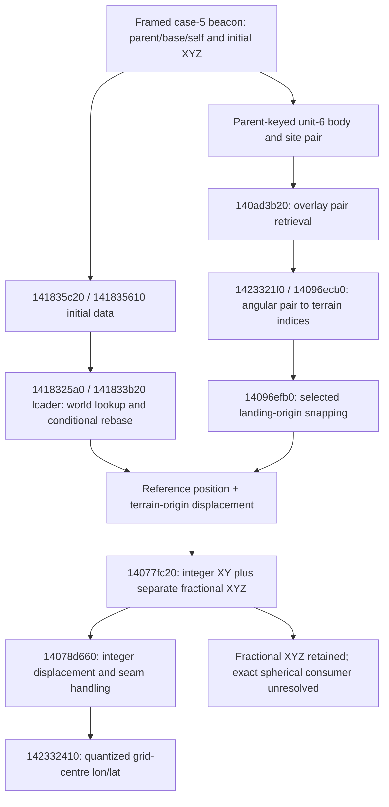

# SOR-EXP-0015 — Beacon terrain projection and exact-position boundary

2026-10-09, Australia/Sydney. ANALYZED; SOR-EV-0021 / SOR-F-0020 / SOR-H-0009. **Critical review required.** Authored research REVIEW-REQUIRED; saves, decoded streams, full native text and databases LOCAL-ONLY.

## Best-supported answer

**The angular projection and its ordinary grid scale are recovered; exact continuous beacon longitude/latitude is not yet established.** The installed engine maps integer terrain coordinates through a nonlinear two-hemisphere square projection. Independently recovered defaults give **49,152 fine steps per square axis**. This reconstructs all **22 available beacon-associated pairs** and **three fixed city pairs** to at most `8.881784197001252e-16` longitude / `3.3306690738754696e-16` latitude radians in the beacon matrix. This is strong evidence for quantized site placement, not validation of the individual beacon's fractional position.

Save25 supplies a more specific relationship: SOR-002 and SOR-003 recover indices `(10465,21122)` and `(10467,21144)` on southern tag 1. Subtracting `floor(float32(X * float32(0.01)))` and the analogous Y gives the **same candidate origin `(10464,21120)`**, also recovered from S1/S1C/L2C. No scale, rotation or per-beacon parameters were fitted. This closes the earlier resolution/projection question and strongly supports a common grid frame for these controlled placements.

The remaining exact-beacon obstacle is concrete: **the authoritative reference-world → active-terrain origin/rebase relation, and a consumer defining how the retained fractional XYZ becomes a continuous planetary point**. The traced engine angle path discards fractional XY and Z. A different path preserves them separately. Their coexistence does not prove that adding fractions to projected site indices is the engine's exact spherical embedding. Loaded-world selection and a cached-angle override also change which coordinate path runs. A universal saved-input algorithm would need to close these terms, not simply re-label the reconstructed site pair as the beacon position.

Confidence: PROVEN / SAVE for selected bytes and arithmetic comparisons; STATIC for pinned operands; **STRONG scoped interpretation proposed** for the projection/grid-centre relationship and controlled common origin. Fractional extension, worldframe reconstruction and post-load authority remain PROVISIONAL/OPEN. Coverage: one installed executable, seven freshly analyzed archived labels, 19 mature ordinary records of which 17 have usable direct pairs, three installed fixed cities. Completeness of all terrain branches and all beacon representations is not claimed. No validated mod integration point.

## Authorization, inputs and actual execution

The user invoked [the retained brief](../implementation-briefs/CODEX_BRIEF_SOR_exact_beacon_planetary_coordinates.md), asked for execution and a commit suggestion, and prohibited committing/pushing. Starting HEAD `ec3f8a4377211e9ef4aa14042566c7915236e852`; only the supplied untracked brief pre-existed. SOR-D-0032 records this authority. Required project policies and previous subsystem/evidence reports were consulted. No agent delegation occurred.

Allowed experiment: read/hash existing archives and installed definitions/executable; make a protected Save25 copy; run existing stdlib archive extraction; export existing Ghidra analysis with `-readOnly -noanalysis`; construct original mathematical/audit scripts; consult public prose; write selected evidence and review documents. Outputs go to ignored local directories except minimal authored numbers/scripts/docs. Risks: disk exhaustion, decoder failure, incomplete native exports, numerical-model error and overinterpreting empirical wire windows. Stop on the 40 GB guard, input/database mutation, essential ambiguous framing or tool failure; retain failures and report incomplete branches. Temporary decoder scratch is cleaned by its context manager. No game launch/load, debugger, hooks, deployment, save/configuration/database edit, dependency installation, external disclosure, staging, commit or push.

Fresh extraction command, from repository root, with installed CPython 3.14.3:

```powershell
python -B save-analysis/scripts/research_two_outpost_anchors.py --run exact-beacon-01 --source 'C:/Users/User/Documents/My Games/Starfield/Saves/Save25_D6036588M417474696C61204B6972616C79_000231_20261009102224_4_0_4.sfs' --catalog .local-work/save-capacity-location/esm-index-verified.json --frozen .local-work/save-capacity-location/body-final-03/save-derived.json
python -B save-analysis/scripts/audit_beacon_projection.py --receipts .local-work/two-outpost-anchor/exact-beacon-01/results.json --fixed docs/experiments/planetary-surface-anchor/fixed-anchors.csv --output .local-work/exact-beacon/audit-NEW
```

Use a new output directory; the audit refuses overwrite. Its grid constants come from native initialization, not numerical fitting. Names and network JSON are not inputs to that audit. Existing extractor compares the network only after save extraction. Save25 is SOR-SAMPLE-0030: original/copy **2,403,744 bytes**, SHA-256 `d4df86bc01c2105933fe856a1be5ebbe0c3fc78a4d67fe1a790e18129faf75f5`; decoded **6,553,789 bytes**, SHA-256 `0c27c10c1f07d5a480da4f857072cafc17e198b981350e01de2fa6b09f972cfd`. New protected archive: `.local-work/savegames/two-outpost-anchor/exact-beacon-01/`. Full manifest/extraction/preservation/network/fixed receipts: `.local-work/two-outpost-anchor/exact-beacon-01/`. S1/S1C/L2C frozen originals are absent; their verified archive identities and decoded hashes substitute only for those unavailable originals, not for an originating-build claim. Save3/Save2/Save52 originals present were rechecked.

Installed Starfield.exe SHA-256 `7e9adb1414a8e1b325e5e1f097b9b17b78deb7eebeda37a333351a43a60f9d28`, preferred image base `0x140000000`; Starfield.esm `1dabed00c3f4282dd3bb54d2e9601e40b577d8742d078b7ccef203adbfef0da7`. Existing Ghidra 12.1.2 / JDK 21, Xmx2G, no installation or auto-download. C/D free space initially approximately 83/130 GB, above the 40 GB guard. Header version strings do not establish full historical configuration or module equivalence.

## Saved inputs and native data flow

Addresses below are **static VAs in the pinned executable**, not runtime pointers; RVA = VA minus `0x140000000`. In-memory member offsets are not save offsets. Decimal save offsets are decoded logical-stream offsets. Saved three-byte tokens are tagged/remapped identities, not handles or cross-session FormIDs.



| Input / mechanism | Exact evidence and supported meaning | Remaining limit |
|---|---|---|
| Ordinary beacon identity | Existing framed case 5, ACTI `002C60E9`, saved self/parent; [prior selected offsets](two-outpost-site-anchors-and-beacon-coordinates.md#save25-side-by-side-evidence) | Alternate forms and active ownership are separate questions |
| Body/site pair | Direct repeated parent/PNDT key in R1 global unit 6; Save25 pairs at 232351 / 232381, Kreet `0003F59F` | Full component wire grammar and post-load authority unclosed; old Uranus-shaped cache hit retained |
| Local initial XYZ | Save25 at 1344574 / 1474225; `141835c20` reads shape, XYZ and conditional rotations; `141835610` transfers initial data | Omitted rotation floats are not evidence of a zero rotation; reference rotation need not rotate a planetary coordinate chart |
| Initial-data flags | Shape 0 trailing byte at 1344586 / 1474237 is `0x0b`; S1 at 1295854 is `0x0b`. All 17 Save52 clear records `0x2b`, two set records `0x3b` | These are not the later saved form/disabled flags. Bit 0x20 participates in frame handling, not a universal ownership test |
| Loader restoration | `140b4e410` writes reference+8c/+90/+94 from XYZ; `1418325a0` and `141833b20` conditionally use overlay translation | Direct write does not prove final unchanged runtime position |
| World translation | `140ad7200` keyed lookup in component DB manager+300; `140ada960/140ada3a0/140ad40c0` consume mapping. Value+8/+c integer shifts multiplied by 100, +30 vertical float, +35 invalid gate | Exact saved key/value → selected loaded mapping remains unvalidated |
| Mapping creation | `140ad1660 → 140ad47e0 → 140ad4a00`; `140adcde0 → 140add2e0 → 140adccf0` creates ActivatedOverlayProperty command | Static creation and registration do not identify the particular post-load map for each archive |
| Reference-coordinate consumer | `140910690`: ExtraData type 0x81 can supply cached pair/body; active terrain-world branch reads ref+8c/+94 and calls `14078d1f0`; other-world fallback calls `140ad3b20` | Not a universally continuous query. Cached override schema/authority not closed |
| Local-angle converter | `14078d1f0` multiplies float XY by float0.01, floors, selects manager origin+0xc8 or+0x1c0 (mode 3), calls `14078d660`, then `142332410` | Fractional XY and Z do not enter this pair |
| Pair plus residual | `14077fc20` combines indexed displacement*100 and actual local position, emits new pair and retains residual at output+20/+24/+28 | No demonstrated continuous spherical residual consumer; no metre conversion |

Frame investigation also followed `140ad7040`, `140ad94a0`, `140ad9810`, `140ad9cd0`, `140ad7b80`, `141805090` and callers `14167d0d0`, `141682790`, `1417e0f40`, `1405a0520`. The latter large function has incomplete decompilation; no conclusion depends on its omitted tail. Searching existing unit-6 associations for source-world tokens (`8147f8` Save25, `8147fc` S1 and each mature source world) finds no direct point under that predicate. **This is a negative result for that bounded search, not proof that the information is absent from the save.** Raw cache bounds/neighbor words remain local and unclassified. A guessed wire offset has not been substituted for the native map.

The residual/body-geometry branch was pursued further in batch 16: `1407bcfb0` also floors current XY, calls `14078d660/142332410`, rebuilds a direction, applies body orientation and scale/translation. It therefore does **not** supply independent subcell ground truth. `140b546a0` likewise quantizes before world/cell selection; `1407be780/1407bea00` derive snapped/indexed points. ActivatedOverlayProperty registration is concretely closed through `140add310` into manager+300; wire restoration and the selected map remain unqualified. Explicit `refall:142332410` exported 46 existing xref rows without the ordinary 24-row cap; this is an existing-analysis reference inventory, not proof of all executable callers or complete semantic classification. The code does not contain a consumer automatically labelled “exact beacon,” and naming alone was never used to choose one.

## Projection algorithm and parameters

[Original reference model](../../save-analysis/scripts/beacon_terrain_projection.py), [audit runner](../../save-analysis/scripts/audit_beacon_projection.py), [analytical tests](../../save-analysis/scripts/test_beacon_terrain_projection.py). Source-informed by Bethesda installed executable SOR-S-0127, independently authored mathematical expression; no decompiled text incorporated. No I/O or engine calls in the model. It is deliberately **not an exact-beacon API**.

| Parameter | Source | Value / units / status |
|---|---|---|
| B | `14008cb90` initializes `uBlockSize:Stitching` to 10; `14008cc50` initializes `uBlockMergeZoneSize:Stitching` to 2; value globals `145ea66f0`, `145ea6770` summed by grid routines | 12 fine-index steps per sub-block under defaults, STATIC; no historical override claim |
| R | `14096e060` initializes with 0x100; `14096da90` clamps8..256 and stores manager+50 | 256 in ordinary initialized branch; other configurations/branches require their actual R |
| N | `14096f4d0`, `14078d660` | `16*B*R = 49152` steps per axis |
| Index hierarchy | Packed terrain coordinate tag+0, coarse XY+4/+8, sub XY+14/+18, fine XY+24/+28 | `I=16B*coarseX+B*subX+fineX`, likewise J. In-memory layout only |
| Local scale | `14078d1f0`, `14078d2c0`, `14077fc20` | 100 engine position units per fine step; do not call metres |
| Half step | double 0.5 at `144f046a8`, `14096f4d0` | grid centres `(I+.5)/N-.5`, `(J+.5)/N-.5` |
| Projection constants | PE-mapped double 2 at `144f04770`, `2sqrt(2)` at `144f047a0`, .25 at `144f04668`, 1e-7 at `144f04210`, 16 at `144f04880` | Exact file-offset/value receipts local; not mutable BSS settings |

No stitching-setting overrides were found in inspected installed-game/MyGames INI/TOML/JSON files. This does not establish the configuration under which historical saves originated. Sample reconstruction independently supports the default N in these particular pairs.

For centred square `(u,v)` in `[-.5,.5]`, observed inverse (`142332410`) is:

```text
a = 2u * sqrt(1 - 2v²)
b = 2v * sqrt(1 - 2u²)
D = 1 + a² + b²
x = 2a/D; y = 2b/D; z = (a²+b²-1)/D
tags 1/2: negate x; tags 2/3: negate y
tags 0/2: z = abs(z)
longitude = atan2(y,x)
latitude = atan2(z, horizontal_norm)
```

The native horizontal norm is mixed precision: `float32(sqrt(float32(x²+y²)))`. The option `native=True` models this latitude stage; platform atan2 and all encoder instruction-rounding details are not claimed bit-identical. Native clamps intermediate a/b; analytical valid-square inputs already obey bounds. The ordinary angle encoder emits tag 0 for north and tag 1 for south. Tags 2/3 participate in mirrored/seam handling; these are **not six cube faces**.

Forward mathematical model: form unit direction `(cos(lat)cos(lon), cos(lat)sin(lon), sin(lat))`. Set `a=(south ? -x : x)/(1+abs(z))`, `b=y/(1+abs(z))`. Then

```text
u = [sqrt(2+a²-b²+2sqrt(2)*a) - sqrt(2+a²-b²-2sqrt(2)*a)]/4
v = [sqrt(2+b²-a²+2sqrt(2)*b) - sqrt(2+b²-a²-2sqrt(2)*b)]/4
```

Native encoder first normalizes through a float norm, and zeroes tiny radicands under 1e-7; the analytical encoder uses trig direction and nonnegative clamps. Therefore it is a mathematical approximation of the forward path, suitable for recovering these comfortably separated integer centres, not a boundary-bit oracle. `14096ecb0` uses nested floor/fmod with an upper clamp; analytical `grid_cell` expresses interior uniform quantization. For the audit, nearest-centre recovery uses `round((u+.5)*N-.5)` and separately reports distance from that half-integer. It does not fit N. Whole-sphere seams/poles and wrap require native branch qualification; poles have undefined longitude.

## Numerical validation and counterexamples

Full selected [25-row matrix](exact-beacon/matrix.csv) includes pair, body/token, indices, angular errors, local split and **candidate**, not proven, origin. Derivation used native code/settings and Save25/S1; held-out mature and fixed-city cases were evaluated with the same constants after that derivation. No JSON-derived body/location or fitted rotation/scale enters the projection audit. This is a separate computation over fresh receipts, not an independent implementation of the entire save decoder.

| Cases | Tag / recovered indices | Result and limit |
|---|---|---|
| Save25 SOR-002 | 1 /10465,21122 | lon/lat residual 0/0; qXY1,2; candidate origin 10464,21120; residualXY22.7004547119,73.0462341309 |
| Save25 SOR-003 | 1 /10467,21144 | lon residual 2.220446049250313e-16, lat0; qXY3,24; same candidate origin; residualXY56.8204040527,59.05859375 |
| S1/S1C/L2C | 1 /10465,21122 | same exact pair, 0/0 reconstruction error; qXY1,2; same candidate origin, differing residuals |
| Save3 | no detected ordinary records | Zero control, no transform comparison |
| Save52 | 17 direct pairs over 16 bodies | Both hemispheres, negative longitude and latitude; maxima8.88e-16 /3.33e-16 radians. Two disabled-set records lack direct pairs and are **not** successful numerical validations |
| Save52 Feynman V | 0 /25124,32446 and 37536,20928, PNDT0005E0DE | Same constants reproduce both distinct sites, errors within above maxima |
| Cydonia / New Atlantis / Akila fixed ESM | 0 /35623,22567; 16985,33329; 30220,46937 | All reproduce with longitude 0 and latitude≤2.220446049250313e-16 rad. Save2's New Atlantis pair equals that fixed ESM pair under prior/fresh comparison; it does not locate the movable player exactly |

All 25 angular pairs reproduce, but inverse-square centre residuals reach approximately `0.0002676` fine steps because the serialized/native latitude contains float rounding. This is consistent with the observed mixed-precision pipeline; using pure-double latitude yields a larger disagreement. Radian maxima correspond to approximately 5.09e-14 /1.91e-14 degrees for beacon rows. No physical distance is reported: reliable body radius/engine-position-unit metric has not been established here. Sample maximum latitude is about 1.001 rad; analytical tests extend to±1.55 rad and longitude wrap, **not runtime validation** of those edge cases.

SOR-003 user description “roughly north” / “couple of kilometres” remains contextual SOURCE-REPORTED. The observed pair difference is `(+0.0013408427594047,-0.0003303898572602)` radians, but no calibrated compass/metric premise follows from that description. Chart axes have position-dependent spherical derivatives; south-tag X is mirrored.

**Counterexample to a universal occupied-cell assumption:** Save52 beacon `84ede9` (PNDT `0005E0DB`) has local X `-53.4358024597168`, so qX=-1, while its site index is 13152 (and J45120), both on 96-step origin multiples. Assuming the site is its current occupied-cell centre gives origin 13153; treating the site as a retained/snapped origin gives 13152. These differ by one whole fine step. No saved action sequence or qualified loaded map decides which interpretation applies. This does not refute the projection, and does not prove the beacon was moved. It refutes treating the site-to-current-cell relation as already universal.

## Hypothesis/evidence log and stopping boundary

| Candidate | Prediction / discriminating test | Result / next question |
|---|---|---|
| One common site pair per traversable landing area | Save25 pairs equal | Rejected by accepted EXP0014 bytes. Distinct outpost-associated sites can share a candidate grid origin |
| Six cube faces / linear lon-lat grid | Native tags and denominator follow cube or linear axes | Rejected: encoder uses hemisphere z sign, stereographic/elliptical math. Lower seam tags do not create six faces |
| Independent default grid N49152 | Held-out pairs land on integer centres and reproduce native-lat rounding | Supported across 22 beacon and 3 fixed pairs, no fit; other R not universally excluded |
| Controlled common grid frame | Site index minus local floor equal for Save25/S1 controls | Supported, same 10464,21120 origin; loaded/rebased equivalence still not proven |
| Site angle is exact beacon angle | Local residual irrelevant to individual position | Unsupported: residual is explicitly retained and differs while S1/site pair stays identical |
| Add fractional local XYZ to site with no frame qualification | All sites represent current occupied cells, including negative X | Counterexample above leaves a one-cell ambiguity; cached/loaded-world branch also matters |
| Continuous fractional projection | Project `I + residualX/100` or `I + .5 + residualX/100`, similarly J | Both are mathematically computable but neither is validated by integer-centre outputs. Native quantized caller cannot distinguish them; terrain embedding/consumer evidence required |
| Source-world token directly supplies missing angle | Existing qualified unit-6 search finds source-world points | No hits under this predicate; not an absence proof. Generic ActivatedOverlayProperty/wire reconstruction remains a possible offline route |

The two missing terms are not being hidden behind “procgen complexity.” (1) A per-reference choice of authoritative world, initial-data0x20 branch, cached override and activated-overlay translation/origin is not resolved from the current qualified wire readers. The exact native storage/consumers are listed above. (2) The observed angle consumer is many-to-one: all fractional XY within a 100-unit interval produce the same grid-centre pair, and Z never enters it. Consequently reproducing **all existing angular outputs cannot validate a unique continuous extension**. Static native code supplies that quantized behavior; no independent subcell global ground truth is in the authorized samples. Broader terrain-generation reconstruction was not pursued without a demonstrated fractional-position consumer connecting it to this question. No full terrain, component-DB or executable caller audit is claimed.

Prioritized offline next step: qualify the `ActivatedOverlayProperty` wire decoder/restore path and the type 0x81 cached pair for one controlled beacon, then trace the actual terrain-to-body geometric consumer of the separate residual. A successful mapping must predict Save25's common origin and the negative-X mature case **without selecting a frame from the desired answer**. This remains authorized offline research in principle, but this package does not claim that uncompleted mapping as evidence.

Smallest decisive *new evidence* test, **proposal only, requires a separate live brief**: on a disposable copy of a protected Kreet save, observe one beacon's reference XYZ/world, cached-angle presence, active terrain tag/origin/R, keyed map shift and `14077fc20` pair+residual before and after a known sub 100-unit XY displacement, then one cell-boundary displacement. Compare the actual body-space terrain/reference geometric output, not merely the quantized angle helper. This distinguishes centre-versus-corner fractional embedding and current-cell-versus-retained-origin semantics. One loaded area/two finite placements, no original overwrite; finite capture counts, evidence flushing, termination/recovery, permitted mutations and hooks/breakpoints would have to be specified and approved. No attachment/placement/call is authorized by this proposal. An observation-only capture of existing Save25 and negative-X frames could resolve map selection first, but cannot alone prove continuous interpolation.

## Terrain vocabulary and secondary leads

| Term / lead | Observation and exact locator | Conjecture / focused follow-up |
|---|---|---|
| Fine coordinate grid | `14096ecb0/14096f4d0/14096f5c0`; 100 local units per step | Computational placement index, not established as one visible terrain piece |
| Sub-block / coarse hierarchy | 16 subdivisions per coarse axis; B12 fine steps each under defaults; `14096eb90` also resolves pattern handles | Need native pattern/asset footprint mapping before assigning terrain-piece dimensions |
| Landing origin / traversable area | `14096efb0` snaps subindices to 0/8/next coarse according to≤3/4..11/≥12 and clears fine fields | 8B=96 fine-step origin spacing is 9,600 engine units. This is not proof of traversable-area width or metres |
| Worldspace | Identity-bearing object with components and bounds; `140ad4a00`, `140ad31a0` | Reconstructed overlays can translate frames; worldspace is not automatically one terrain tile |
| Overlay/site | Body-associated angle/world tuple, saved parent-key association | May be quantized/reused/snapped by consumer; not necessarily beacon-centre or landing-area constant |
| Placed reference | Local XYZ, parent and initial flags; conditional loader/rebase | Individual beacon; exact residual embedding remains primary, not a secondary tile question |
| Mirroring / rotation | `142332410` tag 1/2 flips X, 2/3 flips Y; `14096f940/f5c0` seam/index handling | Chart reflection does not establish random visible-piece rotation. No arbitrary beacon rotation parameter inferred |
| Modular terrain / apparent 2×2 | Required Reddit sources listed below; pattern-handle selection `14096eb90` | No code evidence here equates 16-way hierarchy or 96-step origin snap with 2×2 visible pieces. Need a footprint→pattern-consumer link |
| Poles / meridian / orbital texture | Unit-sphere math+Z pole,+X longitude 0,+Y longitudeπ/2 | Engine chart only; texture UV/body orientation calibration unclosed. Prior `141686a00` inverse-body ray hit is a focused lead |
| Resource overlay | Prior SOR-EXP-0013 source register and body-coordinate consumers | No resource-UV equality shown. Trace an actual sampling consumer before sharing the chart |
| Elevation / streaming | Z retained independently; mapping+30 vertical shift; terrain-origin mode+20 and current-world gating | No established height-to-radius formula. Trace residual consumer and loaded world lifetime before elevating a beacon off the surface |

## Prior art and publication

Required primary threads: [Starfield tiling example](https://old.reddit.com/r/Starfield/comments/1vqcjk3/found_a_perfect_example_of_starfields_tiling/) and [Observations on Starfield's tile system](https://old.reddit.com/r/NoSodiumStarfield/comments/1cr7w8t/obervations_on_starfields_tile_system/). Direct old/www fetches and ID/title searches were attempted; direct access returned unavailable/cache errors. The second is already PA09 in [the prior-art register](planetary-surface-anchor/prior-art-and-leads.md). **Full primary text and original authors could not be recovered in this pass; the requested full reading remains unfulfilled.** Secondary indexed mentions are not substituted as primary evidence. Modular repetition, approximate dimensions, rotations/mirroring and 2×2 components are claims reported in the user brief, not independently verified quotations or engine facts. The table above critically compares their relevance to the mechanisms actually recovered, without adopting them as premises. SOR-S-0131 records this access limit, not a fabricated source review.

Bethesda is credited for installed native/definition evidence (SOR-S-0127/0128/0129); Ghidra/JDK and CPython/zlib for separate-tool execution (SOR-S-0105/0113); maintainer prior methods (SOR-S-0124) and prior-art authors under their recovered names in SOR-S-0130/PA register. No third-party code/assets downloaded, adapted or incorporated. No fork/PR/contact/permission request. Original source-informed math is accurately described; it is not called clean-room. Scientific confidence does not clear proprietary export publication. Minimal numeric evidence and authored scripts await rights/privacy and critical review; raw saves/native exports/database remain local. [Review package](exact-beacon/README.md) includes exact changed files, checks, limitations and local diff locators.
