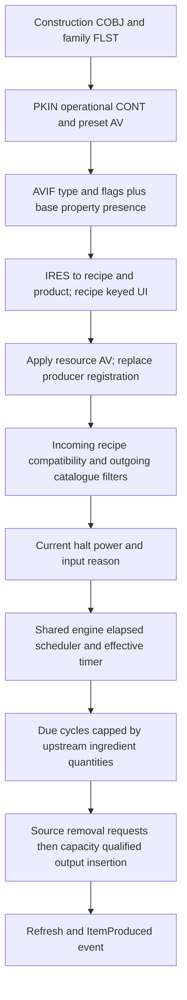

# E3 automated fabricator native reference

2026-10-17, Australia/Sydney. SOR-EXP-0040 / SOR-EV-0048.
[Authorized brief](../../implementation-briefs/README.md#archive-lookup) (`implementation-briefs.zip :: docs/implementation-briefs/CODEX_BRIEF_SOR_E3_fabricators_manufactured_production.md`),
[frozen contract](contract.md), [criterion matrix and review](review.md).

| Element | Answer |
|---|---|
| Research question | Can another researcher locate ordinary automated fabricator choices, inputs, configuration, state, local connections and rate calculation without rediscovering the subsystem? |
| Best-supported answer | **COMPLETE** bounded offline native reference, independently **ACCEPTED**, awaiting maintainer critical review. Three ordinary families contain **11 simple, 10 compound and 9 multiplex products**, realized by 30 construction-linked product-preset producer bases. Generic AVIF/property admission feeds recipe-keyed choice; shared producer registration, input consumption, links, elapsed scheduling and insertion explain the requested production path. |
| Confidence | Definition/byte/table checks are PROVEN within the stated inputs. Native interpretations are proposed STRONG / STATIC and instruction-backed; saved associations are qualified SAVE corroboration. No new RUNTIME evidence. Completion is separate from confidence and publication eligibility. |
| Coverage | Installed main ESM and pinned retail 1.16.244.0; all 45 keyword-qualified manufactured builder CONT definitions, ordinary construction relationships and exact 30 ordinary recipes, plus mature-save inventory and representative saved topology/configuration. Exceptional definitions are retained separately. |
| Evidence | [Definitions and examples](definitions.md), [45-base table](facilities.csv), [recipe/input/output catalogue](recipes.csv), [native/data layout contract](native.md), [reuse/modifiers](reuse.md), [saved examples](saves.md), [pins](sources.csv). Decisive original function exports and deterministic receipts are located by review.md. |
| Limitations | Current loaded AVs, assigned actors, power/input stocks and actual accepted inventory output are unobserved. DLC/mod overrides, remote cargo origin, full storage accounting and safe invocation are unqualified. These do not prevent the mapped ordinary offline contract from being COMPLETE. |
| Next step | Critical review of this package and its original criteria. Any live qualification or downstream tool/integration requires a separate decision/brief; no such action is proposed as an E3 prerequisite. |

## What the game implements

The producer is an operational CONT in a construction PKIN, with Builders and
manufactured keywords and a property sheet of supported resource AVs. Every
ordinary base in one family carries the same catalogue; its one positive preset
selects the initial product. Different presets are distinct native bases. The
tier-3 Comm Relay definition exists outside the ordinary construction list and
does not create a tenth ordinary multiplex choice. Classification uses exact
relationships, not display names. [Definitions](definitions.md) retain unused,
test and missing-recipe exceptions rather than merging them into ordinary counts.

The common builder selector `140f859d0` takes OrganicResourceType zero for these
bases. Its generic callback `140f8be60` filters AVIF category/flags, follows the
IRES backpointer and admits recipe/resource properties present in the facility
sheet. It marks admitted rows known, unlike E2's planet/species knowledge path.
Resource-property **presence**, including value zero, defines support; positive
selection defines current configuration. UI identity is COBJ FormID, while the
producer registry is keyed by IRES. Output MISC, ingredient IRES, AV and saved
reference identities must remain distinct even when names match.

Tier-2/3 COBJ records contain Special Projects conditions, but the mapped generic
catalogue/admission, reconfiguration, input-cap and ordinary creation paths do
not themselves evaluate that recipe condition list. They are not the generic
UI knowledge predicate. Research prerequisites on manufacturing construction
recipes are a separate positive gate. This is a bounded native result, not a
universal claim that skills/research cannot affect manufacturing.

Successful choice change zeroes the old AV, deregisters the old resource, sets
the new AV to one and registers it. The new row begins with zero scheduling
fields; an old countdown is not retained by that successful path. Revalidation
can remove incompatible incoming memberships and at most the first incompatible
outgoing membership per invocation. Outgoing acceptance uses the **whole
candidate catalogue**, not just the proposed product. Null/empty/populated
destination filters have different behavior. Exact operand and termination
contracts, including the UI warning path, are in [native.md](native.md).

The local graph maps destination to incoming sources; the direct outgoing query
and transitive upstream walk are different operations. The input consumer can
walk through buffers to producers. A path is structural evidence: every required
ingredient must still have sufficient quantities at execution. Saved examples
and paths are reported separately from current stocks and loaded authority.
Storage, incoming cargo, unresolved endpoints and missing identified paths remain
explicit boundaries; no cross-planet chain is reconstructed.

The scheduler is shared with E1/E2. It consumes engine elapsed seconds, including
explicit converted wait/travel updates; a planet's displayed local day is not its
interval unit. IRES interval GLOB hours times binary32 3600 gives base duration;
eligible actor/player A1 factors and current positive HarvesterRateMult determine
conditional effective duration. Ordinary presets give registration quantity one.
The native builder helper caps due cycles by ingredient requirements, prepares
source removal requests, then ordinary creation requests items. COBJ NNAM is one
for all 30 ordinary recipes but is not multiplied into this native request branch.

Nominal requested units per engine elapsed minute are `60 / D` for quantity one
under sufficient-input and eligible-state assumptions. Scheduler batching, failed
reasons and insertion acceptance can change actual realization. Manufacturing
Engineering/Management actor conditions differ from inorganic-only player perks;
the [reuse matrix](reuse.md) specifies eligibility. [Worked examples](definitions.md)
cover all three families with exact IRES/COBJ/input/interval identities.

## Persistence and research disposition

Selected AV ExtraBF, resource-keyed producer rows and transfer links have separate
save/load channels. Their remapped identities and scalar fields corroborate
configuration and historical scheduling; they do not prove current power,
current post-load AV authority, input supply or produced inventory delta.
The [saved audit](saves.md) inspects the mature inventory beyond Save52, retains
unavailable/unsupported cases and records usable representative instances.

The shared [native function CSV](../native-availability-map/functions.csv) is
extended rather than duplicated. New metadata carries VA/RVA, original identity,
operands, effects, prerequisites, callers and exact evidence; E1/E2 functions are
explicitly reused. Native pointers and internal mutation operations are not safe
mod interfaces. All authored results remain REVIEW-REQUIRED; raw definitions,
save material and decompilation remain LOCAL-ONLY.

The bounded scientific result is positive. No engineering production tool, mod,
calculator or simulator is created. Target survival/cleanup is not applicable:
no game process was used. Original data integrity, independent review and exact
patch coverage are separately accounted in [review.md](review.md). COMPLETE
does not authorize integration, publication, staging, commit or push.
