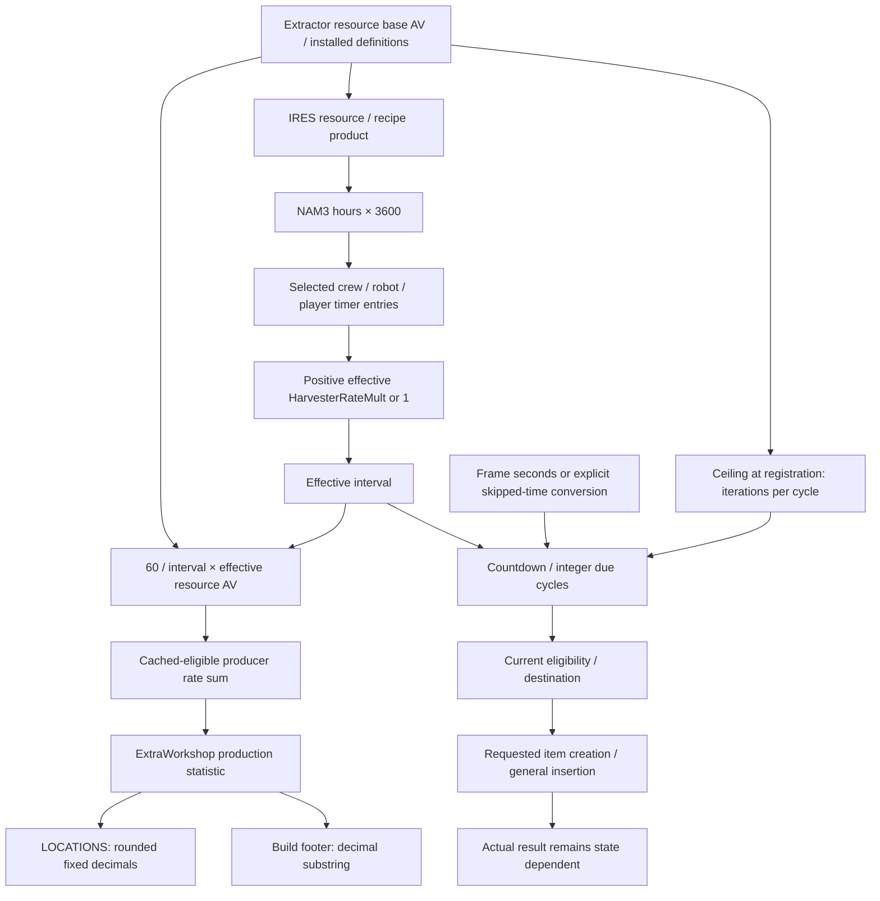

# E1 production arithmetic, clocks and displayed rates

2026-10-16. SOR-EXP-0038 / SOR-EV-0046 continuation under the
[brief](../../implementation-briefs/README.md#archive-lookup) (`implementation-briefs.zip :: docs/implementation-briefs/CODEX_BRIEF_SOR_E1_arithmetic_clock_scheduler_ui_provenance.md`)
and [frozen contract](arithmetic-contract.md).

**Ordinary production has a definition-derived interval, a separate quantity
selection and an elapsed-time scheduler. Both outpost screens read the same
cached production statistic, then format it differently: the build footer cuts
off decimal digits while LOCATIONS rounds.** The installed paths explain how
one value near 1.666… becomes 1.66/MIN and 1.67/MIN. This is now a code-supported
explanation, rather than an inference from the screenshots alone.

The screenshots are maintainer-supplied observations from a Save3-derived
gameplay state: one small Iron extractor, one solar array, no crew/cargo links,
required power 5 and total power 6. Their hashes and interpretation are in
[UI provenance](arithmetic-ui.md). The original protected Save3 is not asserted
to contain that constructed state; no fresh saved control was supplied.
The displayed stored Iron count is not analyzed. No game was launched.

## Answers and scientific closure

| Question | Status and supported answer | Boundary |
|---|---|---|
| A: nominal interval | ESTABLISHED for the named main-game definitions: resource IRES NAM3 supplies hours; binary32 multiplication by 3600 gives 36 seconds for common Iron, He-3 and water. | These are seconds in the scheduler's supplied elapsed domain, not a direct measurement of wall-clock output. |
| A/D: requested quantity | ESTABLISHED for ordinary registered direct-item extractors: registration stores the ceiling of the resource base AV as an iteration count; each eligible iteration requests the integer due-cycle count of the recipe product. | Current overrides, stale registration, leveled products and special categories are separate. Recipe NNAM is not multiplied in this direct branch. |
| B: time domain | ESTABLISHED for traced frame, wait/sleep and travel call paths: frame elapsed derives from the engine's scaled/clamped/smoothed seconds; wait and travel supply explicit skipped-time conversions. | This does not prove every menu, load transition or unloaded reference receives an update. See [clocks](arithmetic-clocks.md). |
| B: scheduler | ESTABLISHED for the producer-row updater: large elapsed uses trunc(elapsed/interval), small elapsed subtracts the remaining countdown; reset discards overshoot rather than maintaining universal fractional carry. | Startup/restoration and arbitrary extreme/invalid floats are not completely qualified. |
| C: effective multiplier | ESTABLISHED native read/composition contract; BOUNDED/CONDITIONAL actual effective value. Applicable current actor/player timer entries precede the positive effective HarvesterRateMult-or-1. | The effective AV has default, override, extra and base-property sources; raw PRPS is not automatically the effective multiplier. |
| D: realization | BOUNDED/CONDITIONAL: current eligibility gates creation; destination selection, general insertion and capacity/splitting machinery are mapped. Requested count, return bookkeeping and actual inventory delta differ. | No loaded inventory was observed. No global guarantee of successful realization follows from an event or displayed rate. |
| D: Special Projects extra items | BOUNDED scoped negative: its main-game PERK has the known timer entry and no D8 entry; three chance-bearing leveled lists exist but no typed incoming grant/use was found in the inspected definitions. | This does not exclude compiled-only scripts, hard-coded dynamic lookups, DLC/mod overrides or all native event consumers. |
| E: build footer | ESTABLISHED for the inspected normal/large installed assets: cached ExtraWorkshop+84 → fProduction → two-digit string substring. | Historical raw bits/update epoch are unobserved; scientific notation and unusual numbers need separate treatment. |
| E: LOCATIONS | ESTABLISHED for the inspected normal/large assets: the same cache field → named outpost row/fProductionPerMin → Math.round(rate×100)/100 then toFixed(2). | Remote display proves a cached statistic is accessible, not remote scheduler correctness or freshness. |

Detailed [quantity and effective-value reference](arithmetic-production.md),
[clock/scheduler contract](arithmetic-clocks.md), [two UI paths](arithmetic-ui.md)
and [modifier matrix](arithmetic-modifiers.md) give exact evidence and examples.
All native VAs refer to retail 1.16.244.0, preferred base 0x140000000, executable
SHA-256 `7e9adb1414a8e1b325e5e1f097b9b17b78deb7eebeda37a333351a43a60f9d28`.
RVA is VA minus that base. Object offsets are hexadecimal; ESM/SWF file offsets
are explicitly decimal. Native names are analyst aliases, not callable APIs.

## Connected production dataflow

The display branch computes an effective *nominal rate*. It does not divide
observed inventory growth by elapsed time. Cached eligibility in its producer
sum differs from the current reason recheck used for creation. Fractional
resource AVs, scheduler overshoot, capacity, registration age and snapshot epoch
can therefore separate a displayed rate from realized production.

The existing [native register](../native-availability-map/functions.csv) is
extended, not replaced. Primary evidence is Bethesda's pinned executable,
installed ESM, ContentResources.zip and interface BA2, read using project-owned
Ghidra/ESM readers and original stdlib UI readers. Raw decompilation, scripts and
SWF bytes remain LOCAL-ONLY; authored analysis is REVIEW-REQUIRED.
[Source pins](arithmetic-sources.csv) and [review/checks](arithmetic-review.md)
identify exact artifacts and limitations.

The previous [crew-stacking feasibility proposal](production-feasibility.md)
is prominently superseded: ordinary multi-actor selection is already answered
by [stacking analysis](stacking-report.md). A live repetition is not recommended.
[Current scientific-value assessment](arithmetic-live.md) separately addresses
new uncertainties. Earlier reports, failures and evidence remain intact.
No organic-facility, full builder, power-network, storage inventory or D1
investigation was added. No integration, publication or live authority follows.
