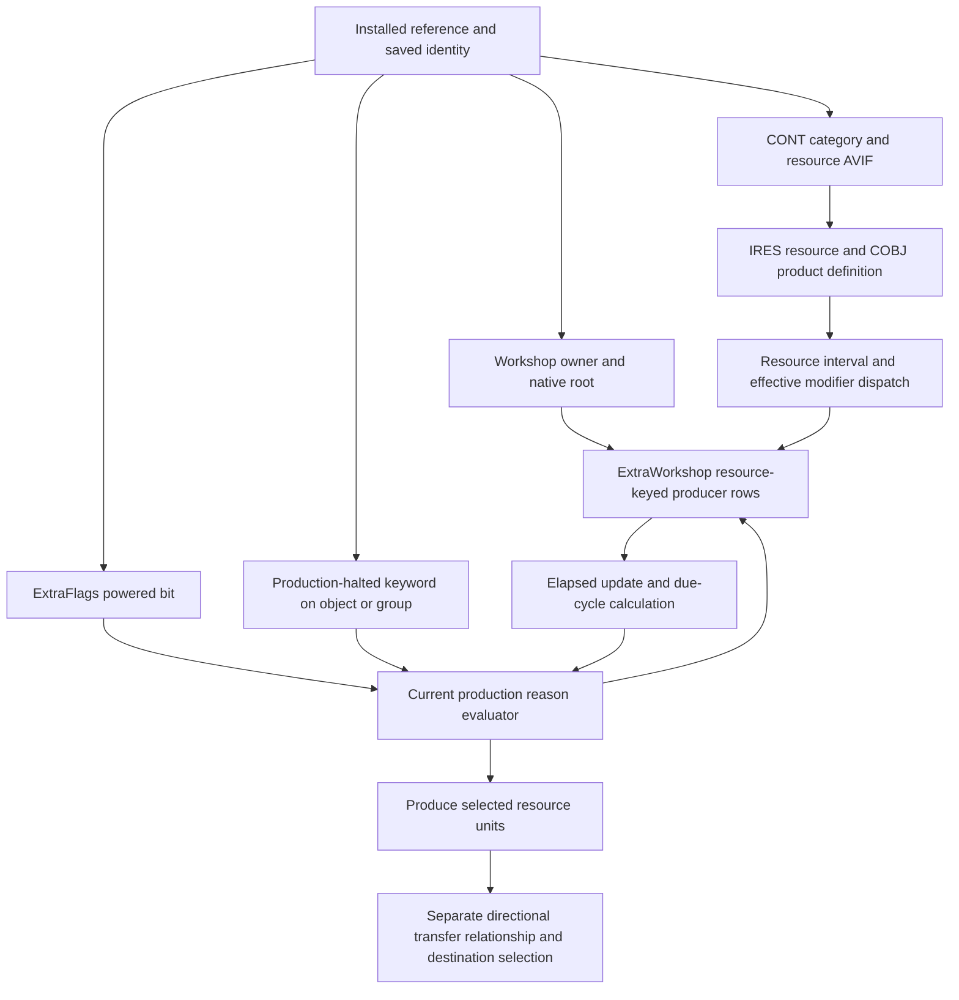

# Native state and production dataflow

[Report](report.md), [definitions](definitions.md), [source pins](sources.csv).
This extends the existing [native register](../native-availability-map/functions.csv).
Aliases describe inferred roles; original `FUN_` names remain the identities.
All native addresses are preferred static VAs, base `0x140000000`, retail
1.16.244.0, SHA256
`7e9adb1414a8e1b325e5e1f097b9b17b78deb7eebeda37a333351a43a60f9d28`.
RVA = VA minus that base. No actual runtime module base was sampled.
Object offsets are hexadecimal. Every new native claim is STATIC and
OBSERVED-INTERNAL, publication REVIEW-REQUIRED; none is a safe callable API.
`e1-NN` means `.local-work/recon/e1-native-NN.tsv`, with adjacent invocation log.

The last edge describes downstream machinery, not a claim that every produced
unit is immediately transferred. Creation and transfer of existing items have
different consumers; stored quantities are outside this assignment.

| Contract | Decisive evidence | Inputs, output, effects and limits |
|---|---|---|
| Current native powered view | e1-01 `140c0563b..140c0567b`; e1-02 `140531b10..140531bb6` | IsPowered condition reads reference+`c8` extra list and tests mask `40` through 140531b10. Helper locks list+20, selects extra type `9c`, tests extra+18 flags, releases lock; missing extra yields false. Wrapper writes numeric float result through R9; AL=1 is evaluation completion, not powered status. Null-reference path can leave output untouched. |
| Power applicability | e1-03 `1406695c0..140669666`; e1-02 `140f7d412..140f7d43b` | Keyword test on ref+68 using 145e8c208, else AV query on ref+70 using 145e8c260. Production evaluator checks powered bit only on this applicability branch. Do not equate a non-power-requiring object with a failed power network. Exact default-object identities require their own binding; topology is not traced. |
| Halt/activation-related state | e1-02 `140157280..1401572b1`; e1-03 `140f7cc89..140f7cd88` and complete function | OutpostProductionHalted default-object container at 145f0ada8 resolves pointer +48=145f0adf0. Predicate tests reference keyword interface and grouped members through 140f366c0. Positive early branch in reason evaluator produces code 9. This is a distinct native halt predicate, not bit 40 and not the saved disabled flag. No universal separate activation Boolean or UI toggle binding is established. |
| Current operational eligibility | e1-02 `140f7d120..140f7d508`; e1-01 `140c59aba..140c59adb`, `140c01ff0..140c0200e` | RCX reference, DL mode; AL reason code. Zero means capability wrappers emit 1, nonzero emits 0. Additional code 5 is assigned on applicable missing power; code 9 on halt branch, other codes retained unnamed. Calls include current flags, categories, property interfaces, linked destination/capacity and recipe availability. It can allocate, resolve/release references and invalidate failed handles; not a pure field read or guaranteed side-effect-free query. No particular saved object was evaluated live. |
| Resource registration | e1-04 `140f7dfa0..140f7e527`, `140f83b90` complete decompilation | Resolves Workshop and ExtraWorkshop; groups rows under resource pointers. Reference handle, base ID, quantity-like property and zero/nonzero eligibility are recorded. Full prototype inferred by decompiler is not an external ABI. Some instruction listings cap at 600; row details needing exact order use displayed windows. |
| Periodic producer traversal | e1-06 `140f7ef20..140f7f1df` | XMM1 carries elapsed scalar, copied for downstream update. Global registered Workshop handles at 145916528/530 under lock 145916548 resolve to ExtraWorkshop type BC. Iterates resource-keyed map +20, storage+30/capacity+38, calls 140f7f1e0 with resource pointer and producer array. Reads additional E2 extra without tracing organic internals. Actual call sites e1-08 `141a3901d..021`, `141a281c9..1cd`, `1417cbb73`. Complete calendar source, loading/catch-up policies remain unqualified. |
| Due cycles and current recheck | e1-04 `140f7f1e0..140f7f6ea`, complete decompilation | Row stride 1c. Elapsed scalar is compared with interval and remaining countdown. For elapsed>=positive interval, trunc(elapsed/interval) yields cycle count; otherwise countdown is decremented and a due transition can yield one cycle. Reference handle resolves, current reason is re-evaluated with mode 1 before 140f7d6a0. Failed handle path is distinct. Countdown/interval reload uses effective interval helper and nonnegative modifier. Not a general continuous simulator or wall-clock output guarantee. |
| Base/effective interval | e1-05 `140f7bd20..140f7bf02`, `140f7c1e0..140f7c20a`; e1-07 `140092260..14009228e` | RCX resource definition. Resource+100 nonnull supplies object+48 float; otherwise fResourceDefaultProductionIntervalHours at 145ea7fe8. Both multiply float constant 3600 at 144f04f78. Effective helper adds reference-context acquisition, eligible modifier actors and entry-point dispatch 0xa1 via 140c94060, including player dispatch. Minimum inputs are selected resource, current producer context, eligible actor list and modifier state; definitions alone do not fix final interval. |
| Interval multiplier | e1-07 `140f7c000` and e1-04 `140f7f345` onward; e1-10 `1400a97a0` | Effective AV read through producer+70 using 145eae2c0; positive value retained, otherwise 1. HarvesterRateMult default container 145eae278 resolves its +48 pointer. Installed DFOB 008408 DATA points to AVIF 008407, independently checked at physical ESM offset 1294772646. Interval result is multiplied by this effective value and stored as binary32 at row+10/+14. Negative PRPS modifiers are not substituted for the current effective AV. |
| Unit production boundary | e1-05 `140f7d6a0..140f7df99`; e1-04 call `140f7f3d3` | RCX producer reference, RDX selected IRES/resource, R8D due cycles. Resolves resource+108 recipe; reads recipe+88 product. IRES form-type 9f in selected recipe results has a separate conversion branch. Calls 140f7f6f0 for qualified resource/recipe counts and reaches inventory-add machinery 1405e9000/140b5d040, then ItemProducedEvent source 140f4fa20. This is unit creation, not proof of outgoing transfer or a measured count. Complete recipe/quantity modifier arithmetic remains qualified. |

Current power is therefore represented independently of the operational reason
result. Halt is also a distinct predicate, although the full halt checker has
additional paths and its setter/UI semantics are not fully classified. Saved
reference disabled/deleted bits are separate state. The cached producer eligibility
byte has serializer evidence; it is not the result of reevaluation after load.
Persistence of ExtraFlags mask 40 remains UNCLASSIFIED within E1: no saver/loader
contract for that specific bit was qualified here. Requiring power, being
currently powered, being eligible now and actually
having produced units during an interval are four different statements.

The producer-row layout is a useful bridge to persistence, established by
existing serializers `140f50660`, `140f515a0`, `140f50880` and new consumers:

| Runtime row offset | Native use | Persistence / authority |
|---|---|---|
| +00 u32 | Reference handle | Serialized reference identity is remapped, not raw pointer equivalence |
| +04 u32 | Base definition FormID | Saved row representation; current installed override equivalence separately bounded |
| +08 i32 | Accumulated/due bookkeeping in update | Not extractor stored inventory; complete semantic name remains qualified |
| +0c i32 | Quantity-like actor-value-derived field | Initial registration rounds upward; no universal fixed output quantity claim |
| +10 binary32 | Remaining countdown | Floating-point subtraction and reload; saved value is historical scheduling state |
| +14 binary32 | Interval | Effective floating-point interval consumed at reset; not an integer field |
| +18 byte | Cached eligibility | Current reason is separately recomputed; cached true is not proof of current operation |

Runtime row size is `1c`; serialized handle/base followed by 17 row-body bytes
must not be mistaken for a byte-for-byte runtime structure. Map key is resource,
not a generated deposit region, and no row field here identifies vein geometry.
Persisted scheduling, reconstructed pointer/handle resolution and current
modifier/eligibility evaluation make the operating account MIXED.

Instruction qualification: e1-04 `140f7f253` advances R14 to row+08;
`140f7f288` loads row+14 as binary32, `140f7f2b9..140f7f2c3` subtracts elapsed
and stores binary32 row+10, and `140f7f674..140f7f67f` multiplies/stores both
binary32 fields. Effective helper returns through XMM0 at e1-05 `140f7beea`.
The separate cycle-count branch `140f7f29b..140f7f2a5` divides the elapsed scalar,
calls its rounding helper and converts that result to an integer cycle count.
The initial review01 i32/countdown and integer-return interpretation was rejected
because the decompiler's inferred types contradict these instructions.

The `fWorkshopProductionIntervalOverride` initializer is located at 140157480,
but searches of guessed interior addresses 145f0b034/038/03c/040 found no consumers.
That negative lookup does not establish an unused setting or an override formula.
Likewise UI labels fProductionPerMin/fProduction bind aggregate payload fields
at 14136c980/14143fb40; their existence does not supply a per-extractor oracle.
These unproductive routes are retained, not promoted to completed semantics.
