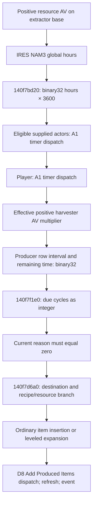

# Production operation and dataflow contract

All addresses here are hexadecimal **static VAs**, image base `0x140000000`;
RVA = VA minus that base, never a live pointer or file offset. Retail 1.16.244.0,
executable SHA-256 `7e9adb1414a8e1b325e5e1f097b9b17b78deb7eebeda37a333351a43a60f9d28`.
The existing [central function register](../native-availability-map/functions.csv)
retains N01–N94; new rows name the newly followed dependencies. Existing E1
[native reference](native.md) and [links](links.md) remain historical evidence.
Bethesda instructions/definitions, exported with the owned Ghidra reader, are
the primary basis. [Pins and local locators](production-sources.csv) identify
exports; the windows below specify the relevant functions/operations.

| Local export (`.local-work/recon/`) | Decisive scope |
|---|---|
| e1-native-04.tsv | Full scheduler `140f7f1e0`: division/truncation, reason gate, final multiplication and row stores |
| e1-native-05.tsv | Full interval `140f7bd20` and creator `140f7d6a0`; repeated known creation windows in production 02/08 |
| e1-production-02.tsv | Full entry evaluator `140c93cf0`, A1 label references and post-creation D8 call window |
| e1-production-03.tsv / 04.tsv | Active-entry copy `141935370`; operation table and full multiply `140c94430` |
| e1-production-05.tsv / 06.tsv | Metadata initialization, PERK/IRES loading and condition registration locators |
| e1-production-08.tsv / 10.tsv | Variadic wrapper, keyword callback, valid direct insertion window; entry DATA loader, IRES fixup and general insertion |
| e1-production-11.tsv / 12.tsv | OneValue vtable identity and full four-byte loader to data+18 |

The quantity path is H → I → J → K → L. Timer factors act before scheduling;
they are not automatically multipliers of K's already selected count.

## Nominal definitions and resolution

Installed Starfield.esm SHA-256
`1dabed00c3f4282dd3bb54d2e9601e40b577d8742d078b7ccef203adbfef0da7`.
All short FormIDs below belong to that file, not dynamic references.
The accepted static inventory `.local-work/extractor-resource/run01/static-records.json`
contains Iron IRES `0057c7` at ESM byte offset 1301610017: NAM1 resource AV
`05ef18`, NAM2 COBJ `05ef53`, NAM3 GLOB `05ed87`. COBJ at offset 1300253652
has CNAM product `00556e`, NNAM unsigned 16-bit 1 and no FVPA ingredients.
The extractor base's positive resource property identifies the resource;
the product/item FormID and the producer's reference handle are different domains.

Native IRES loader `1409e7900` reads NAM1/NAM2/NAM3 into +f8/+108/+100 as tagged
IDs. Fixup `1409e8570` resolves those fields, and sets AV+148 back to IRES.
Thus +100 is the resolved interval global, +108 the resolved recipe. Reset
`1409e7770` is not fixup. Exports 06/08/10 distinguish these roles.

| Global / ESM offset | EDID suffix / FLTV little-endian | Binary32 nominal seconds |
|---|---|---|
| 05ed87 / 1249604 | Common / 0ad7233c | 36 |
| 05ef3f / 1249825 | Uncommon / 8fc2753c | 54 |
| 05ef3e / 1249747 | Rare / 0ad7a33c | 72 |
| 05ef40 / 1249907 | Exotic / cdcccc3c | 90 |
| 05ef41 / 1249987 | Unique / 8fc2f53c | 108 |

EDID prefix is `OutpostResourceProductionInterval`. Values are hours: .01f,
.015f, .02f, .025f, .03f; single-precision multiplication by 3600 produces the
examples above. Only Iron's specific association is traced here; names alone
do not establish every resource's rarity classification. These are definition
examples, not observed retail timing. `140f7bd20` falls back to global
`145ea7fe8` if IRES+100 is null; its actual current value was not sampled.

## Effective timer and modifier evaluation

`140f7bd20` reads global+48 then VMULSS by constant at `144f04f78` (3600).
Its supplied actor-list context has count +18 and handle data +20. It resolves
each handle, skips actors whose virtual +868 predicate is true and requires a
positive actor value identified through `14049a430`'s singleton+108. For each
eligible actor it calls `140c94060` with entry point A1 and resource/product
context, passing the interval by reference; it then dispatches A1 for the player
at `145f43230`. The outer updater `140f7ef20` obtains Workshop ExtraE2 for this
list. The list's construction, assignment membership and duplicate policy are
not qualified. Do not translate the unnamed virtual predicate to a user status.

`140c94060` constructs the variadic argument array and calls `140c93cf0`.
That evaluator checks actor/nonzero FormID, entry-point bounds/availability,
metadata/context and individual entry predicates before dispatching operation
functions. `141935370` copies the actor's active entry-point array from
actor+228 → +8 → +480 (stride 10), under its lock at +478. Active selection,
rank replacement and evaluation order cannot be inferred from rank numbers in
the definition file. Dispatch mutates the same interval across supplied actors,
then the player: a sequential fold, conditional on each actual eligible entry.

A1 metadata row `14590fc10` points to string `144bcfee0`, “Mod Workshop
Production Timer”. Constructor `1400e5200` initializes the context metadata at
`1400e5808` from `144a506d0`; data exports show two context descriptors, separate
from the single result float. PERK loader `140ca2490` creates type-2 entries via
`140ca0540`; `140ca13b0` loads DATA's three bytes to entry+10 and EPFT=1 allocates
OneValue function data. Its vtable `144bd0498`, virtual +28, binds
`140c954b0` (export 12): after validating a four-byte field, it reads the EPFD
payload into data+18. This closes the definition-factor storage binding.
Operation index getter `140c9fda0` reads entry+11;
data getter `1402b5fa0` reads +18. Function table `1458d30b0`, stride 18, index 3
points to `140c94430` at `1458d30f8`. That function checks float result type,
one result argument and OneValue data type, then **VMULSS** factor at data+18
into the result. No clamp or additive percentage conversion occurs in this
operation. Its bookkeeping call `140b97bd0` means it is not a generally safe
read-only API. No native function was invoked by this assignment.

Example, explicitly synthetic: 36f × .95f × .5f, rounded after each multiplication,
is 17.100000381469727 seconds. This does not prove both entries coexist on one
actor or predict that actor's actual interval. Float order can matter. No global
commutativity, strongest-only rule, all-ranks stacking or total clamp is claimed.

The effective HarvesterRateMult consumer is separate. Default-object key 008408
resolves AVIF 008407 (`WorkshopHarvesterRateMultAV`, NAM0=1), at default storage
`145eae2c0`. `140f7f1e0` reads the effective producer AV and substitutes 1 unless
positive. At `140f7f674`, VMULSS computes
`binary32(timer-return × positive-effective-AV-or-1)`; the following stores reset
both row+10 remaining and row+14 interval to that same float. If base resolution
failed, the timer return comes from `140f7c1e0`, not the actor-dispatch path.
Raw medium/large
base PRPS values −.2/−.5 are not effective AV values: owner/default/modifier
composition is unresolved. The reference therefore does not announce 20%/50%
size speedups from those bytes alone.

## Realized scheduling and insertion boundary

`140f7f1e0` consumes rows: +00 runtime handle, +04 base, +08 integer accumulated
due state, +0c integer quantity/iteration state, +10 binary32 remaining,
+14 binary32 interval, +18 cached eligibility. R14 in its instructions points
to row+8. Elapsed ≥ positive interval takes single-precision division, imported
`truncf` through `143a40540`, then VCVTTSS2SI to integer cycles. The smaller-elapsed
branch subtracts elapsed from remaining using VSUBSS, stores the float and marks
one due cycle at nonpositive remaining. It re-resolves the producer, iterates
integer row+0c state, and rechecks reason `140f7d120` in mode 1: only zero reaches
`140f7d6a0(producer, resource, cycles)`. Timer reset does not prove production.
The large-elapsed branch does not preserve an intuitive fractional carry;
zero/negative intervals and failed eligibility are branch cases, not a universal
wall-clock model. Loaded/unloaded time-source policy is outside this closure.

`140f7d120` separates power-applicable failure (reason 5), halted predicate
(reason 9) and other prerequisites; CanProduce tests zero. Existing E1 details
remain applicable. Cached eligibility, saved disabled state, current powered,
halted and actually producing are different facts.

`140f7d6a0` returns on null resource. A special early branch at
`140f7d721`–`140f7d796` can call `1405f7280`/`140f4fa20` and dispatch an event
before the zero-cycle test at `140f7d79b`; zero cycles therefore do not establish
a universal no-effect call. The ordinary continuation resolves recipe at
resource+108 and product at recipe+88, and selects destination with `140f7d510`. Connected
capacity may select a destination; the producer can remain the destination.
Three predicates `140f7cab0`, `140f7cb70`, `140f7d030` select input/resource-count
machinery `140f7f6f0`. Their exact category default identities are unresolved;
ordinary no-predicate path bypasses this count cap. Do not generalize that path
to atmospheric/special extractors without evaluating the predicates.

For ordinary direct item insertion, instructions `140f7df48`–`140f7df95`
(valid focused window starts `140f7df73`, export 08) pass product in RDX,
reason 9 in R8D and selected integer count at stack+20 to `140b64fc0`.
No NNAM load/multiply appears in this direct branch. A leveled-list product
(type 3f) instead expands through `1405e9000` and inserts through `140b5d040`.
`140b64fc0` is a large general insertion operation: export 10 shows count
handling, availability helper `140b70a80`, splitting and inventory bookkeeping.
Its full downstream mutation/return semantics are not closed. Selected count
is an insertion request, not a measured inventory delta. NNAM=1 alone does not
establish a universal product count formula.

After the ordinary creation stage, `140f7de9a`–`140f7dead` dispatch D8,
“Add Produced Items” (metadata row `1459102f0`, string `144bcf658`), with producer
and destination context; then refresh `140b647d0` and ItemProduced event
`140f4fa20`. It may add a further stage; it is not evidence of multiplication of
the already computed base count. Main-ESM PERK census has no D8 DATA entries.
The named `SpecialProjectsSkillExtraProductionNoneChance` global (04ce2e,
offset 1247706, FLTV 80) and no matches in a bounded script locator do not bind
a special quantity bonus to this path. That dependency remains unresolved.

The decisive missing evidence and exact consumers are enumerated in
[uncertainties](production-uncertainties.md). Neither static instruction reading
nor the verification examples claim actual retail count/timing or safety of a
hook/native integration point.
