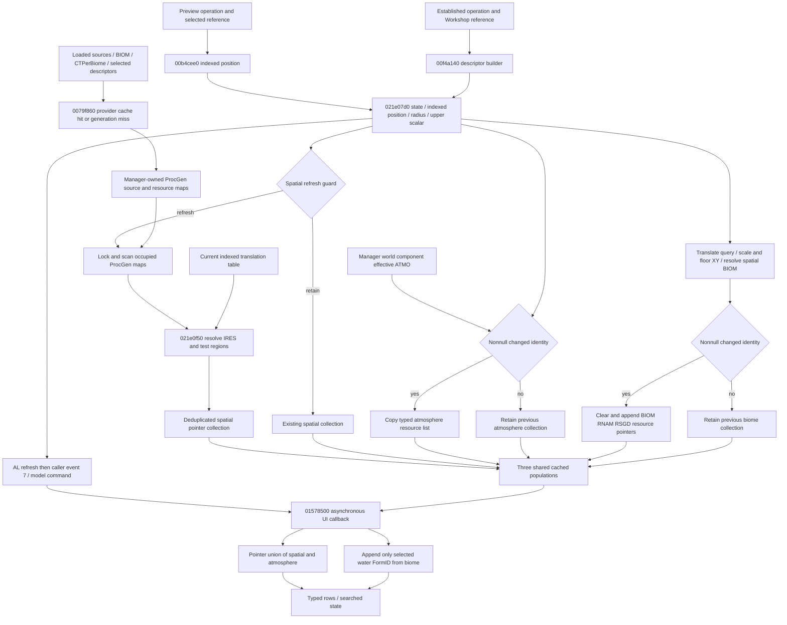

# Native loaded-area dependency specification

2026-10-16 continuation: [native output contract](output-contract.md), [preview/established paths](output-paths.md) and [completion assessment](completion-assessment.md) consolidate result storage, identity lifetime and a bounded research stopping point. Historical results and limits below remain preserved; [separate review](output-review.md).

2026-10-15 continuation: [resource-region lifecycle](region-lifecycle.md) traces
provider cache keys, synchronous attempted construction, task requests/publication
and reset/destruction. [Requirements](region-requirements.md) separately evaluates
arbitrary resident, separate-context and unloaded queries. The provider's source
pointer cache is the store read below; no direct updater-to-provider call is added.

[Report/build domains](report.md), [structured native register](functions.csv).
All addresses in the diagram are RVAs. Edges are STATIC unless the text explicitly
identifies the 0.7.0 runtime observation overlay. This is an account of native
behavior, not a new executable wrapper or public signature.

## 1. Caller-supplied and derived operands

The actual Win64 call at static VA `1421b42e3` supplies RCX=operation+520,
RDX=24-byte indexed descriptor, XMM2=operation+360, XMM3=operation+364.
The descriptor has binary32 XYZ at +0/+4/+8, u32 index +c and reference/domain
pointer +10. The preview reference is independently held, then converted by
`140b4cee0`; a raw player position is not substituted. Types `0x49`/`0x56`
qualify the domain or a sentinel is used. Precision/global reference branches
in that converter prevent a universal reference+8c shortcut.

The established caller's `context+630==0` branch resolves the Workshop via
`140f3df70`, invokes descriptor builder `140f4a140`, stores context+338..36c,
then at `1421b26af..26bc` supplies descriptor +28/+2c in XMM2/XMM3.
The descriptor builder takes initialized output RCX and Workshop reference RDX.
`140f4a2ba..2bf` gets the radius; `140f4a2c8..2d5` computes an upper value
using height helper plus setting. `140f4a41b..43e` can replace it with local
center Z plus component top. Status/early returns and other descriptor fields
are not erased. This supports upper-coordinate semantics in those branches,
not an invariant physical radius, units conversion or an injectable reference API.

## 2. Loaded state, refresh and failures

`1421e080f..0952` compares domain/reference context and translated current/cached
XY displacement against a setting squared. On applicable refresh it stores
indexed XYZ/domain at state+48/+54/+58 and replaces spatial results. Radius
and upper scalar enter the callback closure but are not separately compared in
this local guard. It is incorrect to model every call as a fresh geometrical
evaluation; external caller/reset behavior is a separate dependency.

`1421e09d4..0a77` loads singleton `145fd9c30`, manager+130 ProcGen, locks
ProcGen+40 and traverses occupied 24-byte slots at +20 with capacity +28.
Slot sentinel +10=`ffffffff` marks unused entries. Each slot+8 value is passed
to callback `1421e0f50`. This is synchronous loaded-map retrieval inside the
updater; no external region array is required, and no mapped direct call generates
missing maps at this boundary. Locking protects this traversal; it does not by
itself demonstrate all world generation has completed or all producers' lifetimes.

Within each source, callback resource slots are also 24 bytes. The first dword
resolves through `1405de3b0`; failed or non-`0x9f` IRES resolution skips that
entry. Resource-slot+8 points to collection count+8/data+10. Each 48-byte region
contains center+0..8, broadphase radius+c, point count+18 and point pointer+20;
each 16-byte point holds XYZ/width. One passing region inserts the resource
pointer into the set. Empty/missing/invalid native state and missing captured
state are different: the evaluator reports UNKNOWN for unavailable operands,
whereas actual native invalid pointers are not a promised graceful error API.

The query adds the invocation's indexed 12-byte translation to XYZ if index is
below `1461fae80`; data are at `1461fae88`. Otherwise stored XYZ is used.
Index zero alone says nothing about that translation. Geometry must be in the
same resulting comparison frame; do not reflect/translate it again based on a
different upstream descriptor.

Atmosphere: manager+110 component resolves ATMO through `14076bd20`.
`1421e0c77` jumps over replacement on null; `c84` does so on unchanged FormID.
Changed nonnull identity triggers copying native ATMO+f8/+100 via `14076b950`
and replacement at state+18. Biome: translated query XY is scaled and floored,
then `14078ee90` returns typed BIOM. `1421e0e5b` and `e68` retain the old third
collection on null/same identity. Changed nonnull BIOM clears its end at `e79`,
then BIOM+308/+310 RNAM RSGDs contribute each 0x238-byte descriptor's resource
pointer. Failed lookup is therefore not evidence of zero natural resources.

## 3. Spatial arithmetic versus region generation

The callback's binary32 XY broadphase admits tangency. Count zero rejects;
count one accepts after broadphase without point/height tests. Multiple points
form consecutive tapered strips (no implicit closing last-to-first strip).
Full XYZ direction normalization and native fixed-angle sin/cos construct each
quad. All nonpositive oriented XY crosses accept without Z. Otherwise vertices
use XY radius plus vertex Z<=upper, then closed quad edges use full XYZ segment
distance<=radius. The edge branch does not apply the upper scalar. The
[existing exact algorithm and numeric-domain limits](../resource-availability-milestone-b/native-provenance.md)
and runnable evaluator are reused, including polynomial residual and degenerate
cases. This eligibility is not general extractor collision/footprint validation.

Region construction is a separate dependency: `14079f860` resolves spatial
sources and source-keyed cache entries; a miss invokes `14079b520`. Component
lookup by owner key and BIOM via `140771f30` may fail and exit. Descriptor
selection searches component-selected RSGDs/current BIOM and alternate matching
BIOMs; unresolved selection may fall back to a current-BIOM descriptor. Rarity
sort `1407af470` precedes cell iterator `14079c470` and generator `14079a330`.
The latter consumes selected DNAM/chance/weight, packed cell/owner CRC seed,
MT19937 sequence, source origin/bounds and earlier resource geometry. Nine-sample
inter-resource rejection through `1407af1a0`/`14079b020` affects accepted points.
The related 100x100 raster cache `1407a0820` is not the region map consumed above.
`1407b5160` and `1407a1940` call the provider on distinct lifecycle paths;
their existence does not establish same-evaluation completion/thread ordering.

## 4. Synchronous output and asynchronous consumption

The three ordered collections are operation+520/+538/+550. AL is a refresh
indicator, even when the recomputed mathematical identity set is unchanged.
Preview callers emit event 7 when it is set. Model+8 event shuttle allocates
a command; `141581a80` applies the owning model through `141578500`.
Neither position nor population snapshots are carried by this command.

The UI reads the then-current common collections, deduplicates exact pointers
in first-occurrence order with `1421f8120`, then separately appends third-list
entries whose FormID equals the selected water resource. Special appends are
not deduplicated by that union. Allocation failure precludes unconditional
completeness. Names, tracking/type/info fields and final row count are downstream
outputs, not upstream inputs deciding spatial presence.

0.7.0 observed actual producer and consumer CALLs, row constructors and final
ordinals. All 346 final folds agree. It did not snapshot all callback operands
or establish unique evaluation-to-queue-to-render ancestry; matching sets and
nearby timestamps do not repair that gap.
