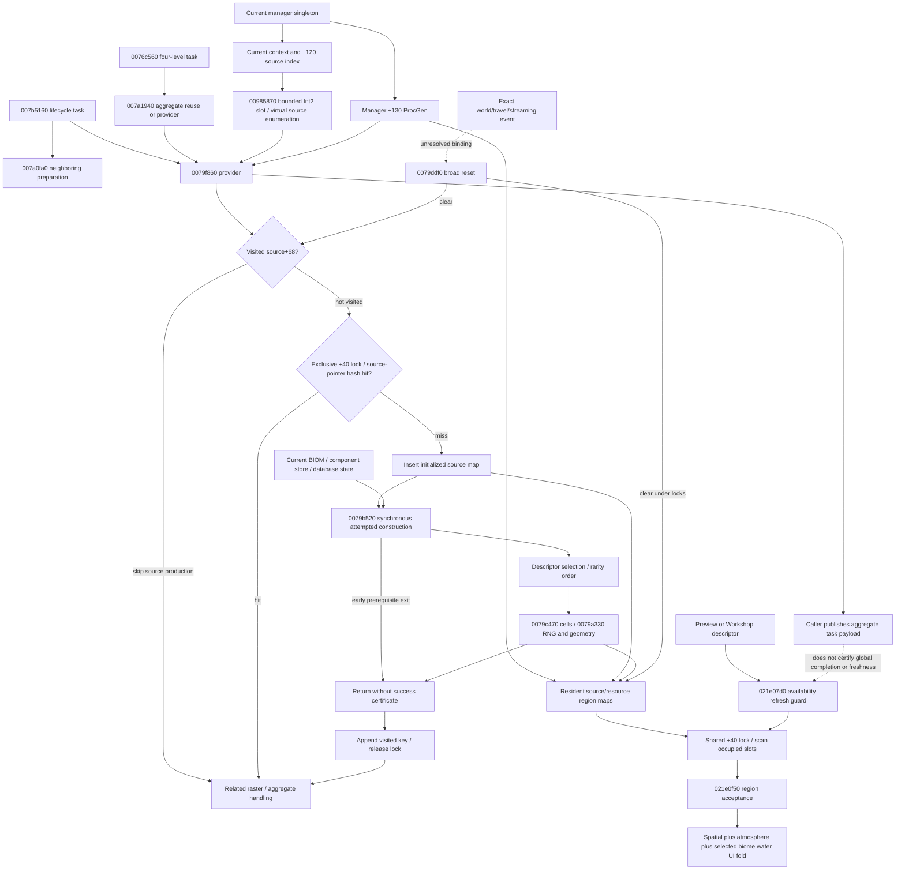

# Provider, generation and consumption lifecycle

[Report/build domain](region-dependencies.md), [function register](functions.csv).
VAs below are static; diagram nodes use RVAs. Solid edges are observed static
calls or explicit field ownership/data access, not runtime ordering observations.
Dotted edges are qualified unresolved lifecycle relations.

## Exact primary locations

| Stage | Primary export and decisive static VA / dataflow |
|---|---|
| Ownership creation | `resource-availability-ui-28.tsv`, manager constructor 140787830 decompilation: allocates 0x138 then 14079D660; manager+130. `event-oracle-06.tsv` constructor 14079D660 initializes +10 source map and +40/+48/+50 state. Manager destructor 140788BC0: 140788D4F..D5E loads +130 and destroys it. |
| Context gate/index | `resource-milestone-b-producers-01.tsv` 14079F8D6..F937 / F9BD..F9CA; new `resource-region-dependencies-01.tsv` 14078C4E0 and 140985870 full functions. Index subtracts native origin, bounds both axes by index+48/+4c, then reads +20 slot array; out of range returns null. |
| Visited versus source cache | `resource-milestone-b-producers-01.tsv` 14079FC37..FCA6 visits source+68; FCC2..FCD4 looks up source pointer. Hash object ProcGen+10, slot data ProcGen+20, capacity +28; the same storage later scanned by updater. |
| Miss/population | Same export 14079FCB3 exclusive acquisition, FD02..FD27 allocation, FDE2..FE27 insertion; FED3..FF18 setup/CALL producer; FF1D..FF60 visited append; FF99..FFA5 release. Complete decompilation resolves branches past instruction cap. |
| Construction preconditions | `resource-availability-cont-01.tsv` / `resource-availability-ui-28.tsv` 14079B625..B6E4 component path, B72B retrieval, B750..B794 status branch; complete decompilation cleanup labels 14079C3E0/3EF. `resource-region-dependencies-01.tsv` 140478A30 identifies BiomeMapDB entry creation/state acquisition. |
| Selection/generation | N17–N23 in existing register; `resource-availability-ui-29.tsv` complete 14079C470 instruction body, CALL 14079A330 at C4F7; prior Milestone B detailed generation evidence remains controlling. |
| Provider caller/publication | `resource-availability-ui-32.tsv` 1407B5235 manager+24 lock, B524C pre-step, B526A provider, B529F task acquisition, B52DC payload+20, B5314..B5324 state adjustment/wake. `resource-region-dependencies-01.tsv` 1407B5470 identifies ProcGenLayersDB entry creation/state acquisition. Publication follows provider return but does not independently inspect all source-map coverage. |
| Alternate consumer | `resource-availability-ui-31.tsv` 14076C560 complete decompilation: levels 0..3 through 1407A1940; `ui-32.tsv` latter calls provider at 1407A1A3C only if aggregate absent, then 14079EE50 sampling. |
| Broad invalidation | `event-oracle-08.tsv` full 14079DDF0: related DB clear, DE83 exclusive lock, DE8D source-map clear, DE92..DE9A occupancy reset, DEA7..DEB8 visited reset, further +58/+F8 cache clears; DF55 tail call 1407B4770(1). Xref to DF60 thunk and vtable slot 144B3F3C0 establishes indirect method, not a named travel event. |
| Lifetime destruction | `event-oracle-06.tsv` 14079D910 source-map/visited/raster cleanup; new export01 14078FC90 deleting destructor frees 0x138 conditionally; 14078F670 owning-pointer cleanup. Destruction is distinct from the reset method. |
| Consumer | `resource-availability-ui-15.tsv` 1421E09D4..E0A77: singleton→+130, shared lock +40, scan occupied source map. No mapped direct provider CALL; spatial guard/ATMO/BIOM retention remain as in [dataflow](dataflow.md). |

## Asynchronous request ancestry

New `resource-region-dependencies-02..06.tsv` explicitly trace the request side:

- `1407B5A00` requests a ProcGenLayersDB entry and calls `1407B4BB0`.
  `1407B4BB0` requests base resources and bounded neighbor layers, gathers their
  keys, then calls `1407B55B0` at `1407B506A`.
- `1407B55B0` constructs `1407B58A0` functor, registers through `1427E5630`,
  and adds dependency edges through `140362140`/`140362300`. The functor table
  `144B406B8` has method+10=`1407B5850`, whose direct CALL reaches `1407B5160`.
- Neighbor preparation `1407A0FA0` requests four neighboring resource entries
  through `1407A1260`. That request gathers density entries via `1407A8D30` and
  registers through `14076CD40`. Dependency constructor `14076D1C0` retains
  DensityMapDB handles. Tables `144B3D0E8`/`144B3D138` have method+10=
  `14076D140`, whose direct CALL reaches `14076C560`.
- `1407C07B0` forms current discriminator/settings/packed coordinate keys;
  `1407C0720` checks current discriminator equality. `1427D4AE0`/`1427D4BE0`
  implement entry-state acquisition/waits. State6 is not a global map census.

The request/registration edges are direct static calls. Table-to-method dispatch
is STATIC indirect linkage; the captured worker execution/epoch is unknown.
The worker calls neighbor preparation before calling the provider; preparation
does not itself make that direct provider call. Ordering and ancestry are distinct.
The generic resource-server scheduler and all polymorphic density generators
are outside this bounded reconstruction. They are not silently labelled proven
runtime ordering. `1403625E0` is a related dependent resource request and can
request a layer entry; cache-mediated requests are not a linear call stack.

The output aggregate/task, source-pointer cache, source+68 visited list, related
raster store and operation availability cache are different state objects. None
is interchangeable with a world ID or with the producer registry serialized by
ExtraWorkshop. Cache destruction/reset and a source miss are concrete lifecycle
events in code; their exact runtime association with travel, load or source
replacement must be observed or traced rather than inferred from names.
