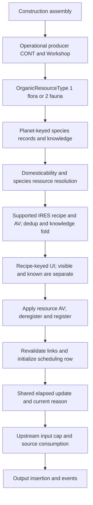

# Organic selection, state and production dataflow

[Report](report.md), [definitions](definitions.md), [reuse matrix](reuse.md),
[function register](../native-availability-map/functions.csv), [pins](sources.csv).
All native addresses here are hexadecimal **preferred static VAs**, image base
`0x140000000`; RVA = VA minus that base. Retail executable 1.16.244.0 SHA-256
`7e9adb1414a8e1b325e5e1f097b9b17b78deb7eebeda37a333351a43a60f9d28`.
Object offsets/strides are hexadecimal. None is a runtime pointer or file offset.
Aliases are analyst interpretations, STATIC / OBSERVED-INTERNAL, proposed STRONG
within these paths, REVIEW-REQUIRED; no invocation or safe integration is qualified.

Evidence notation: `eNN` denotes `.local-work/e2-organic/native/NNN.request.tsv`
(for example e04 = 004.request.tsv). `sNN` denotes
`.local-work/recon/e2-specialist-NN.tsv`; E1 references retain their original
[source pins](../inorganic-extractors/sources.csv) and later continuation pins.
Each native locator below names the complete exported decompilation unless an
instruction window is stated. Full raw native text remains LOCAL-ONLY.

## Candidate producer: planet, species, domesticability and knowledge

| Operation / export | Input, output and consequential contract |
|---|---|
| Selector `140f859d0`, e04 | RCX return-vector storage, RDX Workshop reference, R8 facility/base, R9B require-known. Obtains base property sheet, checks recipe/resource capability through a temporary reference, reads OrganicResourceType. Value 1 selects flora, 2 fauna; zero is a separate generic builder branch. Return vector owns stride-10 entries: byte +00 knowledge and IRES pointer +08; caller releases it. |
| Organic type binding | Existing e1-stacking-08.tsv, lines 3933–3935: OrganicResourceType registered at AV singleton +4c8. Singleton getter `14049a430` (e06); installed producer property `00000387` supplies 1/2. |
| Flora `140f864c0` / fauna `140f86360`, e05 | Obtain numeric planet key from Workshop Extra81 +28, otherwise `140910690` (e08) derives reference cell/world/location/planet context. Manager comes from `1423ff640()` +8b0. Candidate reads participate in manager +238 lease/read-token protocol; this is neither a global all-species array nor current spawned actors. |
| Planet range `140f8ce70` / `140f8bbd0`, e06; `1405f7a80`, e08 | Iterate manager +300 tree within the supplied planet key (high 32 bits), ranging subordinate keys. No facility local-biome operand is supplied. Cached membership completeness and population timing are separate from this consumer contract. |
| Flora rows `140f86590`, e08 | Source flora array at entry +20/+28, stride 0c: species numeric ID +00, resource numeric ID +04, unclassified third word. Resolve FLOR (type 2e); resource fallback FLOR +260, with LVLI expansion where applicable. Intermediate stride 18: knowledge +00, resource pointer +08, FLOR pointer +10; dedup species/resource. |
| Fauna rows `140f8bbd0`, e06 | Source fauna array at entry +00/+08; resolve NPC_ (type 32), dedup NPC pointer. Intermediate stride 10: knowledge byte +00, NPC pointer +08. Resource enumeration `1409e8b70` (e05) obtains resource AV/IRES through property and template contexts; the selector accepts the first successful supported candidate for each fauna row. Do not infer all ambiguous multi-resource cases from the CSV's single-resource policy. |
| Domesticability `140f85900`, e04; flora branch of selector e04 | Flora keyword interface FLOR +148 and fauna NPC +210 test resolved OutpostCanDomesticate pointer `145f0a660`; failed direct tests can traverse templates/group ancestry through virtual +2c0 and `140f8a920` (e11). DFOB `00271127` points to KYWD `002ac11d`; initializer `140156d00` uses container `145f0a618`. Direct keyword-only classifiers are incomplete. |
| Flora normalization `140f85970`, e05, callback `140f8b530`, e09 | Accept IRES directly or find a resource whose recipe +88 product matches the source item. Product-equality lookup and first-match behavior are narrower than a universal unique reverse-reference rule. |
| Knowledge `14130a3e0`, e08 | Query struct: planet key +00, species numeric ID +04, category numeric ID +08, output bool pointer +10. Category comes from HandScannerAnyDomesticateDO pointer `145efacd0`, form +28. DFOB `002491fa` → KYWD `002634bd`; initializer `140127e80` (e10), container `145efac88`. Tests whether the category keyword occurs in manager +268 planet → species known-keyword state. Missing default-object pointer defaults knowledge true. It is not a selector-side percentage comparison. |
| Admission/fold `140f85f80`, e05 | Require nonnull IRES, recipe +108, AV +f8, and **presence** of AV in facility base sheet (`14044b610`, e06). Zero-valued supported properties still qualify. If require-known, omit unknown rows; otherwise retain flag false. Dedup IRES pointers and OR knowledge flags. Species identities and displayed MISC identities are not the final dedup key. |

The native consumer supports the planet-wide cultivation interpretation. It does
not prove that every PNDT species is already represented in a cold/incomplete
cache. The exporter provides definition membership; manager state provides the
actual candidate operand. No separate direct research, Botany or Zoology query
appears in this selector consumer. The upstream knowledge grant does have
Botany/Zoology conditions, as traced below; construction has separate research
gates. Reading a precomputed category is not evidence of absent skill gating. Diet keywords are not tested in these admission
branches: the resource AV/IRES/recipe path decides production inputs. Full creature
diet/harvest systems are outside scope.

## Knowledge acquisition: the indirect skill and scan gate

The narrow upstream writer trace closes the distinction between a species being
present, being domesticable and having its domesticability knowledge recorded.
Fresh FLST definitions in `native/scan-lists.json` use the same pinned ESM:
HandScannerPlantKeywords `00160c96`, physical byte 1289801429, has
HandScannerAnyDomesticate `002634bd` at LNAM index 37 (hex 25);
HandScannerActorKeywords `00160c97`, byte 1289805474, places it at index 15 (0f).
Matching INAM condition entries require OutpostCanDomesticate and player HasPerk:
Botany `002c5557` for flora, Zoology `002c5552` for fauna. Condition function 01c0
maps to native HasPerk command 11c0, registration `1400d1477..1400d14fd` (e21),
callback `140c411c0` (e23) → `140bee540` (e24), returning float true when the
active perk rank is nonzero. It is not a minimum numeric rank comparison.

Scanner candidate construction `141308ee0` → `141308d40` (e20) consumes the
actor/flora default lists and appends keyword IDs for passing entry conditions;
entries with no condition list append directly. The domesticability keyword is
last in the actor list and second last in the flora list, before Diet with the
same conditions. The relevant order is the **condition-filtered** list, not the
raw FLST entry count. No full unrelated scanner subsystem is reconstructed.

Natural scan-state update `1407b75b0` (e24) derives planetary/reference context
and calls `1407b77d0` (e23). The latter updates the species count, computes the
rounded displayed percentage (capped at 100), and reveals a prefix of the eligible
keyword list. For ordinary positive required count S, current count c and eligible
list size N, the mapped rule is trunc(N × min(c/S, 1)), with binary32 division/
multiplication. If that yields all N while the recorded count is still below S,
retain the last keyword as hidden. Instructions `1407b7ab1..1407b7b25` and the
following last-entry guard distinguish percentage rounding from prefix truncation.
Newly revealed IDs are added to the planet → species known-keyword vector that
the selector later reads; this is not a fresh percentage/skill test at menu time.

Required-count helpers `140d83b80` (flora) and `140d83ae0` (fauna), e24, read
player actor values and scanner settings, subtract scaled scan/skill contributions
from their base requirement, round and clamp to at least 1. Their consumed
operands, not a guessed universal number of scans, define S. Consequently the
reference does **not** assert universal 100% scanning for every organic choice,
or an observed early flora unlock: actual c/S and the eligible list matter.
The fauna last-keyword guard and flora second-last placement are meaningful
static differences. Reacquisition/list-cache invalidation after skill changes,
knowledge save/load lifecycle and actual current species counts remain qualified;
this trace establishes the acquisition and selector boundary without fabricating
an unperformed retail transition test.

## UI producer, consumer and choice mutation

`141582340` (e05, repeated e08) produces WorkshopBuilderDirectoryData for facility
references. It calls the selector with require-known **false**. The next call,
`140f86170` (e07/e12), is **auto-selection**, not sorting: if no known resource
has a positive selected AV, choose the first known candidate, set its AV to 1
and emit the builder selection event. Building this menu can mutate state;
it is not a pure read-only query to invoke casually.

The UI row's uID is **COBJ FormID**, from IRES +108 → recipe +28. The model
map at +328 associates that ID with the resource AV and producer reference;
current ID is +370, highlighted ID +374. A displayed name derives from IRES;
weight/value derive from recipe product. `141586950` (e12) binds BuildItemData
fields: iconImage +28, sName +e0, fWeight +100, uValue +120, uID +140,
bCurrentlyBuilt +160, bPlayerKnowledge +180 and bTrackingCreatedItem +1a0.
BuildItemData size is 1d8; enclosing row stride 1f8. These offsets point to
TUIValue wrappers, not direct raw scalar storage (typically wrapper +18).

The complete inspected native loop emits candidate iteration order. No semantic
alphabetical/diet/species sort was established. The installed SWF has generic
sorting methods but no call to them in the inspected builder menu; do not promise
a stable order or interpret first-eligible auto-selection as sorting.

The installed `WorkshopBuilderMenu` SWF was reverified against the current
Interface.ba2; every cached ABC method's bytes match the decompressed SWF.
Decisive method IDs / **decompressed SWF byte offsets** are:

| Method | Supported UI behavior |
|---|---|
| 589 / 106316, BuildList_Entry.SetEntryText | Stores current/knowledge flags independently and displays the row label/product data |
| 840 / 118817, OnSelectionChange | Sends selected uID as formID; enables create iff not currently built and player knowledge true; requests disabled message iff unknown |
| 344 / 93747, ShowDisabledMessage | Unknown row message uses `$WorkshopBuilder_RequiresScanning` |
| 842 / 118936, OnItemPress | Same current/knowledge predicate; otherwise plays failure sound |
| 374 / 95025, PopulatePanel | Requirements list comes from aRequirements; bBreaksAnyLinks sets warning |
| 843 / 119005, ConfirmBuildChange | Warns/asks confirmation for link break; otherwise continues directly |
| 844 / 119069, ChangeBuildItem | Sends `WorkshopBuilderMenu_ChangeBuildItem` carrying uID as formID |

The last offset is verified by the UI receipt; native and SWF offset domains
remain distinct. The menu predicate does not require stock sufficiency to change
configuration. Current production independently checks inputs. The right-hand
input display is not a complete upstream supplier report.

`141717fd0` (e12) parses that event's ID via `141716e70`, optionally queues
`141719040` for engine threading, otherwise invokes `141583410` (e05). Apply
requires both old and new model associations and a resolved Workshop owner:
zero old resource AV → deregister old IRES `140f83900` → set new AV 1 → register
`140f83b90` → queue UI refresh. These preconditions matter: no guaranteed mutation
is inferred from a malformed/stale UI ID or failed owner resolution.

Registration e07 creates the resource-keyed producer row with resolved handle,
base FormID, accumulated bookkeeping 0, quantity ceil(resource AV), zero binary32
remaining and interval at +10/+14, and current reason eligibility. Thus successful
ordinary output changes replace scheduling registration; do not promise the old
timer survives, an immediate output, or a universal timing phase after change.
It emits the builder-selection event through `140b9bdf0`. Installed flora/fauna
scripts store OrganicResourceAV on OnBuilderMenuSelect, choose representative
species via GetFloraForResource / GetActorBaseForResource and manage spawned
plants/animals. Those visuals are consequences, not menu membership sources.

**Links can change.** Warning predictor `140f81000` (e07/e11) uses the proposed
COBJ's +78 ingredients for incoming checks. Its outgoing `140f841c0` checks
receive the **whole candidate vector** returned by `140f859d0(require-known=false)`,
not a singleton proposed product. Registration calls `140f81cc0` (e13),
revalidating incoming sources with `140f84470`, pruning incompatible memberships
and refreshing graph state. Its outgoing checks likewise pass the whole selector
vector to `140f841c0`, which walks stride-10 candidates and can reject an
unacceptable product. The outgoing loop removes **at most the first incompatible
destination/source membership per invocation**, through `140f81a90`, then exits
to cleanup. Instructions `140f820b9..140f820ef` establish that early exit;
e1-native-09.tsv's removal helper establishes the specific edge mutation.
Do not interpret this as a selected-product-only test or a complete outgoing
sweep. Later refresh/revalidation behavior remains conditional.
The direct setter does not explicitly clear output inventory, but events/script
side effects prevent a universal inventory-preservation claim. General graph
mutation failure/atomicity and exact loaded inventory consequences are untested.

## Input cap, consumption and production status

Organic facilities enter shared builder predicate `140f7cab0` (s01), bound to
OutpostCategoryBuilders DFOB `0023aed1` → KYWD `002731a0`; native resolved pointer
`145f0a298`, initializer `140156a40`. This is distinct from fueled-generator and
fueled-cargo-link predicates. The current reason evaluator `140f7d120` (E1/e12)
calls `140f7f6f0` with producer in RDX, null R8 consumption output and R9D = 1.
Zero available cycles yields reason **7**, separately from power **5**, halt **9**,
selected output and historical cached eligibility. Reason zero is the shared
CanProduceForWorkshop/scheduler eligibility result, not proof of produced units.

`140f7f6f0` (s01/s02) gathers current positive selected resources through
`1409e8700` (e03), resolves their IRES +108 recipes and reads ingredients from
COBJ +78: count +00, data +08; ingredient stride 18, form pointer +00, required
quantity +10. It uses [transitive incoming references](links.md) from `140f881c0`
(e03), totals available ingredient quantities through `140b63d40` and IRES-special
`140b6bba0`, returns zero if one ingredient is short, otherwise limits cycles by
floor(available/required) and requested maximum R9D. RCX is not assigned a stable
semantic argument in this helper from these callers; decompiler prototypes are
not a callable ABI. No full inventory implementation is inferred here.

With nonnull R8, it returns consumption requests in owned stride-10 rows:
source handle +00, units +04, ingredient pointer +08. Requirements are allocated
across upstream sources in native order. Creator `140f7d6a0` (existing
e1-native-05.tsv) requests the cap for due cycles, resolves source handles,
converts IRES ingredients to recipe products as needed and calls source virtual
+458 with the requested removal data **before** ordinary output insertion.
This documents actual native consumption operations; it is not an observed
inventory delta or an independent simulation of racing/missing sources.

The shared scheduler, binary32 time arithmetic, A1 effective timer, effective
quantity, capacity-qualified destination, ordinary/leveled item insertion,
ItemProduced event and aggregate refresh retain [E1's limits](reuse.md).
The base recipe interval and NNAM are definitions; effective duration/quantity
require actual provider and actor state; realized output requires the actual
consumption/insertion result. No new organic clock, stock guarantee or generic
quantity multiplier is invented.

## Persistence and authority

The resource-keyed Workshop rows are serialized/restored by E1 functions
`140f50660`, `140f515a0`, `140f50880`: reference identity/base, bookkeeping,
quantity, float remaining/interval and cached eligibility. Runtime stride is 1c;
wire representation is two queued reference identities plus 17 body bytes, not
a raw in-memory copy. Handle/FormID resolution reconstructs runtime pointers.
Links have their separate shared serializer/restoration contract.

Fresh Save52 replay identifies six greenhouse producer rows with selected IRES
and operational CONT, joined to six assembly roots. These are saved producer
configuration/scheduling facts; they neither establish the current selected AV
after load nor authoritative current eligibility. The script OrganicResourceAV,
native resource AV and serialized producer-map key are distinct state channels.
The selected resource AV has its own newly traced persistence path, independent
of those map rows. Reference +70 actor-value-owner vtable `144b96a90` virtual +20
is setter `140b6d190` (e19); it gets/creates ExtraBF through `140b6cbe0` (e21),
upserts base-value row through `1419af7c0` (AV pointer +00, binary32 value +08,
stride 10) and marks reference change mask 80000000. Serializer `1419aec20`
(e21) writes AV references, one-bit-per-base-row masks and nondefault float values;
loader `1419aeff0` restores them, using AVIF +178 for unflagged defaults. Its
second section independently masks three modifier floats per AV. Existing parent
save dispatch `14051ea30` case BF (static-exhaustion-23.tsv, 2283–2286) and load
`140521620` case BF (workshop-origin-09.tsv, around 3577), corroborated in e23,
connect storage at extra +18 to these functions. Fresh selected-state02 confirms
each of the six saved selected base values is 1 and agrees with its resource row.

This establishes a PERSISTED configuration channel, not proof of an unchanged
value in a later loaded session: overrides, special AV redirection, events and
current restoration ordering remain conditional. Candidate/UI vectors are transient; species/knowledge manager data and
resolved pointer ownership require their own lifecycle qualification. Current
loaded state, cache freshness and safe external access remain untested.
