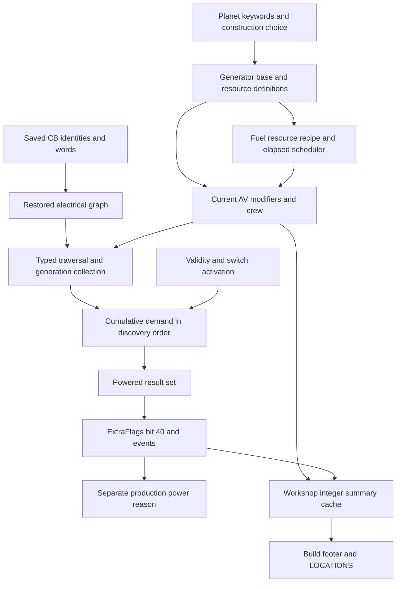

# P1 outpost power: native reference

**Subsequent Save29 evidence (2026-10-17):** the agreed repeated-load test
is **PASS** for its controlled setup. [Result and mechanism plan](save29-test-plan.md)
updates the historical offline uncertainty below; R versus C remains OPEN.

2026-10-17, Australia/Sydney. SOR-EXP-0041 / SOR-EV-0049.
[Authorized brief](../../implementation-briefs/README.md#archive-lookup) (`implementation-briefs.zip :: docs/implementation-briefs/CODEX_BRIEF_SOR_P1_power_generation_distribution_native_mapping.md`),
[frozen contract](contract.md), [review and checks](review.md).

The authorized [allocation-order and switch-persistence follow-up](followup.md)
corrects the preliminary queue description, specifies generator seed and
assessment ordering, maps REFR open-state persistence and confirms the ordinary
one-unit fuel threshold. Its [availability table](availability.md) classifies
actual order as **CONDITIONALLY RECONSTRUCTABLE**. Original P1 review history
below is retained; the follow-up has its own independent review record.
Follow-up review02 **ACCEPTED** the bounded task as **COMPLETE**; order remains
conditionally reconstructable, with current-state and toggle-ground-truth
limits explicitly retained. Final combined review patches are indexed in
[review.md](review.md#focused-allocation-orderswitch-follow-up).

| Element | Answer |
|---|---|
| Research question | Which native definitions, functions and saved representations govern generation, current power, wiring, switches and shortages? |
| Best-supported answer | **COMPLETE** bounded offline map, independently **ACCEPTED**, awaiting maintainer critical review. Ordinary solar/wind use planet-conditioned fixed-rating forms; current contribution includes AV modifiers and eligible crew. The electrical graph stores typed per-reference edges. Shortages use component traversal and cumulative demand, while explicit/simple edge partition controls mixed equipment. Saved graph/flag snapshots are recoverable separately from current engine authority. |
| Confidence | PROVEN within qualified byte/table comparisons; proposed STRONG / STATIC for native interpretations; SAVE corroboration for sampled instances. No new RUNTIME evidence or safe integration claim. |
| Coverage | Pinned retail 1.16.244.0, main ESM, 17 ordinary generator variants, 332 definition candidates, six protected save inputs and natural native consumers. DLC/mod overrides and arbitrary malformed/custom categories are outside demonstrated coverage. |
| Evidence | [Definitions](definitions.md), [generation/fuel/dynamics](fuel.md), [allocation and wire contracts](native.md), [saved matrix/examples](saved.md), [source pins](sources.csv), [uncertainties](uncertainties.md). |
| Limitations | Actual current graph order, handles, crew, fuel stocks and realized output are unobserved. General external invocation, universal UI cable limits and contradictory planet-keyword precedence are unqualified. These do not erase the mapped ordinary calculation/admission/serialization contracts. |
| Next step | Critical review of the package; no new live observation, mod, simulator, importer, staging, commit, push or publication is authorized. |

## Answers to the mandatory questions

**Generation and temporal behavior.** Basic solar is 2 / 4 / 6 / 8 and wind
3 / 6 / 10, selected by body-keyword construction conditions. Solar domes
are 4 / 8 / 12 / 16; advanced wind is 6 / 14 / 25, reactors 30 / 100 and
fueled generation 20. No-atmosphere wind zero in the supplied exporter
expresses construction eligibility; there is no zero-rating ordinary wind
variant. Its fallback 6 for missing pressure is exporter policy, not an
established engine fallback. All 1,765 main-game source rows were physically
compared with matched PNDT records; exceptional orbital/non-landable rows
remain separate. [Definitions and exact identities](definitions.md).

The ordinary native contribution path has no sunlight, time-of-day, weather
or wind-event operand: selected base rating, current AV modifiers and eligible
crew determine conditional contribution. Fuel charge and activation/validity
govern availability separately. This is a positive STATIC account of the
mapped paths, not a claim of observed output across day/night or arbitrary
mod-added effects. The fueled generator uses the shared incoming resource
graph and requests He-3 ×1 per accepted cycle; its base interval is exactly
36 binary32 seconds before timer modifiers. Charged/Uncharged transitions
suppress/restore generation rather than create inventory items called power.
[Native generation and fuel](fuel.md).

**Deficit and mixed wiring.** An allocation pass totals generation in its
eligible electrical component, then adds eligible consumer demand in discovery
order. Demand already exceeding supply stays in the cumulative total, so this
is not a best-fit allocation. Supply 10 with ordered demands 6, 6, 1 admits
only the first. There is no explicit construction-time or gameplay-priority
sort in that allocator. Stored edge order, root and graph filters matter.
Simple word-1 beacon links and explicit word-3 connections share machinery,
but explicit receivers/generators restrict crossing simple links. A wired
generator's component therefore need not supply unwired equipment elsewhere
in the same outpost. Connected generators sum once within the selected
component. There is no universal wired-first or unwired-first rule independent
of topology. [Exact algorithm and switch qualification](native.md#deficit-allocation-and-the-mixed-case).

**Wire eligibility and switching.** Both endpoints must pass the effective
connection predicate; generators, qualified consumers and lamppost/relay
candidates are not excluded by their display category. Existing word-1 links
can be replaced; existing non-1 pair links fail the admission predicate.
The actual selection caller adds assembly, world/context and Workshop-boundary
checks. Logical adjacency, snap/simple relationships and cable art are distinct.
Switch activation state can skip an allocation node and its expansion;
generation collection is a separate stage and must not be modelled as an
identical cutoff. An alternate path may still reach a consumer. These are
native functions and conditions, not a new electrical simulator.
[Admission, graph and state contracts](native.md).

**Save versus current state.** ExtraCB serializes remapped reference identities
and u32 connection words. Four inspected mature snapshots contain reciprocal
word-3 object graphs; two other saves contain word-1 beacon memberships.
Examples include wired generators, consumers, lamps and levers. Extra9C's
saved flags retain mask 40, proving a historical powered snapshot; post-load
recalculation can change it. Saved tokens/FormIDs are not current handles.
Current generator contribution, reachable supply, base demand, switch query,
allocation result and cached Workshop UI totals have separate access paths.
[Six-save evidence and contract matrix](saved.md).

Source code exports are proprietary LOCAL-ONLY evidence. Authored tables,
interpretations and scripts remain REVIEW-REQUIRED. Prior E1/E2/E3 evidence
and superseded interpretations remain unchanged. This extends their current
power reader and explains previously unclassified powered-bit persistence;
it does not retrospectively certify their saved values as loaded authority.

## Load reconstruction continuation (2026-10-17)

[Load reconstruction and determinism](load-determinism.md) gives the five
executive answers, native lifecycle, order provenance and hypothesis matrix.
Both saved-bit restoration and subsequent load-triggered recalculation are
supported. Repeated identical-save settled outcomes remain **NOT YET
ESTABLISHED**. ExtraCB identity terminology is corrected to FormID; Extra4D
and temporary queues use manager handles. No live experiment was performed.

## Save29 player validation — 2026-10-17

**PASS:** the agreed three desktop-exit/reload trials consistently retained the
user-observed #1 powered / #2 unpowered allocation under the 6-versus-10 deficit.
[Accepted result and mechanism plan](save29-test-plan.md) supersedes the earlier
repeated-load OPEN verdict for this controlled setup. It keeps saved-state
restoration versus load recalculation OPEN and distinguishes user UI reports
from independently decoded Save29 flags. Planning/offline inspection only.
