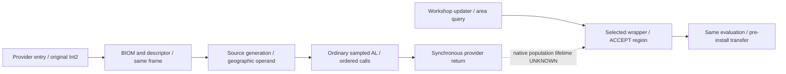

# D5B native and identity contract

2026-10-25, Australia/Sydney. [Report](report.md), [source pins](sources.csv). This contract composes existing read-only native evidence; it asserts no new engine layout. Starfield.exe 1.16.244.0 SHA-256 is `7e9adb1414a8e1b325e5e1f097b9b17b78deb7eebeda37a333351a43a60f9d28`. Preferred static image base is `0x140000000`. The table uses RVAs; runtime VA adds the measured module base. Member and stack offsets are byte displacements.

## Producer boundary

The exact instruction windows and register ownership are inherited from [D4 native evidence](../resource-selection-context/native.md) and [D5's mask lineage](../resource-feynman-d5/native.md). Their source ledgers identify the primary exports; original bytes remain local and unchanged.

| RVA | Meaningful event, frame and copied operands |
|---|---|
| `0x0079f860` | Provider entry RSP P. Copy RDX's original signed Int2. Allocate observer provider token; clear stale pending state. |
| `0x0079fb1b` | Working RSP P minus `0x3c8`. BIOM in RAX; source `[RSP+0x38]`; original query pointer `[RBP+0x2d8]`. Copy source `0x70`, BIOM prefix and original Int2; require provider frame. |
| `0x0079feaf` | Before `0x0078d660` conversion. R8 descriptor `0x2c`, R9 original query. Require same provider RSP and query pointer, and compare the originally observed Int2 bytes in reduction. |
| `0x0079b520` | Generation entry E=P minus `0x3d0`. RCX source, RDX origin Int2, R8 geographic query `0x18`, R9D owner, stack BIOM/output pointers. Return must be relocated `0x0079ff1d`. Manager pointer global `0x05fd9c30`; manager `0x200`, owner `+0x80`. |
| `0x0079b6a5` | F=E minus `0x2d8`. Component success AL and F plus `0xe0` payload `0x68`. Assigned ordinary family is payload `+0x50`. |
| `0x0079b8e8` / `0x0079b8ed` | Before/after ordinary mask sampler. Copy actual geographic RDX `0x18`, sampler RCX and returned AL. Returned ordinary low nibble is distinct from full raster byte and Special high nibble. |
| `0x0079c642` / `0x0079c674` | Actually visited alternate candidate and resolved BIOM. Iterator RBX, lookup RDI; alternate stack plus `0x70` equals F. Ordered RNAM/RSGD/DNAM candidates retain file provenance. Unvisited comparisons remain unknown. |
| `0x0079be20` | Ordinary call. RDX IRES, R8 DNAM 560 bytes, XMM3 low binary32 weight, DIL/stack mask, resource-order list and slot. Snapshot candidate order rather than sorting it in the collector. |
| `0x0079ff1d` | Same synchronous provider continuation, RSP=E+8. Copy source and output prefix. Return is not a population-readiness certificate. |

The geographic conversion (`0x0078d660`, `0x02332410`) and sampler/raster (`0x02339340`, `0x023390f0`) are source-backed STATIC dataflow. The collector directly observes boundary arguments/results; it does not claim to trace every internal transform. Original query, source anchor, beacon, geographic query and later generation-cell query remain distinct.

Ordinary active/inactive decision is the static predicate mask equals 8 or rarity exceeds mask. Inactive settings apply to that resource's traversal; later cells cannot choose the construction mask. No query is substituted from a source anchor or screenshot.

## Consumer boundary

[D4A](../resource-tungsten-acquisition/native.md), [C2B](../resource-carinae-source-context/native.md) and [C1](../resource-geometry-observation/native-contract.md) provide exact instruction and lifetime limits.

| RVA | Meaningful event and copied operands |
|---|---|
| `0x021e07d0` | Updater entry. R14 reference; entry RSP; saved return `0x021b6936`; spatial RCX `base+0x05f5d800`, query RDX `base+0x05f5d618`; 24 query bytes and XMM2/XMM3 radius/upper bits. |
| `0x021e1772` / `0x021e174e` | ACCEPT/REJECT before region advance. RBX region, R13 IRES, R12 resource-slot displacement, RSI closure. Saved updater frame/return `0x021e0a4b`, actual occupied procgen slot, reference and query checks. |
| `0x021e0bf4` | Pre-install transfer. Same updater token/frame/reference/temp set; exact resource pointer plus `0x30` prefix must occur in the transferred vector. |

Reference/base/CELL types must be `0x4a`/`0x1e`/`0x49`, base FormID `0x002c60e9`, BC type/vtable qualified by inherited identity reader, Workshop bytes `b0e207c2dee2c1b6`. Body/owner is separately checked as `0x0005e0de`. IL/Fluorine/Copper are main-file IRES `0x000057d4`/`0x000057d0`/`0x000057cf`. Numeric FormIDs alone do not establish associated-file identity.

Procgen slot size is 24 bytes; slot key points to the `0x70` geographic source, slot `+8` to wrapper. Wrapper `+0x20/+0x28` gives resource slots/capacity. Collection `+8/+0xc/+0x10` gives count/capacity/data. Region `0x30` contains bounds XYZ/radius at `+0..+0xc`, point count/capacity at `+0x18/+0x1c`, data at `+0x20`. Each point is ordered binary32 XYZ/width, 16 bytes. Nonfinite coordinates, negative widths/radii and incomplete arrays refuse promotion. Raw retained Qb is separate from entry query; per-use geometric operands beyond these sites remain unknown.

Source key derives only on the qualified interior chart: descriptor coarse XY times 192, subcell XY times 12, residual XY, plus source signed anchor. The selected descriptor offset is manager `+0x1c0` when mode `+0x20` equals 3, otherwise `+0xc8`. Require chart 0, descriptor (37536,20928) and SFBK `0x0029d20e`. A same-body neighboring source is unrelated evidence.

## Join graph and hard limits

Construction-bound requires the complete provider/source/mask chain. Consumption-bound requires current Workshop, exact source, selected resource/region and same-evaluation transfer. Producer-to-consumer linked requires an independently witnessed population lifetime. The synthetic-only proof is the pinned fixture's stack allocation and sole-writer path plus copied witness/population; it is not a native epoch field.

Native reset `0x0079ddf0`, destruction `0x0079d910` and manager cleanup `0x00788d4f..0x00788d66` lack a demonstrated complete all-alias lifetime fence here. Slot switching explicitly loses native population-history coverage. Source identity, source ordinal, pointer value, matching geometry or timestamp cannot replace that proof. No native linked or historical-attribution result is emitted.
