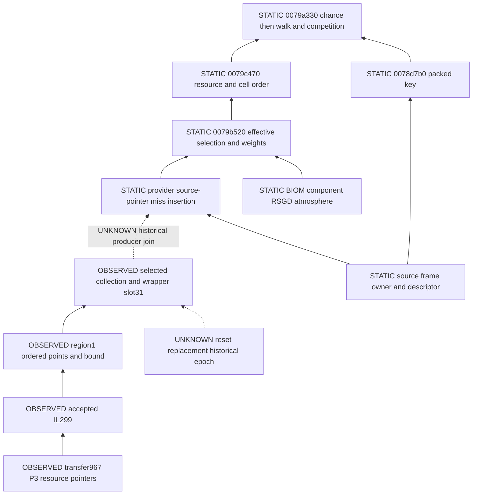

# C1F backward ancestry and operand ledger

[Answer](report.md), [primary pins](sources.csv). All full addresses are preferred
static VAs, base `0x140000000`, retail1.16.244.0 pinned in the report. RVA=VA−base;
future runtime VA=measured module base+RVA. Hex `+` offsets are members of the
named native object. Serialized IDs, FormIDs, runtime pointers and slot ordinals
are separate domains. No Ghidra symbols/types/comments were changed.

OBSERVED means existing native receipt bytes; STATIC means exported instruction,
call or field dataflow; DERIVED means calculation on qualified inputs; CANDIDATE
is an unobserved application to this native path; UNKNOWN is missing evidence.

Arrows describe evidence dependencies, not a measured runtime call stack.
Read backward from the consumed path through the missing historical join.

| Edge/stage and domain | Exact source/locations | Status and available operands | Missing native join / discriminating effect |
|---|---|---|---|
| Workshop→updater→callback | ui15 `1421b6931→1421e07d0`; ui16 true edge `1421e1772` | OBSERVED P3 BC identifier, one updater token/frame/lifetime, Qb, source31, region1, IRES0057d4 | Per-use Qc/Qv/Qe UNKNOWN; cannot alter already observed point bytes |
| Region→collection→wrapper | ui16 `1421e100a..1060`; collection+8/+c/+10, stride0x30; region+18/+1c/+20 and stride0x10 points | OBSERVED selected raw collection/header/resource slot, region address/ordinal and complete ordered XYZW | Tail skipped by short circuit UNKNOWN; region ordinals are not generator cell IDs |
| Wrapper→ProcGen source slot | ui15 `1421e09d4..0a77`, slot stride0x18; ProcGen+20/+28 | OBSERVED same slot/key/wrapper for IL299 and Cu325; source54 controls separate | Source key is runtime source-map key, not packed cell CRC. Pointer reuse/epoch and source+68 contents unobserved |
| Provider insertion→producer | producers01 `14079fc37..fca6` visited source+68; `fcc2..fcd4` source-pointer lookup; `fde2..fe27` insertion; CALL `ff18` | STATIC conditional miss calls `14079b520`; wrapper/resource map storage feeds consumer | CANDIDATE for consumed slot31; hit and visited paths bypass construction; no captured construction stack |
| Generation context | producers01 `fed3..ff18`; manager+80 u32; mode-selected descriptor+c8 or+1c0; `14078d660`, `142332410` | STATIC caller passes source, integer local origin, descriptor, owner and BIOM-related context | Actual historical owner/source/descriptor/epoch UNKNOWN. Equal controls corroborate some candidate geometry without certifying these inputs |
| Source selection/frame | RG1 native005/006, constructor `140982d90`, provider `140985870`; index bounds/origin | STATIC source+10/+14 anchor, +18/+1c dimensions, +20/+24 padding, +28/+2c raw dimensions, +38 selectors, +68 visited key | DERIVED candidate origin `[-3800,-200]`, dimensions10×10 and padding2 for matched source; actual native source fields UNKNOWN |
| Body owner/frame | RG2 N001–013; `14076ec81..86`, `14078a144`, `14078b030`, `14096f5c0` | STATIC PNDT FormID→owner key; DERIVED Feynman385246; ordinary snapped frame from frozen requests | CANDIDATE actual initialization, explicit-key/rebased alternate unobserved. Shift all keys would affect Cu too, but three matches are no global frame proof |
| Surface selection | `14096e060→140970d50`, RG1 native source map | STATIC body/system/surface CRC, BIOM style/SFPT registration/orientation/SFBK; frozen source family | Installed seeds/registry support the baseline, not selected historical descriptor. A different geographic source may have different BIOM/resource rules |
| BIOM/component prerequisites | cont01 `14079b625..b794`, CTPerBiomeData lookup `140771f30`; map state retrieval | STATIC keyed owner/BIOM; early return paths; component-selected/current/alternate RSGD | Actual component, readiness and effective generation BIOM UNKNOWN. Cache inserted before attempted construction; early return still permits visited bookkeeping |
| Family and descriptor | cont01 full `14079b520`; producers01 `14079c540` | DERIVED frozen IL/D0/Cu order, unique rarities3/1/0, RSGD-selected root DNAM blocks; alternate descriptor is a real branch | Actual selected family/order/atmospheric shared selection UNKNOWN. Missing IL eligibility alone contradicts positive native IL, not alternative families containing it |
| Mask/weight | cont01 `14079bdad..be20`, mask comparison and per-rarity setting loads | STATIC mask8 or rarity>mask selects setting; otherwise active1. DERIVED all six frozen masks8, IL .01, Cu .3, CE .2, CB .3 | Earliest concrete differential discriminator: active IL admits exact path; full activation loses Cu. Need actual XMM3/mask/settings at generation, not consumption-time map |
| Special/Everywhere | cont01 `14079be37` onward, `bf06` special; RG1 native schedule | STATIC separate high-nibble/Special branch and Everywhere descriptor; frozen IL family no Special; other family Water Everywhere zero-attempt block | No tie permutation or omitted active Water invented; effective branch changes may alter predecessors and need capture |
| Cell/key/CRC/MT | ui29 `14079c470..538`, CALL `c4f7`; cont01/02 `14079a330`; producers01 `14078d7b0` | STATIC resource then outerX/innerY; packed u64 key + owner u32 raw CRC, MT reset per call; origin added without /100 | DERIVED candidate IL cell10,1 exact path after chance; actual cell/key/CRC UNKNOWN. Chance precedes all walk draws, so a different consumer cannot repair a rejected generation call |
| Walk/clipping/competition | cont01/02 `14079a39a..aab6`; producers01 `1407af1a0`, producers02 `14079b020` | STATIC count/round/heading/width/step, nine samples against prior different-resource regions; conditional scalar/planar evaluator | IL first excludes earlier-resource cause under frozen order. Cu can change from added IL paths. Native marginal quaternion/terrain behavior and true prior contents UNKNOWN |
| Bound and append | RG1 generation export `142bf4850`; cont01/02 append | DERIVED matching complete IL bound and points under active endpoint; original frozen baseline unchanged | No output fingerprint certifies source identity. Equal inputs/native divergence remains a testable arithmetic hypothesis |
| Reset/cache epoch | event-oracle08 `14079ddf0` clear; event-oracle06 `14079d910` destruction; lifecycle ledger | STATIC clear of maps/visited under locks; OBSERVED only consumption window | Exact load/travel/reset/source replacement and historical writer epochs UNKNOWN. No evidence of a bug from a plausible retention route |

Primary export filenames `uiNN`, `contNN`, `producersNN`, RG1 nativeNN and RG2
Nnnn expand through the unchanged [RG1 native map](../resource-geometry/native.md),
[seed lineage](../resource-geometry-mature-context/seed-lineage.md) and
[lifecycle](../native-availability-map/region-lifecycle.md). Exact exported file
hashes are reverified in protected-before.json and summarized in sources.csv.
These are Bethesda-derived local evidence, not code incorporated into this report.

## Stage comparison and falsifiers

| Earliest candidate difference | IL effect | Cu / other source controls | Positive / negative evidence and falsifier |
|---|---|---|---|
| Owner, geographic source or local frame before generation | Different key/cell, source and possible family | Cu could also move; source54 may be independent | No alternate observed; exact source/cell reconstruction weakens need for a new frame for this path. Falsify candidate by actual source/key mismatch |
| BIOM/component/RSGD/family selection | Different eligibility, chance block, attempts or order | Independent source BIOM can retain CE/CB; changed predecessors can affect Cu | Two frozen source biomes exist; actual selected BIOM not captured. Falsify specific alternative with qualified CTPerBiomeData/DNAM/order receipt |
| Effective IL weight/chance | Opens cell10,1 before walking; exact native path | Unit endpoints lose Cu through additional IL/competition, CE/CB survive in source-scoped variant | Positive exact conditional path witness; not complete explanation. Baseline actual threshold in the qualified candidate call falsifies this weight-admission cause |
| Earlier different-resource competition alone | Cannot open frozen chance-rejected call; IL first has none | Can change Cu and CB | Excluded under frozen order, not alternative order. Native predecessor/order divergence falsifies that precondition |
| Arithmetic/clip after chance | Can change path after an admitted call, cannot pass a fixed failed gate without a different gate interpretation | Might affect only branch-sensitive paths | IL exact active-endpoint output; Cu three frozen controls exact. Native equal qualified inputs and unequal output supports arithmetic defect |
| Cache/history after construction | Retains/replaces particular resource geometry | Same wrapper at consumption allows unobserved history; shared lock constrains only present writes | Actual birth/reset/insertion/completion/consumption chain is missing. Qualified continuous same-output epoch falsifies historical substitution for that interval |
| Consumer/radius/rendering only | Cannot create these missing stored point bytes | Qb XY/radius corroborate nominal test; three stored controls exact | Already insufficient for stored geometry mismatch; per-use query limits remain for full consumer equivalence |

All historical cache claims are UNCLASSIFIED as to persistence; no generated
region save representation or safe integration point is established.
