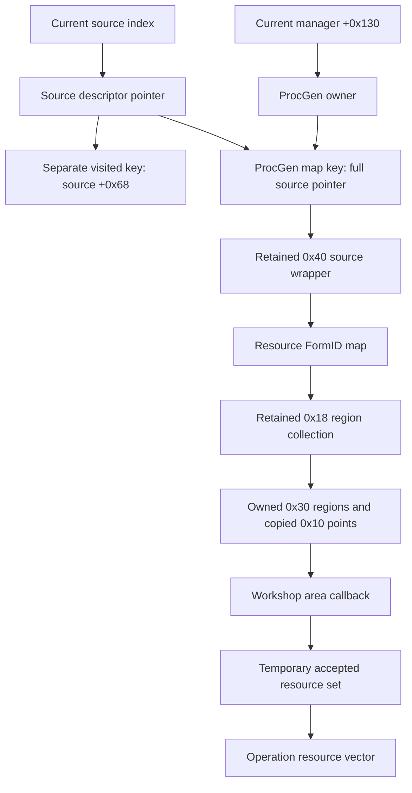
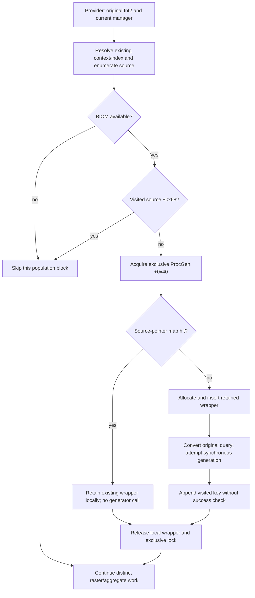

# D5C resource-source population lifecycle

2026-10-25, Australia/Sydney. [Invoked brief](../../implementation-briefs/CODEX_BRIEF_SOR_RG2_D5C_resource_source_population_lifecycle.md), [native account](native.md), [lifecycle matrix](lifecycle.csv), [propositions](propositions.md), [review and reproduction](review.md), [source pins](sources.csv).

**The inspected native path implements process-local retention and reuse of
generated resource populations.** The provider stores a refcounted source wrapper
in the current manager's ProcGen map, leaves that ownership intact after returning,
and bypasses generation on a map hit. The outpost consumer scans this same map.
This supports calling the structure a cache within that ownership scope. It does
not establish that geometry is serialized, that the selected population existed
at Save52 load completion, or that D5B consumed a particular construction epoch.

This is a scoped STATIC result on Starfield 1.16.244.0, executable SHA-256
`7e9adb1414a8e1b325e5e1f097b9b17b78deb7eebeda37a333351a43a60f9d28`.
Native code proves these branches and ownership operations, not their frequency
or execution for the historical Feynman V population. Coverage is the principal
provider, producer, consumer and direct ownership/reset/task/save edges in the
[native register](native.csv). The investigation does not claim an exhaustive
engine-wide writer, loader, alias or invalidation census. Authored interpretation
is REVIEW-REQUIRED; native exports, captures and private receipts are LOCAL-ONLY.

## Ownership and identity

Solid arrows describe static data access/ownership, not an observed lifetime
chain. [N01–N08](native.csv) establish the owner, holders and copy/free path.
The source descriptor contains definition and geographic input fields; it is
distinct from the generated wrapper and from the Workshop's accepted-resource
result. A region's points are copied into destination storage before the
generator's temporary storage is freed. Refcounts retain wrappers; they do not
make mutable arrays immutable or supply a generation counter.

The source map compares the full 64-bit source pointer. It does not hash the
pointed-to descriptor, ordinary mask, original Int2, BIOM, owner, seed or generation
version as additional fields. Current-manager selection and source allocation
provide implicit context, whose complete lifetime contract remains unknown.
The separate visited guard compares an eight-byte value at source `+0x68`.
Neither key is the analytical geographic label
`0:37536:20928:0029d20e`, a Workshop identity, a persistent handle or a source ordinal.
[Exact key table and hash semantics](native.md#lookup-and-chronology) retain that distinction.

## Construction and reuse chronology

[N03–N05](native.csv) support this control flow. A map miss is a lookup returning
the capacity sentinel, not an expiry or validity test. A hit bypasses generation
even when its wrapper was populated incompletely. The producer has component and
database-state early exits. Visit marking and provider return therefore certify
neither nonempty geometry nor complete construction. Visited-hit skipping is
different from a map hit: it does not even retrieve the wrapper in this block.

The exclusive lock spans the second lookup, insertion and synchronous construction.
Two ordinary callers using the same ProcGen/source pointer cannot both take that
miss branch concurrently without an intervening lifecycle change. The visited
check occurs earlier under a shared lock and is not repeated under the exclusive
lock; a second caller can pass it and later find the first caller's map entry.
This does not establish scheduler order or a deterministic winning query. Reset
between these stages, another owner, source replacement and unqualified aliases
must be considered separately. No claim of universal thread safety follows.

The native mask comes from the first admitted miss invocation's converted query;
the map key omits that query. Thus query order **can affect the retained result if**
different queries enumerate the same live source pointer, sample differing masks,
and reach successful construction before a later hit. D5/D5A model the differing
conditional geometries; they do not demonstrate all those native preconditions.
No retail two-query retained-geometry experiment was performed. First-request
dependence at this outpost remains PLAUSIBLE-BUT-UNPROVEN.

## Lifetime and save/load boundary

Reset `0x14079ddf0` clears source values and visited state; final release reaches
resource collections and nested point storage. Owner destruction is a distinct
path through `0x14079d910` and manager cleanup. Hash growth moves holders and can
relocate slots without regenerating geometry. Generic replacement code is not
evidence that an ordinary provider hit refreshes its population. No TTL or LRU
policy is demonstrated in these inspected bodies. [The lifecycle matrix](lifecycle.csv)
states predicates, identities, races and missing event bindings individually.

The mapped provider/reset and area scan use exclusive/shared ProcGen `+0x40`.
The destructor has no local acquisition of that lock; its external owner fence
and all collection aliases remain unresolved. Equal pointers may represent a new
allocation after teardown. Equal geometry does not prove an unchanged epoch.
Outpost movement can recompute the operation overlay through its query guard;
that alone is not source invalidation. Exact travel, terrain, biome-change and
Save52-load bindings to reset or source replacement remain unproved.

[Targeted save and initialization inspection](native.md#save-and-initialization-scope)
finds concrete Workshop producer-row serialization and task-mediated resource
construction, but no established join between those save rows and these region
arrays. This is a bounded missing-link result, not proof that geometry is absent
from all saves. Full geometry persistence, recipe/seed restoration and the selected
population's load-time readiness remain UNRESOLVED. Process-local retention is
demonstrated; cross-process persistence is not. A restored Workshop does not
establish a materialized resource population. Task preparation can demand resources
without a player-position argument in the provider, but no inspected edge proves
that Save52 initialization demanded this source before arrival.

## What D5B does and does not imply

The [D5B observation](../resource-combined-acquisition/phase-b.md) binds Workshop
identifier bytes `b0e207c2dee2c1b6`, owner FormID `0x0005e0de`, the selected
geographic source, three ACCEPTs 12901/12906/12907 and transfer 15119 in one
evaluation. Ionic Liquids, Fluorine and Copper each exactly match the frozen
mask-3 region and bounds, and differ from mask 0. That is current runtime geometry
plus a conditional model comparison, not an observed historical mask.

The retained-map mechanism supplies a concrete explanation for consumer-only
acquisition, but does not select it as D5B's history. The evidence also permits
construction during load, travel or later demand before sampling; missed
construction during a schedule gap; reconstruction or restoration through an
unjoined path; and population replacement before consumption. A design in which
every area callback necessarily runs the generator is contradicted by the mapped
consumer's direct resident scan. That does not exclude a fresh construction
elsewhere immediately before that callback. D5B recorded generation activity but
no qualified selected-source construction, and cannot distinguish these histories.

For VIII-b, retention followed by reset/reconstruction under changed context is
a plausible mechanism to test, not an explanation of the reported substitution.
Neither two populations at one outpost nor the incident's initiating query,
effective definitions, invalidation event or authority after load is observed.
All seven indeterminate Save52 associations and the frozen predictors stay intact.
The [proposition matrix](propositions.md) states evidence and falsifiers separately.

## Completion boundary and recommendation

No retail session was authorized or performed. No save loading, debugger attachment,
regeneration, save/content/configuration change, analysis-content edit, staging,
commit, push or publication occurred. B6 remains on hold. The work reads existing
native analysis and evidence, exports bounded existing functions read-only, and
writes authored documentation plus ignored verification/review artifacts.

The next useful discriminator is the selected source's population at an explicitly
observed load-completion boundary, joined to birth/insert/reset/destruction and
later consumption without a scheduling gap. [The proposed acquisition design](next-run-draft.md)
is unimplemented and NOT AUTHORIZED. It requires separate qualification, owner
and alias protection, and explicit live approval; this report supplies none.
