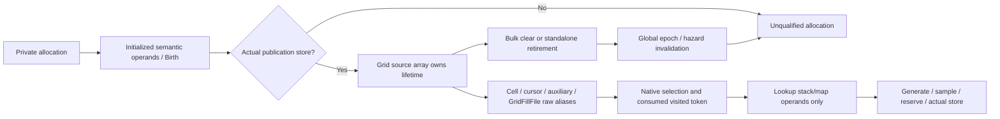

# P1 source identity and lifetime matrix

2026-11-01, Australia/Sydney. D5AB INCOMPLETE / REWORK; D5R OPEN;
B2 NOT AUTHORIZED. [Contract](../../implementation-briefs/CODEX_BRIEF_SOR_RG2_D5AB_P1_native_source_identity_lifetime_closure.md),
[active ledger](d5ab-p1-investigation-ledger.md), [starting C2 edges](d5ab-c2-evidence-matrix.md).
All native locations below are preferred static VAs for image base `0x140000000`
on the pinned 1.16.244.0 executable. They are not relocated runtime pointers.

## Identity and observation contract

An allocation witness is a unique observer birth token, not a native reference
count or a visited token. Geographic semantics use terrain FormID at source
`+0x00`, face byte `+0x38`, coordinate components `+0x3c/+0x40`, `+0x4c/+0x50`
and `+0x5c/+0x60`. The visited token at `+0x68` is separately recorded. Every
selected scalar is written before birth at `0x14098301b`, `0x140983085`,
`0x14098308d`, `0x140983095`, `0x1409830a5`, `0x1409830ad`, `0x1409830bd`,
`0x1409830c5` and `0x1409830c9`.
The schema-4 semantic definition excludes padding `+0x39..+0x3b`, unused
descriptor words, mutable dimensions and later `+0x178` metadata.

Birth copying occurs while the allocation is constructor-private. Selection
records a pointer already loaded by native code. Visited and Stored record the
engine-consumed token. Lookup records the native stack pointer operand, map
capacity/sentinel and result, without following the selected source. Its source
payload is zero. The schema-4 consumer reconstructs identity from birth only
after the allocation/publication/epoch/order checks succeed through lookup time.
This is one semantic snapshot with a static immutability premise, not a second
source-memory observation or a native source lease.

The diagram summarizes the examined ownership edges; the evidence rows below
control the proof. Grid retention and raw aliases do not retain a source. D5S's
detached-retirement counterexample remains valid. Schema 4 removes the observer's
retrospective source dereference and refuses invalid allocation histories; it
does not repair an engine lifetime gap or establish retail safety.

## L01–L21 accounting

`N01/N02` denote `.local-work/d5ab/p1-export01/02/native.tsv`.
`X01` through `X15` denote `.local-work/d5ab/p1-specialist-exportNN/native.tsv`.
Their exact function ranges and hashes are in the [source ledger](d5ab-p1-sources.csv).
Local preservation receipts retain the database/tool pins. `E1/E2/E4/P` keep
their exact C2 primary locators. Rows account for the pinned ordinary receiver
graph; arbitrary corrupt objects, replacement vtables and other builds are outside
this proof. Final acceptance remains with independent review.

| Edge | Native owner / primary evidence | Observer coverage, counterexample and disposition |
|---|---|---|
| L01 | E2/N01 `0x140982d90`: locked coordinate dedup or new 0x1a0 allocation. X01 binds all three callers. | Birth is new-allocation-only. Original-instruction dedup/bounds controls distinguish return from new birth. No birth is invented for dedup. |
| L02 | N01 constructor scalar writes listed above initialize every schema-4 semantic byte. | Padding and unused descriptor words are excluded. Token is not injective and pointer equality is not identity. Collision controls must refuse firstness. |
| L03 | N01 `0x14098316c` reserve; sentinel skips store `0x14098317e`. | Published follows the executed store. Modeled exception/unpublished controls refuse identity; null or nonnull return does not establish publication. |
| L04 | N01 FuncInfo `0x1454c00e4`; N02 `0x1402b6280/0x1402c5b40`; X09 `0x140315190`. | Complete constructor unwind table has lock cleanup and stack-functor restoration, no source-free action. String destination is source `+0x70..+0x175`, outside semantic bytes; bounded copy does not reconstruct/free the source base. No universal allocation-failure or leak claim. |
| L05 | X01 three constructor return paths; N01/X02 population; N02 cells/auxiliary; X04–X08 GridFillFile; X10/X13 synchronous creation; X14/X15 getter roots. | Return aliases, array ownership, cell/cursor/auxiliary, getter and file aliases are distinguished. Source creation and reset share landscape-owner protection; no captured creation callback escapes. Supported at this native graph scope. |
| L06 | X01 caller `0x140785490` writes only `+0x178`. N02/X02–X08 consumers read semantic scalars or copy into independent output/maps. Retained `0x14079b520` reads dimensions; X11/X12 and retained `0x1407a0cc0` close later provider arguments. X14/X15 and the getter consumers below close L18-G. | No selected-semantic-byte writer remains in the source-rooted graph. Lookup no longer compares two observed copies. Static writer coverage, rather than that comparison, supports immutability at the pinned ordinary scope. |
| L07 | E1/N01 `0x1409829b0`: map erase, unlock, resource release, source free `0x140982af8`. | Existing fence 3 brackets normal and exceptional exit. Lost event with changed epoch cannot sustain a schema-4 allocation join. |
| L08 | E1/N01 `0x140982b70`: standalone erase/unlock/free `0x140982c32`. | Existing fence 4 brackets the function. Detached source retirement invalidates the join even though Grid remains retained. |
| L09 | E1 `0x1409828ff/0x14098719f` reaches Grid clear. N02 concrete cell destructors free receiver sizes 0x28/0x40/0x78 only. | Cell destruction is not source destruction. Original-instruction controls use inaccessible source slots and record only receiver frees. |
| L10 | E4 `0x14098706d`, E1 `0x140988175`; D5S 38-step retirement receipt. | Grid-only protection remains disproved. Native host retirement-at-lookup controls must refuse continuity without reading source memory. |
| L11 | D5S layer reader and destroyed preparation reader have distinct lifetimes. | No source lease is borrowed from a detached preparation node. Observer source reads occur only at private birth. |
| L12 | Provider `0x14079fa90`, consumed token `0x14079fc37`, visited branch `0x14079fca3`; unchanged bridges. | Full Entry/Selected/Visited context and native order now qualify bypass identity. Missing/duplicate/mismatched bypass prefixes refuse positive identity. |
| L13 | Provider exclusive map lock precedes lookup, while retirement frees after unlocking. | Unsafe lookup source copy removed in schema 4. Private birth plus observed continuity reconstructs identity through lookup; inaccessible-source host control demonstrates the removed dependency. |
| L14 | D5V/D5Z reset/manager teardown; protected initialization `0x14078b030 → 0x140789ce0`; X10/X13 construction callbacks. | Equal epochs refuse old births. `0x140785190` holds owner `+0x08` before either Grid capture through synchronous callback return and destruction; reset `0x1407846d0` takes that same lock before null/release. Thus creation completes before reset, or reads post-reset slots. Detached density does not create sources. No outer owner fence is needed for this edge. |
| L15 | Unique birth token, publication, equal producer epoch, matching consumed token and complete event order form a conditional join. | Address reuse, equal token across sources and equal geography across allocations remain possible. Explicit controls refuse false continuity/firstness. No universal collision freedom. |
| L16 | Missing birth or publication has no qualified allocation witness. | Retain refusal for old-before-arming/unpublished sources. Positive normal construction and same-allocation bypass remain mandatory. |
| L17 | Exact FH4 inverse-action census maps ten named free funclets to twelve parent entries; E2/X09 supply actual allocations and saved stack slots. | All ten free locally allocated objects from separately bound non-geographic constructor families. The metadata `.rdata` cross-check has no unmapped action literal. These are positive origin exclusions, not size-based guesses. |
| L18 | E1/N02 enumeration and `0x140988ab0` cursor copying; X14/X15 receiver census and retained getter consumers. | Raw pointer copying is neither ownership transfer nor a lease. Getter results flow only to known comparison, new-cell insertion or pointer-key lookup within the bounded receiver graph. No observer traversal of moving cursor backing is added. |
| L19 | E1 `0x140988090` owns pointer-array backing; N02 cell vtables; X01/X02 modifier construction/destruction. | Grid `+0x20` cells, `+0x28` auxiliary records and `+0x38/+0x40` modifiers are distinct owners. No cell semantics are assigned to modifier virtual slots. |
| L20 | Existing `0x1409832e0` population; N01 `0x1409865e0`; N02 `0x140988b60`. | Auxiliary path stores source pointers and weights in independently allocated 0x40 records. Its modifier consumers do not acquire a source lease. |
| L21 | Existing `0x140985870` lookup, bound cell enumerators, GridFillFile raw source `+0x278`. | Lookup obtains a cell, not a source lease. GridFillFile `+0x270` owns file data; `+0x278` is raw source. Its destructor releases file data/buffers/receiver, not source. |

## ABI, loss and capability comparison

The following controls supplement primary native proof; a modeled control does
not replace a function/alias record. `R` means Reader Final03's `rows` in
`.local-work/d5ab/p1-reader-final03/receipt.json`; `I` means Original Instructions04's
`rows` in `.local-work/d5ab/p1-native-instructions04/receipt.json`. Native cases
are in `.local-work/d5x/p1-native03/build.json` and their named session directories.

| Branch | Final disposition and discriminating control |
|---|---|
| L01 | Accounted: I `constructor-dedup`, `constructor-bounds-refusal`; native `normal`. |
| L02 | Accounted: R `semantic-padding-excluded`, collision controls; initialized-byte native stores above. |
| L03 | Accounted: native `p1-unpublished`, `p1-constructor-exception`; R explicit birth/publication boundary counts. |
| L04 | Accounted: I `allocator-functor-cleanup`, `lock-cleanup-20000`, `lock-cleanup-10001`; complete parent-correct metadata. |
| L05 | Accounted: native `edge`, `corner`; X01/X10/X13 returned-pointer and synchronous-capture proof. |
| L06 | Accounted at selected scalar scope: R `semantic-padding-excluded`; X02–X12 writer/argument proof, not a dynamic mutation detector. |
| L07 | Accounted: native `clear`; R `semantic-delayed-admission-retirement-before-store` and omitted-invalidation epoch controls. |
| L08 | Accounted: native `p1-retire-lookup`; R retains earlier identity while refusing lookup continuity. |
| L09 | Accounted: I all six `cell-*` deleting/nondeleting cases; virtual targets bound by N01. |
| L10 | Unsafe dependency removed: native `interrupt`, `p1-retire-lookup`; retained D5S shift-38 counterexample. |
| L11 | Borrowed-reader hypothesis rejected: retained D5S preparation/worker proof; no later observer source read. |
| L12 | Accounted: R `bypass-qualified-positive`, missing/duplicate/context/order bypass cases. |
| L13 | Unsafe copy removed: native `p1-noaccess-lookup`; R `native-zero-lookup-source-payload-p1-noaccess-lookup`. |
| L14 | Accounted: X10/X13 and same-lock reset proof; native `p1-reset-lookup`; R epoch and owner-context mismatch controls. |
| L15 | Accounted: R `semantic-same-address-reallocation-in-flight`, all three collision cases, bypass native/admission inversion and tie. |
| L16 | Conservative refusal retained with positive control: native `unknown-birth`, `p1-unpublished`, `later-bypass`. |
| L17 | Accounted by exact ten-action metadata/slot-origin evidence; `funclet-parents-final01.json` has twelve parents and zero unmapped actions. |
| L18 | Accounted: original emitter execution in native `edge`/`corner`; X14/X15 and explicit getter return-flow proof close L18-G. Raw aliases confer no lease. |
| L19 | Accounted: I six cell-destructor cases and X01/X02 receiver-specific modifier proof. |
| L20 | Accounted: N01/N02 auxiliary stores and X03 modifier consumer proof; inaccessible lookup control removes observer reliance on those raw aliases. |
| L21 | Accounted: X07/X08 GridFillFile destructor/consumer proof, original emitters and inaccessible lookup control. |

No P1 native dependency remains open within this ordinary pinned graph. General
engine behavior under corrupted inputs, replacement code and arbitrary asynchronous
exceptions remains outside this static/finite host result. P3/P4 and retail
authorization remain open obligations of the original parent, not missing P1
evidence silently relabeled as a pass.

L18-G specifically challenged source-returning cell virtual slot `+0x18`, whose
harmless implementation alone would not establish caller safety. X15's bounded
Grid component census covers 31 functions and 5,083 instructions, retaining 251
`+0x18/+0x20` contexts. Its twenty literal virtual `+0x18` calls comprise thirteen
source getters and seven positively classified modifier/file-interface calls.
This corroborates the receiver graph; it is not a global offset heuristic or
proof against arbitrary computed clients.

The thirteen source getter calls have these complete return-flow dispositions:

- `0x140983ebe` compares the returned pointer with the known source.
- `0x14098615d`, `0x14098625c`, `0x1409863cb` and `0x1409864cc` in upgrade
  `0x140986080` forward source pointers into newly allocated corner-cell insertion.
- `0x14098690d`, `0x140986920`, `0x1409869bd`, `0x1409869d0`, `0x140986a6d`,
  `0x140986a80`, `0x140986a93` and `0x140986aa6` use source pointers as stack-held
  map keys; `0x1409868f0/0x1409869a0/0x140986a50` return file-holder values.

The full bodies of those upgrade/map helpers remain at
`.local-work/d5w/functions/140986080.txt`, `1409868f0.txt`, `1409869a0.txt` and
`140986a50.txt`. X14 supplies cell lookup's remaining caller `0x14078e900`,
which uses only the cell's `+0x38` type enumeration. Its other two direct callers,
`0x14078dce0` and `0x14079f860`, use the known cursor enumeration. X15 also supplies
`0x1409831f0`: it uses the cell's cached file key and returns file lookup output,
not a raw cell/source. No material getter escape remains unresolved in this
bounded ordinary graph. The review record preserves the earlier incomplete
acceptance and subsequent corrective proof review.

Production hook addresses, displaced bytes, bridge arguments, seventeen event
kinds and 312-byte layout remain unchanged. P1 adds no production native boundary
or observer lock. Constructor/publication/selected/visited/store assembly remains
the same; disposable fixture assembly adds fault schedules only. The ABI guards,
resident inert STOP behavior and original asynchronous-unwind limitation remain.
Fixture equivalence does not establish arbitrary retail exception safety.

Every original category remains recorded, including non-target events and global
resets. Schema 4 loses the second raw source snapshot and independent runtime
mutation comparison. It gains a lookup path without source-memory reads,
padding-free semantics, stricter cross-epoch refusal and native rather than
admission-only bypass chronology. Sources surviving reset without new birth are
deliberately unqualified; normal fresh construction must still qualify.
Schema-2 B1 and schema-3 historical results are interpreted by their original
paths. Transport/controller behavior and loss fences are not relaxed.
