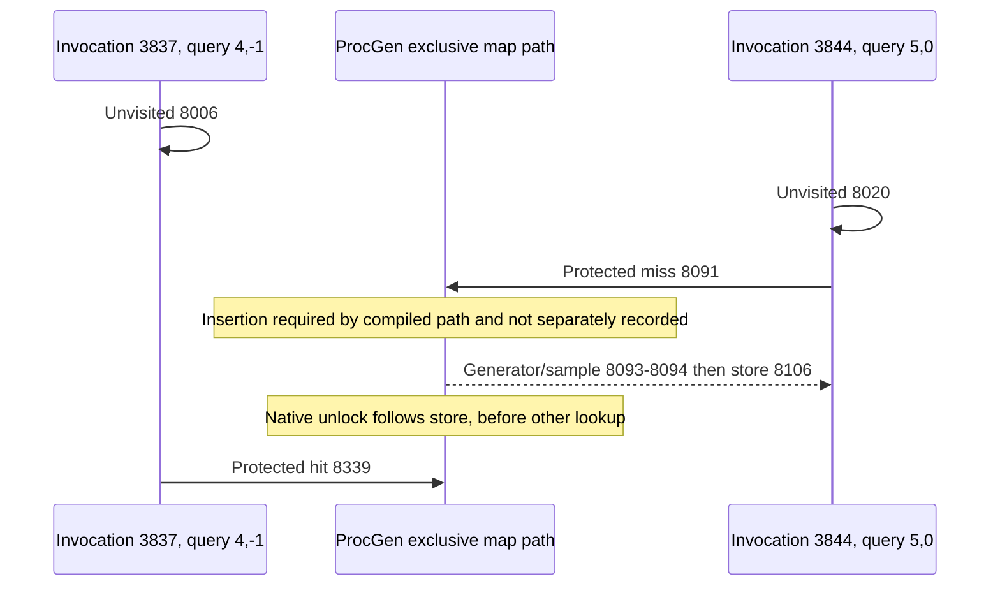

# D5AC competing target lookups

**The earlier unvisited check belongs to the later map hit.** Both requests
pass the shared visited check; the later checking request acquires the exclusive
map path first, constructs and marks visited before the other request looks up
the now-present holder. This is a source-backed historical ordering explanation,
not a generic race hypothesis. D5R OPEN. [Report](d5ac-report.md),
[primary locators](d5ac-sources.md), [counterexamples](d5ac-tests.md).

## Actual contexts and native time

The target selection, decision and construction rows share allocation 932 and
its published source pointer. Both invocations share the same ProcGen, epoch
207, parent invocation 0 and zero status/hazards at the listed boundaries. Entry
has no selected source yet; the final other-source selection is labelled below. Birth
2074 and publication 2075 precede both entries, with no intervening retirement,
replacement, new same-pointer birth, loss or epoch change. Source identity is
`0:37536:20928:0029d20e`; generator body FormID is `0x0005e0de`.
The private `target.json` includes complete parent/child invocation contexts,
all other selections and runtime operands. No nested child invocation is recorded
for either request; parent 0 is not evidence of a captured worker caller chain.

| Sequence | Invocation / selection | Thread | Original query | Native QPC | Boundary |
|---:|---|---:|---|---:|---|
| 8004 | 3837 / 0 | 42984 | `[4,-1]` | 3761445485639 | Provider entry. |
| 8005 | 3837 / 3838 | 42984 | `[4,-1]` | 3761445485647 | Target selected. |
| 8006 | 3837 / 3838 | 42984 | `[4,-1]` | 3761445485668 | Unvisited, matching birth token. |
| 8018 | 3844 / 0 | 44268 | `[5,0]` | 3761445496317 | Other provider entry. |
| 8019 | 3844 / 3845 | 44268 | `[5,0]` | 3761445496331 | Same target selected. |
| 8020 | 3844 / 3845 | 44268 | `[5,0]` | 3761445496360 | Also unvisited. |
| 8091 | 3844 / 3845 | 44268 | `[5,0]` | 3761445560087 | Protected miss: result 64 = capacity sentinel 64. |
| 8092 | 3844 / 3845 | 44268 | `[5,0]` | 3761445560106 | Consumed descriptor, input equals holder `+0xc8`. |
| 8093 | 3844 / 3845 | 44268 | `[5,0]` | 3761445560111 | Generator with matching body/geographic argument. |
| 8094 | 3844 / 3845 | 44268 | `[5,0]` | 3761445560191 | Direct sample `0x3`. |
| 8104 | 3844 / 3845 | 44268 | `[5,0]` | 3761445576022 | Generation returns. |
| 8105 | 3844 / 3845 | 44268 | `[5,0]` | 3761445576037 | Reserve index 21; count 21 → 22, capacity 32. |
| 8106 | 3844 / 3845 | 44268 | `[5,0]` | 3761445576040 | Executed matching token store at base + 21 × 8. |
| 8110 | 3844 / 3845 | 44268 | `[5,0]` | 3761445578364 | Constructing invocation returns. |
| 8339 | 3837 / 3838 | 42984 | `[4,-1]` | 3761445739159 | Protected hit: slot 18, capacity 64. |
| 8340 / 8341 | 3837 / 3979 | 42984 | `[4,-1]` | 3761445741198 / 3761445741228 | A different source is selected and bypasses; not another target lookup. |
| 8345 | 3837 / 3979 | 42984 | `[4,-1]` | 3761445743514 | Earlier invocation returns after its other-source selection. |

The map key operand is the full runtime source pointer, identical in both
lookups; neither token nor geographic coordinates are that key. Lookup `d`
records current epoch 207 as well as the inherited epoch. No earlier target
pointer lookup is recorded. Later positively joined target bypasses number 390
and follow the executed store in QPC order, beginning at 8107 on another thread.
The actual token/pointers, all 48 process lookups and source birth/publication
locators remain in local tables. File offset 2,654,504 for sample 8094 is not a
native address.

## Compiled causal constraint

The provider releases shared visited protection before acquiring exclusive
ProcGen `+0x40` protection. It does **not** recheck visited under the exclusive
lock. Pointer lookup, miss insertion, synchronous generation, reserve and actual
store all execute before exclusive unlock. A hit branches past generation and
append. The lookup wrapper's QPC is recorded before that exclusive unlock,
so these two same-owner protected decisions cannot exchange order merely through
queue admission delay.

The diagram shows observed callbacks and explicitly labelled native-required
edges. It does not assign lock acquisition or waiting timestamps. The elapsed
check-to-lookup intervals are not measurements of time spent waiting for a lock.
Other sources also execute between the two target decisions and lookups; they
cannot substitute for the exact-key insertion required by the target hit.

## Alternatives and discriminating evidence

| Explanation | Test / counterexample | Disposition |
|---|---|---|
| Earlier check must own first lookup | Raw QPC puts miss 8091 and store 8106 before hit 8339; compiled lock spans both callbacks. | Disproved. Selection/check order does not fix exclusive acquisition order. |
| The two outcomes use different keys, owners or epochs | Compare exact `proc`, source, lookup `c`, epoch/`d`, birth/token and allocation joins. | Contradicted; both use the same key and owner. |
| Hit ran first and later erase caused miss | Counterfactual requires opposite lookup time and an intervening removal/reset. Actual QPC is opposite, and there is no relevant fence or replacement. | Disproved for this pair. |
| Hit without intervening insertion from an empty key | Finite state oracle rejects a hit after miss without insertion; native miss path inserts before generator. | Disproved under the compiled path; insertion is inferred, not directly observed. |
| Insertion for a different pointer explains hit | Independent schedule inserts another key and still rejects the target hit. Raw target key is identical. | Disproved. |
| Reset/retirement between insertion and hit | Independent schedule removes the key and rejects hit; actual history has no such fence and retains epoch/lifetime. | Contradicted within observed ordinary coverage. |
| First unvisited request is the constructing request | 8006 belongs to invocation 3837; 8091–8106 belong to 3844. | Disproved, independently of the missing same-epoch cold certificate. |

The exact cause of the OS scheduler's choice and precise acquisition instants
remain unobserved. They cannot reverse the supported native lookup order and
are not silently substituted with a claimed fairness policy or retail frequency.
