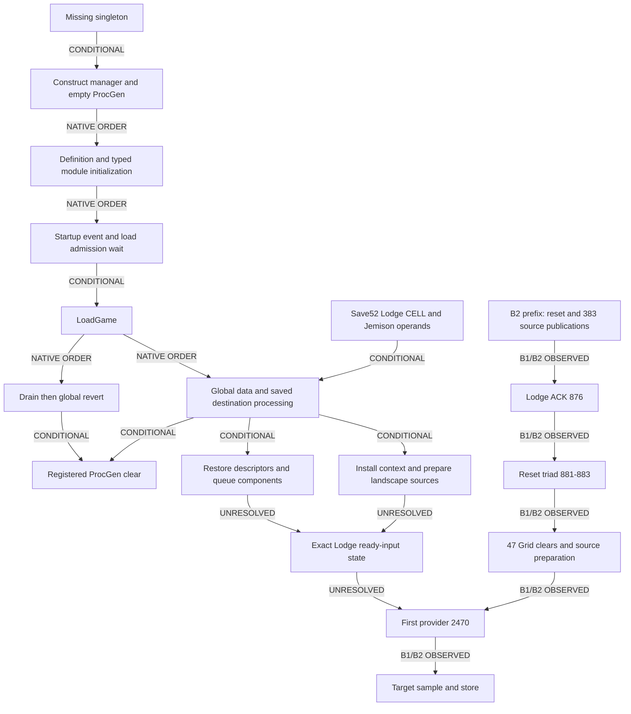

# D5AD startup, Save52 and destination handoff chronology

2026-11-02, Australia/Sydney. [Frozen contract](../../implementation-briefs/CODEX_BRIEF_SOR_RG2_D5AD_initialization_save_load_reconstruction.md),
[report](d5ad-report.md), [state matrix](d5ad-save-state-matrix.md),
[input provenance](d5ad-input-provenance.md), [sources](d5ad-sources.csv).
This is a partial order with explicit historical gaps. Native possibilities do
not supply the missing Save52 call trace. D5R remains OPEN.

**By B2's acknowledged Lodge checkpoint, source metadata had been constructed
and published, while no provider demand had been recorded. A second reset and
further source preparation precede the first recorded provider demand.** This
is stronger than an assumption that everything starts at travel, but it does
not identify the reset callers, the Lodge's linked body or every ready input.

All native addresses are preferred static VAs for Starfield 1.16.244.0, image
base `0x140000000`; RVA is VA minus that base. QPC below is the retained B2
native counter, at 10,000,000 ticks per second. Record sequence and capture-file
offset are separate domains. No native loading-screen or visual-arrival clock
was captured.

## Native dependency order

| Edge | Label | Concrete support and limits |
|---|---|---|
| Missing singleton to manager and registered ProcGen | CONDITIONAL | Bootstrap `0x141881660` tests singleton at `0x141881f3d`, skips construction on nonnull at `0x141881f45`, otherwise calls constructor at `0x141881f51`. Constructor `0x140787830` installs ProcGen `+0x130`; `0x14079d660` initializes empty storage. A reset does not prove construction. [D5Z](d5z-report.md#representation-identity-and-synchronization). |
| LoadGame drain to global revert | NATIVE ORDER | `0x141815eda` calls drain `0x14078f0b0`; `0x1418162db` calls revert range `0x1418278c0(0,17,0)`, before first global-load call `0x141816347`. Source: D5Z reset export01, LoadGame body. |
| Ordinary full-load revert or type-3 manager load to ProcGen clear | CONDITIONAL | Revert type 3 clears when the reload setting is zero; manager loader clears when it is nonzero. Both reset flag variants reach the registered clear. Stable setting and valid ordinary objects are premises; exact setting/caller was not captured. |
| Type-3 payload consumption to descriptor/component reconstruction | NATIVE ORDER | `0x141825ac0` consumes comparison prefix, world descriptors, auxiliary lists and queued typed component restoration. [State matrix](d5ad-save-state-matrix.md). Deserialization is distinct from completion of queued component work. |
| Saved destination processing to context/cell preparation | CONDITIONAL | Global dispatcher `0x141825e00` calls `0x141829ec0` at `0x141825f9e`. Its branches call context initialization at `0x14182ab2d`, `0x14182acb4` or `0x14182b503`; one branch installs world component at `0x14182acd8` and invokes focus work at `0x14182af17`. These are alternative paths, not one historical sequence. |
| Global restoration to finish phases and load return | NATIVE ORDER | Later LoadGame sites call InitGlobalData ranges at `0x14181761b/628`, reference finish `0x141817635`, FinishLoadGlobalData ranges at `0x141817641/64e`, later global load `0x1418176de`, final finish at `0x1418176f8`, then `0x14182cab0`. The log's finished-loading message follows these calls. |
| FinishGlobalData type 3 to queued component command | NATIVE ORDER | `0x141827380`, case 3, calls `0x142406950`, which publishes a CreateAndDeleteCommand and returns without waiting. Worker `0x142417130 → 0x142413270 → 0x142407350` performs keyed storage/index work. InitGlobalData case 3 is a no-op. This does not certify completion of queued components or deferred inputs. |
| Context/landscape setup to geographic-source construction | CONDITIONAL | Landscape/Grid construction and source publication depend on the chosen descriptor, component, file and source-index predicates; see the input map. Metadata creation is distinct from generated geometry. |
| Interior residency to linked exterior context/focus demand | CONDITIONAL | Attached cell data type `0x81` can provide context; the TES interior route additionally requires existing terrain and service/focus gates. [D5AA's exact predicates](d5aa-gameplay-transition-map.md#save-loading-and-interior-residency). No captured caller or body binds this to a Lodge resource request. |
| Accepted travel to pending transition, context, focus and requests | CONDITIONAL | Confirmation prepares player `+0xa08`; processing `0x141a20380` invokes context work before exterior preparation. `0x141a278a0` enables focus/service work before its final cell-placement call. Ready worker nodes can run while later preparation continues. |
| First eligible provider to visited/map decision and possible generation | CONDITIONAL | BIOM/visited/map and generator-input guards apply. Existing density aggregates can skip the provider; visited bypass and map hit are separate later gates. No fixed global scheduling priority follows. |
| Exact historical loader completions relative to Lodge observation | UNRESOLVED | No call-completion, file-readiness, manager-construction or full context snapshot exists in the retained observer schema. Compiled ordering cannot manufacture those operands or clocks. |

The load-function order above is the order of its synchronous calls. Queued
component work, file/block preparation, service commands and density/layer nodes
have separate dependency edges. D5AD corrects the earlier interpretation of the
type-3 finish call as a wait. A different context wrapper, `0x14078af30`, calls
`0x14078b030`, which drains a worker service through `0x1428d46d0`, then invokes
`0x14078bc30` and module `+0x70` callbacks. That concrete drain does not extend
to every future raster or resource request. The Lodge ACK supplies no wider
closure certificate.

## Actual B1/B2 overlay

### Startup admission and the Save52 branch

The connected ordinary startup path is `0x141898870 → 0x141881660`.
The manager singleton occupies PE virtual zero-fill, rather than an initialized
file-backed pointer. Bootstrap tests it before constructing and publishing the
manager. The writer census distinguishes constructor/bootstrap stores from
teardown and deleting-destructor clears; `0x14078f810` is a deleting destructor,
not a replacement setter. This establishes ordinary new-process construction
before use under this census. It does not date that construction within the
observer's READY prefix or imply another construction for each load.

The startup worker `0x14187f9d0` runs initialization `0x141893ee0` or full reset
`0x141896280`, then signals its event. Initialization reaches definition loading
through `0x141883440 → 0x1405994a0`, followed by typed module setup
`0x1409518b0`. The full-reset route has the same definition-before-module order.
The definition postlink driver `0x14059ac20` includes IRES/RSGD type jobs; both
serial and counted parallel routes reach `0x1405e10b0`, which dispatches vtable
`+0xf8`. The parent waits for the counted jobs, and the final submitted graph has
an explicit completion wait. Thus linked definitions precede the subsequent
PNDT component initialization on this path; merely finding a loader symbol
would not establish that edge.

Pending-operation processing `0x1418501b0` checks startup readiness. Its load
mask includes manual-load bit `4` in mask `0x40d4` and calls `0x141898210`.
That wrapper's first-transition branch calls `0x14187fbd0`, which waits for the
startup event, pumps work and disposes the worker control. Its already-completed
guard branch is separate. Manual-load dispatch reaches `0x141841460` and
`0x141840f50`; load workers `0x141854180/0x141854c00` call `0x141841610`, whose
successful file/header path calls LoadGame at `0x14184177a`. UI override alone
does not establish readiness; the load-mask wait path supplies the relevant
dependency. These native edges constrain a successful ordinary Save52 load,
while their exact historical timestamps remain unrecorded.

Save52 supplies concrete destination operands, not just a list of callbacks.
Its global type **9** has a 60-byte parsed prefix: static destination token
`46bb29` decodes to saved static ID `0x0006bb29` before native remapping.
That identity independently matches installed CELL `CityNewAtlantisLodgeInt`,
with its interior DATA bit set. Its context identifies
system `71456`, body `3` (Jemison), and the alternate-reference flag is zero.
See the [destination proof](d5ad-save-destination.md) for exact offsets,
reader/writer and remapping qualifications. Type 7 is a different grammar.

On successful resolution of those operands, the ordinary CELL branch must
perform context initialization at `0x14182ab2d`, cell preparation at
`0x14182ab48`, the interior test at `0x14182ab94`, pending payload setup at
`0x14182abfd` and processing at `0x14182ac09`, in that native order. The
maintainer's successful Lodge-load observation corroborates the destination;
it does not record every intermediate call or exclude effective overrides.
The saved context comparison key is not itself a direct manager-origin store.

These edges join startup admission, restoration, actual saved destination and
the recorded Lodge boundary into a partial order. They deliberately leave
parallel component commands and per-map readiness unordered where no dependency
or historical field supplies an order. A complete timestamped call trace is
neither reconstructed nor needed to state which edges cannot be placed.

| Boundary | Label | What is established |
|---|---|---|
| B1 reset 2/3/4 | B1/B2 OBSERVED | Matched reset begin, protected empty unlock and end before the 110-record pre-travel watermark. Exact reset caller is unknown. |
| B1 prefix 110 | B1/B2 OBSERVED | READY, 54 fence begins, 54 fence ends and one cold witness; no admitted provider/selection. Schema 2 did not include B2's constructor/publication witnesses. |
| B1 reset 115/116/117 | B1/B2 OBSERVED | A second reset after that prefix. Later target-compatible bypasses occur beyond known transport loss; no complete historical target append/query is recovered. |
| B2 main-menu prefix 1 | B1/B2 OBSERVED | Identity-bound READY/ACK before the maintainer loads Save52. This is not a construction snapshot for every native service. |
| B2 reset 2/3/4 | B1/B2 OBSERVED | Empty reset in observer epoch 2. Native QPC end 3760802204976. No caller identity. |
| B2 births/publications 5/6 through 875/876 | B1/B2 OBSERVED | The acknowledged Lodge prefix has 383 births and 383 publications, 54 fence begins, 54 fence ends, READY and one cold witness. No provider, selected-source, lookup or append event appears there. |
| B2 Lodge ACK 876 | B1/B2 OBSERVED | Maintainer reports Save52 loaded at the Lodge without travel. Observation interval starts `2026-11-01T06:46:28.031888Z`; confirmation recorded at `06:47:02.4124958Z`. These are UTC receipt bounds, not native visual-load instants. |
| B2 reset 881/882/883 | B1/B2 OBSERVED | Second matched empty reset, epoch 113, end QPC 3761440385432; later than the maximum QPC in prefix 876. Travel occurs after the checkpoint by operator account; no native caller proves that travel caused this reset. |
| B2 reset 883 to first provider 2470 | B1/B2 OBSERVED | Forty-seven removal-only Grid clears advance observer epoch 113 to 207. First provider QPC is 3761443830507. Geographic-source creation/publication occurs in this interval without constituting population generation. |
| B2 target birth 2074/publication 2075 | B1/B2 OBSERVED | Target allocation 932 precedes its two unvisited decisions. This birth is later than Lodge prefix 876. Source-key equality alone across worlds would not establish body identity; the target join uses the qualified B2 lifetime/generator context. |
| B2 target decisions, miss, sample/store and hit | B1/B2 OBSERVED | Decisions 8006/8020; miss 8091; sample 8094 `0x3`; executed store 8106; delayed competing lookup hit 8339. Original request, source lifetime and sampled result are joined in D5AC/B2, without qualified cold-first attribution. |
| Byte/order and adverse controls | CONTROLLED | D5AD's fresh offline decoder/ACK audit reproduces the prefix; altered checkpoint, loss, provider admission and second-reset QPC are rejected. These fixtures test the analysis, not a live engine load. |

The B2 watermark acknowledges a durable prefix. It does not pause concurrent
producers or certify that every operation before a player-visible milestone
was instrumented. The useful bounded absence is **no provider recorded in this
prefix**. The positive birth/publication observations show metadata construction;
they neither prove an exterior resource request nor identify all then-resident
Grids. B1 cannot supply the missing B2 constructor fields by analogy.

Under the audited ordinary mutator/lifetime graph, reset end 4 supplies a
separate **carried-empty inference through Lodge prefix 876**: its intervening
53 Grid clears remove state, and source metadata construction does not insert
retained populations or visited tokens. Both resets name the same ProcGen.
This is not a direct memory snapshot at the ACK or a certificate of all other
request/file/cache state. D5AC's later carried-empty interval begins instead at
reset end 883 and ends at provider 2470. Keeping both intervals explicit prevents
the Lodge boundary from being mistaken for the target's construction epoch.

## Competing explanations and discriminating limits

Directly restored visits contradict the positive ordinary writer/clear/load
graph. Reused manager versus reconstructed manager remains compatible with the
same reset receiver: reset clears state without proving allocation. Source
metadata being present is compatible with deferred raster or worker work; it is
not an all-inputs-ready certificate. The Lodge's interior state permits a linked
context route but does not prove that route executed. Removal-only Grid clears
contradict the interpretation of every epoch increment as a native cold reset.

The remaining missing historical edges are caller identities for the two
observed resets, the construction timestamp relative to recorder readiness,
effective remapped runtime destination operands, world/Grid/body binding at the
Lodge, and completion clocks for deferred material input dependencies. The
serialized destination operands and ordinary new-process startup dependency
are now constrained above; they are no longer treated as unexplored avenues.

## Separate PCM restoration before destination processing

Global type 7 is a separate material serializer. Its paired reader/writer
`0x1418b22c0/0x1418b1eb0` restore/write the PCM manager seed, PNDT-keyed content
map and remapped world-token placement map. These are not ProcGen's visited
array or retained resource collections. The [state matrix](d5ad-save-state-matrix.md)
records the native subreaders, full Save52 framing and ownership boundaries.

This has a concrete place in the Save52 partial order. The native LoadGame body
reads the 100-byte directory, preserves the resulting R1 start position and
passes its first count to `0x141824020`. That function reads each saved unit and
dispatches it before advancing to the next. Save52's directory gives R1 start
`0xb95` and 17 units; the independently length-closed suffix has types 4 through
16 in order. Type 7's payload is at logical offsets `0x162504..0x1b42ee`
(end exclusive), preceding type 9's destination prefix at `0x1b82a1`.
Thus successful ordinary type-7 restoration precedes the type-9 context branch
described above. This follows the reader and the actual sample layout, rather
than treating file order alone as a call trace. Primary windows are LoadGame
in D5Z reset export01 and `0x141824020` in export02, independently pinned in
the D5AD native audit.

The later destination preparation can consume restored PCM selections and
placements while rebuilding landscape/source structures. Queued component work
and deferred map readiness still have their own dependencies. Restoring PCM
data does not restore old ProcGen pointers or certify that any particular
resource population has been generated by the Lodge checkpoint.
Read-only native tracing can constrain their possible relationships. Save bytes
can establish serialized inputs. Neither contains the unrecorded execution
schedule. A new capture would test a new episode and requires separate approval;
it cannot retroactively supply B1/B2's missing call trace.
