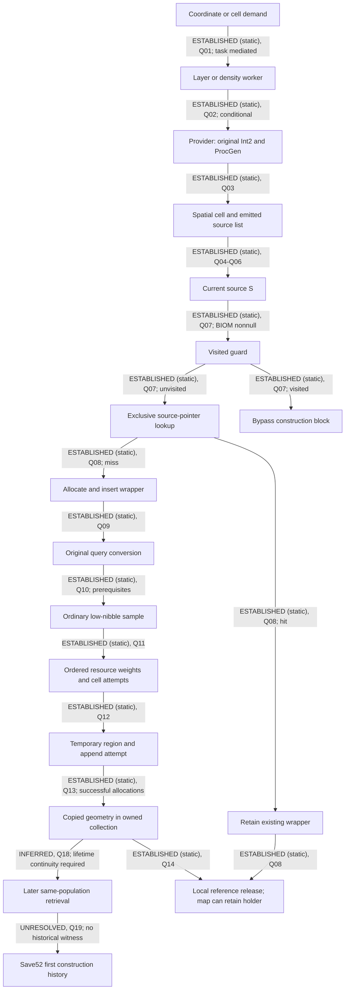

# D5Q resource construction call and data-flow map

2026-10-29, Australia/Sydney. [Report](d5q-report.md),
[claim/source ledger](d5q-sources.csv), [review](d5q-review.md),
[authorized brief](../../implementation-briefs/README.md#archive-lookup) (`implementation-briefs.zip :: docs/implementation-briefs/CODEX_BRIEF_SOR_RG2_D5Q_resource_construction_call_dataflow_mapping.md`).

**The provider processes source pointers emitted by a spatial cell for the
original request. On the unvisited source-map miss path, that same selected
pointer reaches the generator, while the original request determines the
ordinary mask sample. A completed copy can remain owned by the source map;
selection, insertion, successful copy and later reuse are separate facts.**

All addresses are preferred static VAs on image base `0x140000000`, for
Starfield.exe 1.16.244.0, SHA-256
`7e9adb1414a8e1b325e5e1f097b9b17b78deb7eebeda37a333351a43a60f9d28`.
RVA means VA minus that base. Member/stack offsets are bytes. Names below are
research aliases for compiled behavior, not recovered Bethesda declarations.
`W` is provider entry RSP minus `0x3c8`; provider RBP is `W+0x100`.
`G` is generator working RSP, `W-0x2e0`. `C=W+0x1b0` is its temporary list.
Source pointer `S`, visited identity `[S+0x68]`, saved Workshop identifiers,
FormIDs and geographic descriptors belong to different domains.

## Classified graph

Each graph edge carries its evidence class. `ESTABLISHED (static)` establishes
instructions for this binary, never the historical Save52 path. No new retail
execution occurred. Existing fixture execution is described separately in the
report and does not upgrade these native graph edges to executed observations.

Q01–Q19 are local claim identifiers in the source ledger. They are not new
global finding IDs. Branches omitted from this schematic remain in the tables.

## Request boundaries and initiators

| Alias / VA / RVA | Caller and decisive site | Inputs, outputs and conditions | Evidence |
|---|---|---|---|
| Coordinate dependency request `0x1403625e0` / `0x3625e0` | Rectangular request `0x1407a1580` calls at `0x1407a17c8`; cell preparation `0x140aed020` calls rectangle request at `0x140aed393` | Original cell `+0x58` Int2 is min/max. Current discriminator, owner, acquisition-result and dependency guards control scheduling. No Workshop argument is needed by this route. | Q01; D5D N05–N10. |
| Layer worker `0x1407b5160` / `0x7b5160` | Dispatch wrapper `0x1407b5850`; provider CALL `0x1407b526a` | After request validation and manager shared protection, neighbor preparation CALL `0x1407b524c` precedes the provider. RCX=current manager `+0x130`; RDX=worker input Int2 saved in RSI; R8=address of aggregate holder at working RSP `+0x88`. | Q02; fresh body `0x1407b5207..0x1407b526a`. |
| Density-level builder `0x1407a1940` / `0x7a1940` | Worker `0x14076c560`; provider CALL `0x1407a1a3c` | Entry RCX=ProcGen saved in R13; RDX=query saved in R15; R8D=level; R9=aggregate state saved in RSI. Nonnull `[R9+0x08]` skips provider. On absence, R8=`RSI+0x08`, RDX=R15, RCX=R13. | Q02; fresh `0x1407a1953..0x1407a1a45`. |
| Source provider `0x14079f860` / `0x79f860` | Two defined direct call xrefs above; data/unwind xrefs are not callers | Entry RCX=ProcGen, RDX=original Int2 pointer, R8=caller aggregate output holder. Saved at `W+0x3d0/+0x3d8/+0x3e0`. No evidence supports an additional explicit mask argument. RAX at return is not interpreted as a population-success flag. | Q02–Q09. |

These are concrete initiating operations and task dispatch links, not a complete
gameplay-event census. D5D's conditional cell flags, owner/current-discriminator
and result-1 dependency gates remain in force. D5H/D5I's accepted initialized-state
proofs show possible first-successful continuations, not Save52's actual worker
order. The smallest unmapped upstream edge is a qualified historical gameplay
event to one of these request invocations. Global ProcGen callers are outside scope.

## Cell selection and temporary-container ownership

| Boundary / VA / RVA | Established operation and operands | What the witness means |
|---|---|---|
| Context getter `0x14078c4e0` / `0x78c4e0` | Provider CALL `0x14079f8dd`; null stops. Singleton `0x145fd9c30` supplies index at manager `+0x120`, ordinary Grid at index `+0x10`. Provider stores Grid at `W+0x100` and increments Grid `+0x08` reference count. | Qualifies this request's retained Grid, not every later current-manager Grid. Q03. |
| Spatial lookup `0x140985870` / `0x985870` | Provider CALL `0x14079f92c`: RCX=retained Grid, RDX=original Int2. Origin helper `0x1409870d0` returns effective origin. Signed deltas must be nonnegative and below Grid `+0x48/+0x4c`; read cell from Grid `+0x20` at eight-byte linear index. | Returns one cell or null. It does not scan the separate Grid source vector. Q03. |
| Cell dispatch `0x14079f9ca` / `0x79f9ca` | RCX=returned cell, RDX=C; call through cell vtable `+0x10`. | Materializes selected cell entries into caller-owned chunks. Exact dynamic type still needs qualification in a future observation. Q04. |
| Fill emitter `0x140988240` / `0x988240` | If cell `+0x18` nonnull, tail-call `0x140988ab0` at `0x140988251`, RCX=C, RDX=address of cell slot. | One raw source-pointer value. Q04. |
| Edge emitter `0x140988330` / `0x988330` | CALLs at `0x14098834e/0x140988361` append nonnull `+0x18`, then `+0x20`. | Up to two ordered entries, without nominal-containment or blend-weight filtering in this body. Q04. |
| Corner emitter `0x140988760` / `0x988760` | CALLs `0x14098877e/0x140988791/0x1409887a4/0x1409887b7` append nonnull slots through `+0x30`. | Up to four entries in slot order. Neither deduplication nor unique-source identity follows. Q04. |
| Chunk append `0x140988ab0` / `0x988ab0` | RCX=C, RDX=address of source-pointer value. Allocates `0x108` bytes through C's allocator or consumes spare chunk. Copies eight bytes; returns prior u32 count in EAX. | Mutates caller storage. It is not a membership query or a source-reference acquisition. Q05. |
| Selected-entry load `0x14079fa90` / `0x79fa90` | Loads `[cursor]` into RDX, then stores it at `W+0x38` at `0x14079fa93`. | The source processed by this loop iteration. It does not prove successful generation, Workshop acceptance or complete ordinary-Grid membership. Q06. |
| Chunk cleanup `0x14039ff30` / `0x39ff30` | CALL `0x1407a0791` on C; frees chunk allocations through allocator `0x1422cb6b0`. Grid reference release follows at `0x1407a079c`. | Caller owns list storage for this invocation. List entries do not independently extend source lifetime. Q05–Q06. |

The four concrete emitter vtable links are inherited from D5H N09 and checked
through the fresh emitter xrefs: fill `0x144b67eb8`, X edge `0x144b67e28`,
Y edge `0x144b67f00`, corner `0x144b67e70`, all method offset `+0x10`.
Setters `0x140988220/0x1409882d0/0x1409884e0/0x140988670` retain contributors
only in eligible empty slots; existing identity comparisons and edge-to-corner
conversion mean enumeration is not equivalent to an unconstrained set union.
Q04 concerns the entries actually retained, not every attempted insertion.

| C-relative field | Width / role inferred from explicit reads/writes |
|---|---|
| `+0x00` | Eight-byte allocator/context obtained through provider TLS handling. |
| `+0x08` | First chunk pointer, initially zero. |
| `+0x10` | Address at which to publish the next link; initially `C+0x08`. |
| `+0x18` | Last/current write chunk. |
| `+0x20` | Spare chunk chain head, initially zero here. |
| `+0x28` | Next write cursor; endpoint after materialization. |
| `+0x30` | Read cursor initialized by first append; cleanup advances it. |
| `+0x38` | u32 entry count; incremented before the eight-byte slot store. |
| Chunk `+0x00..+0xff` | 32 eight-byte entries; `+0x100` is the next chunk link. |

These roles are research descriptions of Q05's instructions, not a C++ type.
The provider initializes C at `0x14079f97d..0x14079f9b6`, captures begin/end
state at `0x14079f9cd..0x14079fa59`, and uses separate local traversal cursors.
It increments by eight, follows the `+0x100` link at a chunk boundary, and
terminates on cursor equality at `0x1407a073f..0x1407a0780`. It does not use the
count as its loop bound. Initial endpoint normalization handles full chunks;
an empty list takes the equal-cursor exit. In the inspected ordinary emitters,
one cell emits at most four entries; the generic append/iterator supports more.
Allocation failure handling and arbitrary alternate emitter types are not
qualified by this account. Cleanup frees chunks, not pointed-to source objects.

## Value provenance and generation

| Value | Origin and transformation | Consumer / condition / classification |
|---|---|---|
| Original query | Two signed 32-bit integers through provider RDX, preserved at `W+0x3d8`. Worker aggregate reuse may prevent this provider invocation entirely. | Spatial lookup and later query converter use the same argument pointer. ESTABLISHED (static), Q02/Q03/Q09. |
| Source geographic descriptor | Constructor copies descriptor fields into `S+0x38..+0x63` at `0x140983081..0x1409830c5`: chart byte, coarse pair, pattern slot, subindices, block slot and final words. It separately stores visited identity at `S+0x68`. | These are source-definition/geographic provenance fields, distinct from the current manager descriptor used for original-query conversion. The inherited source-enumeration register interprets chart/coarse/pattern/block fields; their equality alone cannot identify a historical allocation or sampled query. ESTABLISHED (static), Q03. |
| Source-local origin | Source `+0x10/+0x14` minus padding `+0x20/+0x24`, multiplied by 100 in 32-bit arithmetic, converted to binary32; generator origin rounded down into Int2 at `0x14079feda..0x14079fefb`. | RDX at generator CALL; distinct from original query and descriptor anchor. Native units only; no saved-world-XYZ interpretation. ESTABLISHED (static), Q09. |
| Local query residual | Original Int2 multiplied by 100, converted to binary32, minus the binary32 source origin, round-down into local Int2 at `0x14079fa98..0x14079fb03`. | Later provider output processing; it is not substituted for the original sampler query. ESTABLISHED (static), Q09. |
| Source BIOM | CALL `0x14078ee90` at `0x14079fb16`, using source `+0x10` anchor; result R15 and saved local. | Null skips source construction block at `0x14079fc29`. Generator fifth argument is this BIOM, not the request's selected geographic descriptor. ESTABLISHED (static), Q07/Q09. |
| Effective descriptor | Current manager mode byte `+0x20==3` selects `+0x1c0`, otherwise `+0xc8`; original query restored in R9. CALL converter `0x14078d660` at `0x14079feaf`, RCX=manager, RDX=output, R8=descriptor. | Descriptor copy, signed remainder and chart conversion; then CALL `0x142332410` at `0x14079febe` produces geographic values. ESTABLISHED (static), Q09. |
| Geographic query | Chart coordinates project through square roots, chart signs and atan2, with explicit binary32 horizontal conversion. Generator R8 points to the resulting structure. | Sampler RDX at `0x14079b8dd`; first two binary64 values feed longitude/latitude trig. Complete round-trip arithmetic scope remains D5H's qualified interior charts and current CRT premises. ESTABLISHED (static), Q09/Q10. |
| Owner/component context | Generator R9D comes from current manager `+0x80`; BIOM `+0x28` supplies component key. CALL `0x140771f30` at `0x14079b6a0` searches owner range and compares component `+0x40`, copying via `0x14076e810`. | False AL exits at `0x14079b6e4`. Output payload `G+0xe0` supplies family/effective-definition fields. Definition existence alone does not prove a loaded component. ESTABLISHED (static), Q10/Q11. |
| Body/raster state | Calls `0x140478350/0x140478a30` and readiness path `0x1427d4be0`; accepted final status 0 or 6. Sampler object from acquired handle `+0x20`. | Other status exits before sample at `0x14079b794`; this map does not equate a new wrapper with a sampled mask. ESTABLISHED (static), Q10. |
| Ordinary sampled mask | CALL `0x142339340` at `0x14079b8e8`, RCX=sampler, RDX=original converted geographic query; AL saved at `G+0x30`. | Sampler projects to chart; folds charts 2/3; uses descriptor table pointer `[sampler+0x18]+chart*0x30`; raster helper `0x1423390f0` floors clamped X/inverted Y. Load byte via descriptor `+0x20`, then AND AL with `0x0f` at `0x142339428`. ESTABLISHED (static), Q10. |
| Ordinary weight | Numeric mask 8 or mask less than resource rarity `IRES+0x110` selects inactive multiplier; otherwise binary32 1. Rarity outside 0–5 retains zero on the inactive branch. | XMM3 at CALL `0x14079be20` to resource traversal `0x14079c470`; not a test of individual membership bits. ESTABLISHED (static), Q11. |
| Resource and descriptor | Assigned family, effective RSGD, current BIOM ordered RNAM and first successful alternate search determine DNAM; ordered resource pointers are rarity-sorted before traversal. | RDX=IRES, R8=DNAM at ordinary CALL; current/alternate search failure may use first-descriptor fallback. This map inherits D5/D4's qualified initialization/order proof. ESTABLISHED (static) for branches; historical winner UNRESOLVED, Q11/Q19. |

At generator entry E=`W-0x08`, explicit operands are RCX=S, RDX=source-origin
Int2, R8=geographic query, R9D=owner, `[E+0x28]`=BIOM,
`[E+0x30]`=wrapper `+0x08` output resource-holder context. The entry saves
these operands before its `0x2d8` frame change. TLS allocator-state handling
at generator entry is implicit execution context, not another resource argument.
This is an observed ABI description, not an original function declaration.

The mask is a sampled generation value. Its determination requires query,
descriptor, conversion, sampler and loaded raster. It is **not established as a
resource-membership bitset**: the ordinary consumer compares its numeric value
with rarity. Special generation separately samples the high nibble at
`0x14079c005..0x14079c042`, selecting an inactive multiplier when it is zero.
That does not change the earlier ordinary sample. Atmospheric/Water/Everywhere
routes and their definitions remain separate branches, not ordinary-bit meanings.

## Successful copying, ownership and reuse

| Boundary / VA / RVA | Call site, data and side effects | Evidence / qualification |
|---|---|---|
| Visited guard and pointer lookup `0x1403499f0` / `0x3499f0` | Provider compares `[S+0x68]` against ProcGen `+0x48` count / `+0x50` data under shared `+0x40` protection. Unvisited path takes exclusive protection at `0x14079fcb3`; CALL lookup `0x14079fccb`, RCX=ProcGen `+0x10`, RDX=address of S. Compare RAX with ProcGen capacity `+0x28` at `0x14079fcd0`. | Q07/Q08, ESTABLISHED (static). Visited hit bypasses lookup; full 64-bit pointer is the map key. |
| Wrapper insertion `0x1407aa5f0` / `0x7aa5f0` | Miss allocates `0x40` wrapper; CALL `0x14079fdf9`; new source-slot stores at `0x14079fe14` and `0x14079fe18`. Source slots: ProcGen `+0x20` data, `+0x28` capacity, stride `0x18`, S at slot `+0x00`, wrapper `+0x08`, occupancy/link `+0x10`. | Q08, ESTABLISHED (static). Inserted wrapper can still have empty/failed generation. Defensive existing-slot assignment releases old holder; this does not prove ordinary concurrent overwrite under the held lock. |
| Resource traversal `0x14079c470` / `0x79c470` | CALL `0x14079be20` (ordinary), `0x14079c042` (Special), `0x14079c117` (separate later route). CALL `0x14079c4f7` to per-cell attempt `0x14079a330`. RCX=IRES; RDX=cell Int2; R8=source-origin Int2; R9=bounds/context; stack arguments at callee entry `+0x28/+0x30/+0x38` carry DNAM, binary32 weight, output context. | Q12, ESTABLISHED (static). Ordered chance/seed/walk/competition work builds a temporary region. No complete original algorithm/type reconstruction is claimed. |
| Resource collection `0x14079a330` / `0x79a330` | Resource key stored at `0x14079a615`; resource lookup CALL `0x14079abe5`, insertion CALL `0x14079ac5b`. A `0x18` collection is retained in resource-map slot `+0x08`; key is u32. | Q12/Q14, ESTABLISHED (static). Wrapper resource slots/capacity are wrapper `+0x20/+0x28`, stride `0x18`; context receiver offsets differ by its `+0x08` subobject. |
| Region append `0x1407ac2f0` / `0x7ac2f0` | CALL `0x14079aced`: RCX=collection `+0x08`, RDX=temporary region. EAX=index or `0xffffffff`; valid index addresses collection data + index*`0x30`. | Q13, ESTABLISHED (static). The unconditional `R12B=1` at `0x14079acf2` also executes after failed append. |
| Point copy `0x1407ac0d0` / `0x7ac0d0` | CALL `0x1407ac39d`: source temporary `+0x18`, destination region `+0x18`; copies ordered 16-byte points into separate storage, plus bounds and meaningful fields in append caller. | Q13, ESTABLISHED (static). Failed individual point append can be skipped at `0x1407ac212..0x1407ac215` despite final AL=1. Success needs actual destination equality, not return flag alone. |
| Provider continuation `0x14079ff1d` / `0x79ff1d` | Generator returned; visited append follows through `0x1422cc0d0` at `0x14079ff3e`. Local wrapper release precedes exclusive unlock `0x14079ffa5`; source-map reference can remain. | Q14, ESTABLISHED (static). Final retained geometry requires reading through owned slot/resource/collection, not merely seeing this continuation. |
| Resource retrieval `0x1407a97c0` / `0x7a97c0` | u32 key lookup; CALL `0x1407a9891` to `0x1407aabd0` shares collection holder by reference counting. Provider source hit increments wrapper count at `0x14079fcf4`, without sampling again. | Q15, ESTABLISHED (static). Retrieval capability is established; a later observed hit needs lifetime, wrapper and geometry correlation. |
| Workshop resident scan `0x1421e07d0` / `0x21e07d0` | Shared ProcGen `+0x40`, occupied source slots, callback `0x1421e0f50`; D5C primary windows `0x1421e09d4..0x1421e0aa5`. | Q16, ESTABLISHED (static), existing D5B executed consumer evidence separately scoped. No provider CALL in this inspected scan. Invocation-selected provider provenance does not itself identify the Workshop consumer. |

Collection count/capacity/data are `+0x08/+0x0c/+0x10`; region point
count/capacity/data are `+0x18/+0x1c/+0x20`. A copied-region witness requires
valid nonempty ordered points, exact meaningful bounds/header/point words,
and the actual destination index/address under its owner. Partial output can
coexist with a separately valid copied region. Neither visited marking nor a
nonempty aggregate proves all attempted regions survived.

## Continuity boundaries and competing observation routes

Q17's ESTABLISHED (static) invalidators include ProcGen reset `0x14079ddf0`
(source clear CALL `0x14079de8d`, protected post-clear point `0x14079de92`),
destruction `0x14079d910`, related erase `0x140975030`, Grid clear
`0x1409829b0`, and standalone source retirement `0x140982b70`. Grid clear
erases at `0x140982a36` and frees at `0x140982af8`; standalone retirement
erases at `0x140982bbc`, unlocks at `0x140982bc9` and frees at `0x140982c32`,
including an absent-map path. Source acquire/dedup `0x140982d90` is not a birth;
the allocation at `0x140983001` and completed init at `0x140983140` differ.
Manager replacement, same-address reinitialization, wrapper replacement and
unobserved coverage gaps defeat an unqualified historical pointer join.

| Lifetime operation | RVA | Observed control boundary |
|---|---|---|
| ProcGen reset `0x14079ddf0` | `0x79ddf0` | Protected clear CALL `0x14079de8d`; release `0x14079dec4`. |
| ProcGen destruction `0x14079d910` | `0x79d910` | Clears owned state; no local lock acquisition establishes external owner synchronization. |
| Source-map erase `0x140975030` | `0x975030` | Receiver is ProcGen `+0x10`; Grid clear and standalone retirement call it. |
| Grid clear `0x1409829b0` | `0x9829b0` | Erase and free sites above; Grid reference alone does not exclude this operation. |
| Source retirement `0x140982b70` | `0x982b70` | ProcGen lock/erase/unlock followed by free; absent-map branch still retires. |
| Source acquire/dedup `0x140982d90` | `0x982d90` | Can reuse existing anchor; only new allocation/init establishes a new source. |

The ordinary Grid source vector is a different allocation from both its cell
table and C's temporary chunks. R3 establishes dynamic u32 count/capacity at
Grid `+0x10/+0x14`, data at `+0x18`, stride eight. Growth frees old storage at
`0x1422cbb13` before publishing pointer/capacity at `0x1422cbb18` and `0x1422cbb1c`; append
publishes count before filling its slot. Lock Grid `+0x5c` protects inspected
acquire/dedup work, but complete writer/lifetime coverage remains unknown.
Page readability, count≤capacity, equal pointers or repeated headers do not
establish suballocation extent or lifetime. No helper invocation or lock call
was performed. The rejected `n<=256` bypass is never production code.

**Q18 is INFERRED:** observing a source selected into `W+0x38` could establish
invocation provenance without traversing the whole ordinary vector. It would
still need a coherent dynamic cell/type and retained-Grid witness, source lifetime
through generation, exact invocation/thread/frame joins to mask/copy/final owner,
and continuous invalidation coverage through later hit or Workshop consumption.
There is no per-source retain in the inspected chunk append/selected-entry load.
Retaining Grid does not prove that another path cannot clear/retire its sources.
Caller-owned storage reduces the full-vector extent problem but does not solve
all source lifetime or concurrent cell-writer problems.

**Q19 is UNRESOLVED:** no available joined retail witness supplies the historical
winning query, mask and uninterrupted retained population for Save52. The minimal
future discriminator is a separately qualified natural invocation witness from
cell selection through actual mask, successful destination copy, final owner and
later retrieval, with lifecycle coverage. For a static-only next step, enumerate
the relevant cell/source writers and their synchronization against the retained
Grid reference. Writer-qualified ordinary-vector observation remains an alternative
requiring allocator extent and publication coherence. Neither route is declared
safe, impossible, implemented or authorized for retail by this map.
