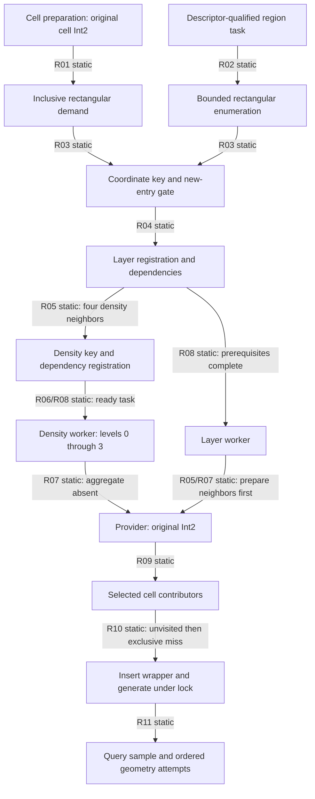

# D5R query scheduling and selection

2026-10-29, Australia/Sydney. [Report](d5r-report.md),
[input matrix](d5r-determinism-matrix.csv), [sources](d5r-sources.csv),
[review](d5r-review.md). R01–R18 below are task-local claim IDs.

**A fixed request has a reproducible local coordinate expansion. Location and
static definitions alone do not select its request history or winning source-map
miss. The inspected lock serializes construction; it does not impose a
coordinate priority.** ESTABLISHED (static) applies to compiled branches on the
pinned build, not an observed Save52 event. Full population invariance remains
UNRESOLVED.

All VAs are preferred static addresses at image base `0x140000000` on
Starfield.exe 1.16.244.0, SHA-256
`7e9adb1414a8e1b325e5e1f097b9b17b78deb7eebeda37a333351a43a60f9d28`.
RVA is VA minus that base. Member/stack offsets are bytes; Int2 elements are
signed 32-bit native cell coordinates. Geographic chart coordinates below are
analytical labels, not saved XYZ or universal native coordinates. Function names
are research aliases. Full listings and decompilation remain LOCAL-ONLY.

## Initiation and the two caller routes

The graph describes positive call/data relationships. It is not a complete
gameplay-event census. The [D5D register](../resource-construction-demand/native.md)
N08–N11 supplies additional cell callers and the 3×3 dependency ingress. R01/R02
revisit their decisive bodies; their bindings to particular landing, travel or
outpost actions remain UNRESOLVED.

| Claim / operation / VA (RVA) | ABI, producer and consumer | Predicate, ordering and side effects |
|---|---|---|
| R01 cell preparation `0x140aed020` (`0xaed020`) | Original object saved in RSI; `[RSI+0x58]` points to Int2, copied at `0x140aed0a9..0x140aed0b1` to working RBP `+0x7f/+0x83`. At CALL `0x140aed393`, RDX and R8 point to that original pair as min/max; R9 is output handle storage. | Exterior/flags/global gates and placement predecessor remain D5D/D5H qualifications. `0x14078d7b0` separately converts a CellRefDB key; it does not replace this original resource query. Calls `0x14078c940` before extracting coordinates. |
| R02 region task `0x1407b1420` (`0x7b1420`) → `0x14079d080` (`0x79d080`) | Task payload feeds descriptor/discriminator check `0x14079cd50` and rectangular collector `0x1407af970` (`0x7af970`), CALL `0x1407af9d0` to coordinate request. | Matching manager `+0x60/+0x68` and nonzero owner `+0x80` are required. Original gameplay producer is bounded here, not inferred from the task table name. |
| R02 rectangle `0x1407a1580` (`0x7a1580`) | Entry RDX=min Int2, R8=max Int2, R9=caller list. Saved R15/R14/RSI respectively. At `0x1407a17c8`, RCX=output holder address and RDX=working RBP `-0x51` Int2. | Nonzero owner; preparation node/wait precedes enumeration. Load min X/min Y/max X/max Y at `0x1407a1798..0x1407a17a2`. Visit X ascending, Y descending from max Y to min Y; DEC Y at `0x1407a1867`, INC X at `0x1407a1877`. Final dependency wait is after registration, not a barrier between every worker. Qualified well-formed inclusive rectangles only. |
| R03 key `0x1407c07b0` (`0x7c07b0`) | RCX=12-byte output; RDX=Int2; R8D=request-class tag. Reads globals discriminator `0x145903184`, bounds through `0x145903194` under shared `0x145903198`. Copies low X word and low Y word at `0x1407c0825/0x1407c0837` into output `+0x08`; discriminator/tag at `+0x00/+0x04`. | Invalid global region or zero discriminator yields zero key. This checks global bounds validity, not individual query containment. Coordinate-key equality can merge requests; full Int2 survives in worker capture. Aliases 65,536 cells apart do not establish equivalent geography or admissibility in the same region. |
| R03 coordinate acquisition `0x1403625e0` (`0x3625e0`) | RCX=output holder, RDX=Int2. CALL key at `0x140362626`, tag from `0x145e7f03c`. Acquires coordinate entry through `0x140362fa0`; new path requests layer at `0x140362726`, links dependency through `0x1407b5dd0`. | Only nonzero key and acquisition result 1 create this dependency chain. Existing entry is reuse, not a fresh source-map lookup or construction. State bits, handles and completion notifications are separate from source geometry. |
| R04 layer acquisition `0x1407b5a00` (`0x7b5a00`) | RCX=output holder, RDX=query preserved R15. Tag `0x145e7f024`; CALL key `0x1407b5a41`; CALL acquire `0x1407b5a6f`. On result 1, CALL `0x1407b4bb0` at `0x1407b5b4e`. | A keyed layer can already exist. Its root coordinates are copied into the registration payload; no source-anchor canonicalization is performed. |
| R05 layer registration `0x1407b4bb0` (`0x7b4bb0`) | RCX=root Int2. Native packed array contains root offsets `(-1,+1),(-1,0),(0,+1),(+1,+1)` in that order. Each CALL `0x1407b4e8b` to `0x1407a1260` precedes the corresponding in-region coordinate request at `0x1407b4ef3`. Collects handles/dependencies; CALL layer registrar at `0x1407b506a`. | Region shared guard `0x145903198`; coordinate recursion only when neighbor lies in current region. File/resource prerequisites also contribute dependencies. This deterministic registration loop does not imply completion in that order. D5D N12's `0x1407b4e8b` is specifically the density-request call, not a direct call to `0x1407a0fa0`. |
| R05 layer neighbor preparation `0x1407a0fa0` (`0x7a0fa0`) | Entry RCX=ProcGen, RDX=root Int2. Builds the same four offsets, CALL density request `0x1407a1050`; traverses resulting data before return. Layer worker calls it at `0x1407b524c`, then provider at `0x1407b526a`. | Neighbor preparation can expose earlier construction before the root provider. It must not be omitted to force a desired layer query to win. |
| R06 density request `0x1407a1260` (`0x7a1260`) | RCX=output holder, RDX=neighbor Int2. Tag `0x145e7ed24`; CALL key `0x1407a12a8`; result-1 entry path gathers file handles through `0x1407a8d30`, registers node at `0x1407a141b` via `0x14076cd40`. | Registration captures original coordinates and current discriminator plus handles. It selects mode 2 when dependency set is empty, otherwise creates dependency edges. DensityMapDB file availability and BaseProcGen generation are distinct. |
| R06 density task `0x14076d140` (`0x76d140`) | Node RCX → RCX+`0xb0` coordinate payload; RDX=node+`0xd8` holder; CALL worker `0x14076c560` at `0x14076d14f`. Worker checks payload `+0x08` discriminator through `0x1407c0720`. | Stale/zero discriminator cancels/releases entry. Valid worker allocates aggregate and loops levels 0–3, preserving query Int2. Level is not another query coordinate. |
| R07 density builder `0x1407a1940` (`0x7a1940`) | RCX=ProcGen, RDX=query saved R15, R8D=level, R9=aggregate saved RSI. Nonnull `[R9+0x08]` skips provider; otherwise R8=`RSI+0x08`, RDX=R15, RCX=saved ProcGen at CALL `0x1407a1a3c`. | Ordinary fresh aggregate normally invokes provider at level 0 and reuses payload at later levels. Missing/failed allocation remains a separate failure condition. No right shift or density-level scaling occurs before this provider call. |
| R07 layer task `0x1407b5850` (`0x7b5850`) | Node+`0xb0` becomes worker RCX, node+`0xf0` becomes holder RDX, CALL `0x1407b585f` → `0x1407b5160`. Constructor `0x1407b58a0` copies root to node `+0xb0/+0xb4`, discriminator to `+0xb8`, moves dependent handles. | Worker validates discriminator then takes manager shared `+0x24` protection; prepares neighbors before passing original query RSI in RDX and stack holder address in R8 to provider. Density worker has no corresponding local manager guard in its inspected body. |

## Scheduling and the meaning of first

R08: `0x1427e56d0` dispatches ready mode-2 nodes via scope pointer node `+0x98`,
tag `+0xa0`, through `0x1427eb6b0`. The inherited
[D5H consumer proof](../resource-query-reachability/feasibility.md#concrete-worker-and-publication-order)
pins the real pool `{[0x1461fabe8]+0x140, tag=2}`, startup, callback and tables.
Fresh `0x1428d2b80` and `0x1428d3960` listings recheck ring publication and peer
claims. Worker `0x1427ec2e0` reaches `0x1427e5880` and node virtual `+0x10`.
Publication before producer completion and peer work consumption allow a ready
density job to finish before a later registration. N=1 inline execution is a
different conditional path. This is ESTABLISHED (static); there is no measured
worker order or blanket proof that all model permutations are admissible.

R09–R11 preserve [D5Q Q03–Q14](d5q-call-dataflow-map.md). One original query
selects a cell by `dx+width*dy` after origin subtraction and signed bounds checks.
Fill/edge/corner emit up to 1/2/4 nonnull raw pointers in slot order. A source may
occur in multiple cells. Source support `[-padding,width+padding)` in each axis
is an insertion upper, subsequently narrowed by clipping/slot occupancy. For the
qualified second V source that is `[-2,12) × [-2,12)`, 196 candidate cells; it is
not proof that all 196 issue requests or reach an unvisited miss.

| Milestone | Concrete control and consequence |
|---|---|
| First registered / enqueued / started | Request-server entry, dependency node and pool state. None is a source-pointer priority rule. |
| First source selected | Provider selected-entry load `0x14079fa90`; BIOM lookup and visited guard still precede the miss. |
| First unvisited check | Shared ProcGen `+0x40`, comparing source `+0x68` against visited storage. Separate from the source pointer key. A second request may pass before the first has appended visited. |
| First exclusive map miss | Exclusive acquire `0x14079fcb3`; pointer lookup `0x14079fccb`; miss branch `0x14079fcd4`. Stable ProcGen and source identities required. Competing waiter that passed visited earlier can later hit the inserted wrapper. |
| First inserted wrapper / generation attempt | Insert `0x14079fdf9`, synchronous generator CALL `0x14079ff18` under the same exclusive interval. No coordinate-minimum comparison appears on this path. A failed generator can leave an inserted empty/partial wrapper. |
| First successfully copied region | Append `0x1407ac2f0` and point copy `0x1407ac0d0`; successful destination bytes/counts needed. Outer true markers do not prove all copies succeeded. |
| First retained populated output | Requires actual generated/copy output within the wrapper. Visited append `0x14079ff3e` occurs after generator return without a successful-population test, before exclusive release `0x14079ffa5`. No automatic successful retry follows from this marker. |

With stable identity and no erasure/reset, the exclusive miss path gives one
serialized constructor for that pointer-map entry. It does not choose which
waiting query reaches it first or guarantee nonempty output. This is a bounded
first-miss rule, not a universal successful-first-writer or cache-correctness
claim. Runtime visited collisions, prior entries, aggregate reuse and failed
prerequisites can suppress otherwise geometrically eligible candidates.

R12: initialization supplies empty state under the D5H QS1 prefix. Reset
`0x14079ddf0` clears source/visited state under exclusive `+0x40`, releases it
at `0x14079dec4`, then eventually tail-calls server drain `0x1407b4770`.
Reset does not constitute a proven atomic fresh scheduling epoch. Stale worker
discriminator checks cancel work; complete cancellation/restart arbitration and
all indirect request producers remain UNRESOLVED. No reset was executed.

## Effective values and lifetime

R11: the original Int2 is converted with the current manager descriptor
(mode byte `+0x20`: 3 selects `+0x1c0`, otherwise `+0xc8`) through
`0x14078d660`, then `0x142332410`; sampler `0x142339340` returns the raster
byte's low nibble. Source BIOM comes from the source anchor, not this query.
Ordered effective RSGD/BIOM resources use the numeric comparison mask=8 or
mask<rarity at `0x14079bdad..0x14079be20` to select inactive weights.
Seeds, DNAM, resource order, source origin, geometry chance/walk/competition,
special branches and allocation/copy success remain separate output inputs.
Fixed nibble does not establish fixed complete population. D5Q Q09–Q13 and
the matrix retain those distinctions and exact operand domains.

| Claim / interval | Established protection | Remaining boundary |
|---|---|---|
| R13 acquire `0x140982d90` | Grid `+0x5c` lock guards inspected anchor dedup/allocation/append. New source size `0x1a0`; descriptor fields copied and visited key set separately. | Neither raw contributor slot nor temporary chunk acquires a source reference. No blanket cell-writer exclusion follows from this acquisition lock. |
| R14 Grid owner | Provider retains Grid `+0x08` through invocation. Landscape release `0x140784730` and destructor `0x14078faa0` decrement Grid count and invoke virtual destruction only on final release. Grid destructor `0x140982930` calls clear `0x1409829b0` at `0x140982947`. | Under this reference-counted release contract, final-release destruction cannot overlap a valid retained reference. The additional call at `0x14098719f` belongs to derived deleting destructor `0x140987190`, not a newly demonstrated arbitrary clear caller. Standalone retirement still needs separate ownership analysis. |
| R15 generation interval | Same ProcGen exclusive `+0x40` held from map lookup through generator and visited append. Clear and retirement both acquire this lock before map erasure. A retire operation still waiting to acquire it cannot erase before generation releases it. | Selection, BIOM and visited reads precede exclusive acquisition. Retirement frees after unlock (`0x140982bc9` → `0x140982c32`), including map-absent branch; an already unlocked retirement can overlap later acquisition unless an outer owner contract excludes it. Map lock alone does not prove source lifetime. |
| R15 contributor/clear writers | `0x140988100` conditionally calls retirement at `0x140988175`, then compacts its vector. Grid clear releases map protection before freeing each source at `0x140982af8`; it does not locally take Grid `+0x5c`. | Concurrent mutation of selected cell/source storage cannot be ruled out from the provider's Grid reference. Outer quiescence and direct-clear/retire callers are the precise unresolved interference boundary, not evidence of an actual retail use-after-free. |
| R16 ProcGen/manager | Manager destructor `0x140788bc0` calls ProcGen destruction at `0x140788d5e`. Reset lock excludes concurrent map mutation during its protected subinterval. | External manager/task quiescence, destruction and same-current-manager assumptions remain explicit. Intended engine safety is INFERRED, not proof from a missing local lock. Later allocator-address reuse is outside this within-invocation question. |

The bounded lifetime answer is therefore conditional: normal final-release Grid
destruction is excluded by its retained reference; the shared map lock excludes
new erasure while generation owns it. A complete guarantee for the raw source
from cell selection through return still needs the outer retirement/clear owner
contract. The fresh caller follow-up is recorded in R17 and the report rather
than represented as a demonstrated live hazard.

R17 follow-up identifies the immediate shift owner: `0x1407856b0` (RVA
`0x7856b0`) holds landscape `+0x08` exclusively while calling `0x140986da0`
for ordinary and overlay Grids at `0x14078572e/0x140785746`, then completes
the index through `0x140785190`. Shift Int2 comes from manager
`+0x1a0/+0x1a4`; anchor displacement comes from `+0x1ec/+0x1f0`.
Neither inspected provider nor density worker takes this landscape lock.
That establishes a real outer writer guard, but does not prove that worker
dependencies, manager transitions or another owner exclude shift during source
selection. The remaining edge is this landscape-shift dispatch/quiescence
contract against both workers, not an unbounded allocator-ABA investigation.
