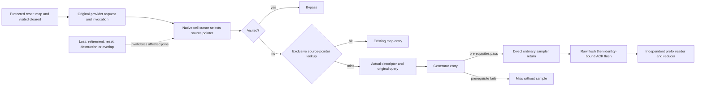

# D5X observation boundaries and evidence schema

2026-10-30, Australia/Sydney. [Architecture](d5x-architecture.md),
[ledger](d5x-investigation-ledger.md), [implementation](../../../runtime/construction-winner/observer.h).
The diagram is schematic; it has no spatial axes or map interpretation.



## Native sites and domains

All locations below are **RVAs**, relative to the actual module base. Preferred
static VAs add `0x140000000`. They apply only to the freshly reverified
1.16.244.0 EXE hash in `.local-work/d5x/identity04/identity.json`. That receipt
contains the exact displaced bytes and 32-byte guard hashes. They are not runtime
addresses and are never transferred to a different executable.

| Index | RVA | Observation / displaced length |
|---|---|---|
| 0 | `0x79f860` | Provider entry/return; first seven prologue bytes. |
| 1 | `0x79fa90` | Actual cursor load and store to provider W + `0x38`; eight bytes. |
| 2 | `0x79fca3` | Visited TEST/JNZ; nine bytes, both outcomes retained. |
| 3 | `0x79fccb` | Pointer-map lookup CALL/result, within native exclusive interval; five bytes. |
| 4 | `0x79feaf` | Provider conversion scope at converter CALL; five bytes. |
| 5 | `0x79ff18` | Generator CALL scope; six arguments, including stack arguments; five bytes. |
| 6 | `0x79b8e8` | Ordinary sampler CALL/result AL; five bytes. |
| 7–11 | `0x79ddf0`, `0x79d910`, `0x975030`, `0x9829b0`, `0x982b70` | Reset, destruction, erase, Grid clear, source retirement; lengths 5, 5, 8, 5, 5. |
| 12 | `0x79dec4` | Reset unlock CALL: map/visited already cleared under exclusive protection; five bytes. |
| 13 | `0x78d6f4` | Scoped normalizer CALL: actual engine-local descriptor and original Int2 copy; five bytes. |

Selection captures a pointer without following it. Protected lookup copies
`0x70` source bytes only under unchanged invocation epoch and no lifecycle hazard.
The scoped normalizer witness copies the engine's actual `0x2c` descriptor and
eight-byte query copy. Descriptor padding `+0x01..+0x03` is raw, not semantic.
No Grid vector, wrapper map,
geometry region or point array is traversed; no engine helper is called by the
observer to establish identity. Native originals are forwarded with unchanged
arguments and results. Observation still changes execution timing.

## Transport

Schema `sor-d5x/2` uses a 16-byte little-endian frame header: magic
`0x31505253`, payload size 312, sequence low word and payload CRC32. Validate the
header against the low 32 bits and the payload against the full 64-bit admission
sequence, including wrap of the low word. The payload
has eighteen u64 words, two signed i32 request coordinates, 112 source bytes,
44 descriptor bytes and four reserved bytes. The u64 order is:

```text
sequence kind invocation parent thread ticks epoch hazards status
proc source frame holder a b c d selection
```

`kind` is entry, selected, visited, lookup, descriptor, generating, sample,
generated, returned, fence-begin, fence-end, cold or ready, numbered 1–13.
Invocation/selection tokens are process-local monotonic observer identities;
thread IDs and native pointers are not persistent identities. Parent invocation
records nesting. Payload `frame` is the provider's working stack address W at
the selected/visited inline sites; it is zero at entry. Entry operand `a` is the
original Int2 input pointer. Effective geographic frame evidence is the captured
descriptor and converter context. A new selection starts from the original request context so a
previous source's failure cannot contaminate the next source's fields.

The four variant operands have these decisive meanings. Lookup records result,
actual native map capacity, actual source-key operand and actual decision epoch
in `a/b/c/d`; `proc` is the native owner used by the call. This decision epoch
is distinct from the invocation's entry epoch. Descriptor records master context,
engine-local descriptor pointer, copied query pointer and original descriptor
input pointer in `a/b/c/d`. Its 44 bytes are the actual engine-local copy before
normalization. Descriptor `holder` is the actual converter manager argument;
entry `holder` remains the aggregate holder. Ordinary-frame qualification requires
the original input pointer to equal that manager plus `0xc8`. The temporary
descriptor at manager plus `0x1c0` is recorded but remains frame-unqualified.
Generator records owner FormID, BIOM, geographic query pointer and
output holder. Sample records raw AL, sampler pointer and geographic query pointer.

QPC ticks use the identity receipt's frequency. Sequence is successful queue
admission order, not an engine scheduler order or elapsed gameplay time. QPC
supports same-host chronology and measured intervals; no wall-clock precision or
cross-machine ordering is inferred. The writer's 1,024-cell queue uses at most
32 reservation retries. Capacity and retry loss count separately, advance epoch
and continue acquisition. Counter exhaustion is an integrity failure.

Worker I/O occurs outside hooks. Each bounded drain snapshot writes raw frames,
flushes raw bytes, then writes and flushes a cumulative ACK binding identity
SHA-256, byte/record count and prefix CRC32. CRC detects damage; separately pinned
SHA-256 manifests bind the local original artifacts. These checks establish byte
integrity, not semantic truth or resistance to a malicious forger with write access.
An ACK known to have failed its flush is excluded using terminal acknowledged
count. Crash tails remain uncertain. STOP leaves resident inert wrappers;
hot unloading/unpatching is unsupported. Both-drive 40,000,000,000-byte guards
remain active. The transport has no total evidence-volume or session-duration cap.
`terminal_success` reports the worker's terminal verdict. `complete_session`
additionally requires undamaged framing/ACKs and finalization of every admitted
record. Neither means native observation loss was zero; loss counters and causal
coverage remain separate. The offline reader materializes its input and has not
been qualified for arbitrary evidence sizes beyond the stated controls.

## Reducer and minimum claim

For each selected source, require entry, selection, visited false, exclusive map
miss, actual descriptor, generator scope and exactly one direct low-nibble sample,
in that order. The sample's geographic pointer must equal the generator operand.
Selection and subsequent scientific boundary records must agree on invocation,
request, source, working-stack frame, ProcGen and epoch with no status failure/
hazard; entry joins original request, owner, thread, parent and epoch. Raw AL
above 15 is contradictory evidence,
not silently masked into an ordinary result. Mask 0 and Mask 3 are equally valid.

A cold certificate requires matched reset entry, protected unlock witness and
normal reset closeout for that ProcGen/epoch. Entry must follow the certificate's
protected anchor. Every prior observed miss, including an invalid one, prevents
a later miss from becoming the first in that epoch. An earlier same-source map
access also prevents later cold attribution. Loss requires a new qualified
cold certificate before a new first-construction claim. Equal source keys from
different pointers in one owner/epoch are an identity collision, not one lifetime.
Uncertain native map activity after an anchor blocks later first attribution for
that owner using the actual decision epoch. Unscoped native activity after the
anchor leaves that epoch's coverage uncertain. A clean later record alone cannot
repair either gap; acquisition continues and a fresh qualified reset can recover.

The source key uses chart at `+0x38`, coarse/sub/fine coordinates at
`+0x3c/+0x4c/+0x5c` and `+0x40/+0x50/+0x60`, and SFBK FormID at `+0x00`.
Each axis is `192 × coarse + 12 × sub + fine`. Preserve the full bytes, including
SFPT/block-slot ancestry; key equality alone does not prove allocation identity.
Generator owner FormID is recorded separately. Target labels are derived offline.

Zero-initialized request/source/descriptor storage is unavailable when its read
or context status fails; it is not an observed zero descriptor or null. Status
bits distinguish read failure, missing invocation, context mismatch, invalid
lifetime and exception. The first failing observation boundary is reported;
where one boundary has several possible failed reads, the operand-level cause
remains explicitly uncertain rather than reconstructed from initialized fields.

A complete durable prefix through the sample can qualify even if the provider
never returns. Later target survival and terminal completion remain separate.
Missing entry, selection-only, bypass, hit, missing descriptor/generator/sample,
unqualified cold state, context/lifetime failure, contradictory chain and absent
provider records all have explicit diagnostics. READY proves installed/armed
status only. Missing records never prove absent native activity.
