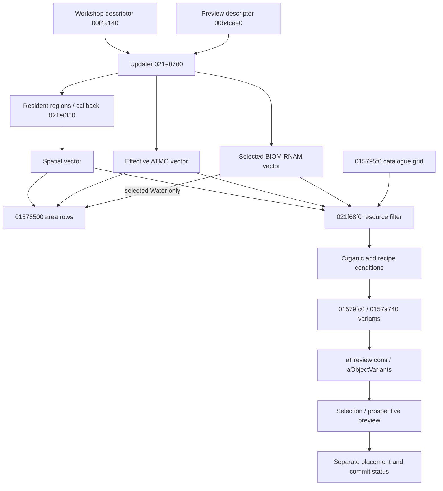

# Two UI consumers, one mutable cache

[Answer](report.md). All full native addresses here are **preferred static VAs**,
image base `0x140000000`, Starfield.exe 1.16.244.0 SHA256
`7e9adb1414a8e1b325e5e1f097b9b17b78deb7eebeda37a333351a43a60f9d28`.
RVA = static VA minus that base; future runtime VA = measured module base + RVA.
Object offsets are hex relative to the named owner; saved tokens and logical
save offsets are separate domains. `FUN_` names are analysis labels, not APIs.
Exact export hashes are in [sources.csv](sources.csv); no new DB exports/edits.

`uiNN` = `.local-work/recon/resource-availability-ui-NN.tsv`.
`bmNNN` = `.local-work/build-catalogue/native/NNN.request.tsv`.
Source registers: [availability](../native-availability-map/functions.csv),
[catalogue](../build-catalogue/functions.csv). These remain the function inventory;
this task supplies new connecting interpretation, not new function IDs.

Arrows are static calls/data reads, not a captured sequence for the screenshot.
There is no established area-row→catalogue edge in this bounded route.

| Edge / state | Decisive evidence and supported interpretation |
|---|---|
| Established Workshop→updater | ui15 `1421b26a8..26bc`, descriptor builder `140f4a140` in `workshop-origin-03.tsv`; [output paths](../native-availability-map/output-paths.md). Preview uses `1421b42d1..42e3` instead. A call-site name alone does not establish loaded P1. |
| Spatial writer | ui15 `1421e080f..0960` domain/displacement guard, `1421e09d4..0a77` manager+130/shared +40 traversal, callback call `1421e0a46`; ui16 `1421e0f50` resolves IRES and admits regions; temporary set transferred at `1421e0bf4`. No refresh on every invocation; no synchronous generation call. |
| ATMO writer | ui15 `1421e0c61..0d65`, ui16 `14076bd20/14076b950`; resolved changed atmosphere copies resources, missing/unchanged retains. |
| BIOM writer | ui15 `1421e0e44..0eff`, `14078ee90` selects spatial BIOM; changed ID clears third end at `1421e0e79`, RNAM/RSGD resource append `1421e0ec0..0ee3`; missing/unchanged retains. This is raw declaration, not generator-selected family. |
| Cached representation | Shared operation O=`145f5d2e0`, S=O+520. Spatial begin/end/cap `145f5d800/808/810`, ATMO `818/820/828`, BIOM `830/838/840`. Each 24-byte header, eight-byte pointers. S+48 XYZ, +54 index, +58 retained domain, +60/+64 last ATMO/BIOM IDs. [Output contract](../native-availability-map/output-contract.md) controls details. |
| Reset/retirement | ui15 `1421b6b50..6b73`, `1421d06f6..0719` reset ends; ui17/ui25 `1421ae2fb..e302`, `1421ae59d..e633` teardown frees backing arrays/releases domain. Reset does not necessarily zero every freshness field. ProcGen reset `14079ddf0` and destruction `14079d910` concern a different store. |
| Area typed-row input | ui08 `1415785af..85e8` passes first two ranges to `1421f8120` pointer union. `1415785ed..8641` appends only biome entries whose FormID equals selected Water at `145efb1f0`; not all biome resources. `1415787da..8803` constructs rows; growth may relocate earlier rows. |
| Actual catalogue resource filter | **bm001 `1415796f1..96fc`: RDX=RDI node, RCX=RBX category, CALL `1421f68f0`, BL=AL.** `141579707` calls organic filter, `14157970c..9716` excludes on either failure. `141579736` recipe condition then `14157975e` row builder; separate retry/unearned paths retained in full body. This confirms BM2's specialized gate; not an inferred association by address proximity. |
| Category-level eligibility | bm011 `1421f6dea` also calls `1421f68f0`, under `1421f6dc0`; tabs use qualifying-entry logic separately from selected-grid construction. |
| Filter selector and overlap | bm001/ui10 `1421f691e..6925` category equality; node/leaf/resource/property resolution through `1421f6aca`. PlaceAnywhere branch `1421f6ad0..6af1` bypasses; SkipVein chooses BIOM at `1421f6b3a`; otherwise Atmosphere chooses +818, ordinary +800 (`1421f6b43..6b54`). At `1421f6b58` RCX is chosen header, +8 is end; produced resource begin/end from frame `RBP-79/-71` at `1421f6b5f..6b63`. Pointer overlap loop `1421f6b70..6b9a`, result in SIL and ultimately EAX at `1421f6bad`. Early true paths are not overlap success. |
| Grid→compiled display | BM2 [UI](../build-catalogue/ui.md), bm001 `141579fc0`, bm002 `14157a740`; `WorkshopCategoryInfoData.aPreviewIcons` / nested `aObjectVariants`, compiled BuildPopupContainer methods 594/WorkshopUtils56. First FNAM discovery, nodes/variants and conditions remain [BM2](../build-catalogue/catalogue.md), not a new full census. |
| Selection→placement | BM2 selection callbacks→`1421bab50` NewItemEvent. AttemptBuild→`1421f4ed0`→`1421bb3d0` CommitEvent only accepted state; ordinary handlers require frame status2. [Eligibility](../build-catalogue/eligibility.md) and [placement](../spatial-placement/report.md) retain territory/collision/footprint gates. No catalogue row certifies a placement. |

The mapped UI command/event7 is queued without an immutable population snapshot.
AL from the updater means some refresh work, not which list changed, set
inequality, source generation success, or global readiness. Observe branch paths
per list. THIS_REFRESH_REPLACED describes operation-list refresh in that call;
it does **not** mean fresh region generation. A cache hit can still be useful.

The pictured catalogue is consistent with this native/compiled route, but its
selected base FormID, callback ancestry and runtime invocation were not captured.
The unresolved edge is **this catalogue evaluation↔this Workshop-bound refreshed
population interval**, not an unidentified general catalogue producer. Observe
both exact call context and per-event population copies; leave temporal ancestry
UNKNOWN unless transition coverage actually closes the gap.

Water's raw biome path differs in two consumers: area UI selects Water only;
the skip-vein gate intersects *all* declared biome resources. [F1 Water](../resource-geometry-mature-context/f1-water.md)
pins the installed terrestrial base/property case. Ordinary IL/Cu/Fe hardware
does not alone prove their current effective property selection. Effective node,
base, produced IRES and selector must be captured rather than inferred from names.
