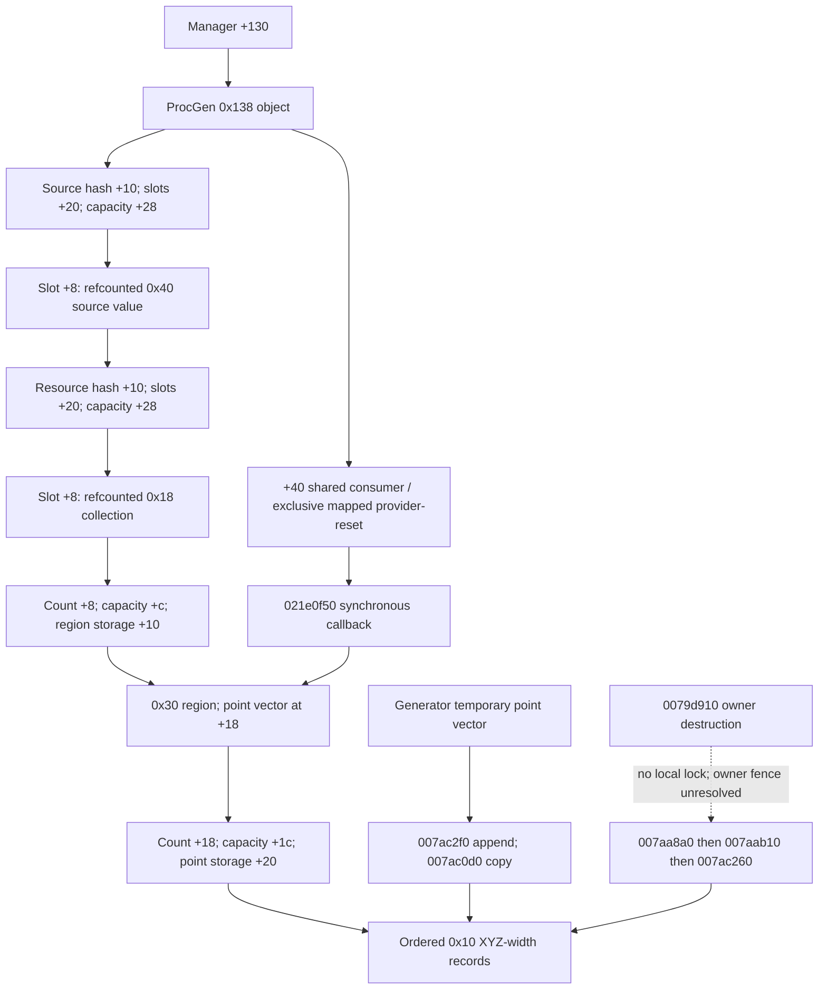

# Geometry ownership and snapshot window

[Decision](report.md), [operand map](operands.md), [pins](sources.csv).
All field offsets and addresses in this file are hexadecimal. Addresses prefixed
`0x` below are module **RVAs**, unless marked static VA. Pinned retail executable
1.16.244.0 SHA256 `7e9adb1414a8e1b325e5e1f097b9b17b78deb7eebeda37a333351a43a60f9d28`;
preferred static base `0x140000000`. Runtime base is not measured in this task.
P15/P16/P17 refer to `resource-availability-ui-15/16/17.tsv`; G1/G2/G3 to new
`geometry-lifetime-01/02/03.tsv`. All are local `.local-work/recon/` exports.

Edges express static ownership/data access, not observed runtime epochs.
Refcounts cover wrapper lifetime, not point immutability. No observer may fabricate
a version/lease field in these engine objects.

| Object / owner | Producer and layout | Consumer | Mutation / destruction | Protection and candidate window | Evidence / confidence / unresolved conditions |
|---|---|---|---|---|---|
| ProcGen, manager+130 | Manager constructor 00787830 allocates 0x138; 0079d660 initializes maps and lock | P15 021e09d4..09ed reads singleton, +130 and acquires +40 | 0079ddf0 reset; 0079d910 destructor; 0078fc90/0078f670 free wrappers; manager 00788bc0 cleanup | Shared acquire 021e09ed returns before scan; release at 021e0a7e..0a9f after callbacks. Constructor/destructor have no demonstrated concurrent-owner fence | Existing region-lifecycle ledger; event-oracle-06 full destructor. STATIC: mapped lock interval; UNKNOWN: owner epoch and external destruction exclusion. Callback holds raw pointer ancestry, not new ownership. |
| Source-map slots, ProcGen+10 | Slots +20; capacity +28; 0x18 stride; unused sentinel slot+10=ffffffff; slot key source pointer, slot+8 value | P15 021e09f8..0a77 | Provider 0079f860 miss inserts, may grow hash; reset 0079ddf0 clears; destructor 0079d910 frees map | Same +40 shared/exclusive pair excludes mapped construction/reset. No extra observer lock needed for that pair | producers-01 0079fcb3..ffa5; P15. STRONG scoped; no claim of all possible owners/writers. |
| Refcounted 0x40 source value | Provider allocates wrapper and initializes embedded resource map at +10 | P16 021e0fb3 dereferences slot value; slots source+20, capacity +28; resource key u32 resolved to IRES | 007aa8a0 decrements source refcount; final release calls 007aab10(source+10), frees 0x40 | Source-map ownership retains value against mapped locked reset. Callback does not increment it | dependencies-03 007aa8cd..aa900. STATIC. Source pointer key is distinct from wrapper pointer and source+68 visited key. |
| Refcounted 0x18 region collection, resource slot+8 | Generator 0079a330 allocates 0x18, inserts retained wrapper; count +8, capacity +c, data +10 | P16 021e102d..104c reads count and constructs end=count*0x30+data | 007ac2f0 appends; 007aabd0 retains/replaces wrapper; 007a98b0 releases; 007aab10 clears resource map | Mapped generation under provider exclusive +40, evaluation under shared +40. Generic refcount/transfer helpers have no local ProcGen lock | cont-02 complete decompilation; G1/G2. STATIC operations; UNKNOWN alias scope outside mapped caller chain. Refcount does not exclude append. |
| Region storage / collection | 007ac2f0 calls 022cc0d0 with stride 0x30 and capacity; selected destination = data+index*0x30 | P16 RBX points at current region; reject advances 0x30 | Append can change collection count/storage. 007ac260 frees every nested point buffer then region buffer using capacity*0x30 | Conditional callback interval protects against mapped producer/reset only | G1 007ac31b..34a; G2 022cc0d0 allocator dispatch; G1 007ac280..2cb. STATIC; indirect allocator implementation not a whole allocator proof. |
| Point vector embedded region+18 | u32 count +18, u32 capacity +1c, pointer +20; 0x10 point stride XYZ-width. 007ac2f0 initializes destination and calls 007ac0d0 | P16 021e1146 count; 115a..1180 pointer/end; 1180..119b XYZ and 12c1/1739 widths | 007ac0d0 copies values, may reserve/grow destination, appends missing points; 007ac260 uses +1c capacity*0x10 and frees +20 pointer | Deep copy means generator temporary free is not by itself invalidation. Full coherent snapshot still needs parent/alias protection | G2 007ac120..13f / 160..232; G1 007ac34e..39d and 007ac290..2a7. STRONG scoped ownership; no established version or independent payload lock. |
| Temporary generated point array | 0079a330 appends accepted XYZ/width through 022cc0d0, then passes a region record to 007ac2f0 | Copy helper reads full ordered count*0x10 | Generator frees local point allocation after append | Temporary and destination are distinct allocation paths; copy failure handling remains native behavior, not observer authority to repair | cont-02 complete decompilation at append and allocator cleanup; G1/G2 copy instructions. STATIC; no live allocation addresses observed. |
| Four derived quad vertices | P16 021e12fb..1349 constructs stack vertices; 1356 allocates four 0x10 entries and copies | Containment, four vertex helpers, four edge descriptors | Freed at 021e1719 on strip failure or 1769 before terminal acceptance | Must copy while active; 021e1772 is too late for borrowed quad data. Region identity RBX remains valid there until MOV executes | P16 complete body. STATIC. Quad is derivative evidence, insufficient alone for full strip reconstruction. |
| Indexed query / translation table | Closure+0 points to descriptor; +c u32 selects translation. Globals RVA 061fae80 count and 061fae88 pointer to 0xc rows | Broadphase, each strip containment, each called vertex helper and edge fallback | Writers and global-table lifetime not established by ProcGen map lock | Capture resolved values as consumed; no after-the-fact table reread. Query+10 domain is provenance, not a replacement arithmetic input | P16/P17 and operands.md. STATIC repeated reads; UNKNOWN inter-use stability. |

## Reachability and limits of the protection argument

G1 xrefs identify only one defined code caller of region append 007ac2f0:
0079aced inside generator 0079a330. That generator's defined caller is 0079c4f7
inside 0079c470. Provider owns the exclusive interval over synchronous attempted
construction. The xrefs also contain non-code/unwind metadata; they are not
additional executions and do not prove absence of indirect callers.

G2 follows remaining collection-release xrefs: 007affb0 is a resource-region
consumer retaining/releasing collections; 007ab730 and 007abc90 move resource-map
values during hash operations, with final-release paths. Moves explicitly zero
the old pointer before testing it; do not label those branches proof of an actual
payload free during rehash. 007a9650 clears a source map; its only exported xref
is metadata. 0079da80/0079dd50 concern a separate database payload path, not a
demonstrated geometry writer or a ProcGen destruction fence. G3 closes the two
remaining explicit release bodies: 007a54c0 and 007a59f0 consume a caller-supplied
collection wrapper, clear that wrapper, decrement its refcount and free the
collection only on final release (007a5711 / 007a60d5). They perform separate
resource/geometry processing; no point append is established in these bodies.
Their caller-supplied wrapper's alias relation to the evaluated source cache and
external synchronization remain unresolved. They are not declared concurrent
cache writers merely because they share a destructor specialization. G3 xrefs
also show collection replacement through 007a97c0 and resource-map growth through
007aa9b0/007ab8c0; these do not establish a separate payload lock.

The destructor is a concrete missing condition: 0079d910 calls 007aa8a0 without
first taking +40. G3 independently confirms manager cleanup at 00788d4f..d66
loads manager+130, calls that destructor, then frees the object. Earlier manager
cleanup includes virtual and other destructor calls; their complete transitively
synchronized lifetime contract is not established. This does not prove a race;
the engine may serialize owner destruction elsewhere. No mapped callback
retention or demonstrated task fence establishes that serialization here.
Extra references would be new engine mutation and still would not freeze
contents. A synthetic lease cannot resolve this native fact.

## Snapshot decision

If owner epoch and alias exclusion were established, the narrow window would be
inside the shared-lock callback after count/pointer selection, before terminal
advance/cleanup, with immediate owned copying and no worker pointer traversal.
Only broadphase-passing count>1 needs full points; other branches need qualified
consumed bounds/count. Copy count*0x10 with checked arithmetic and a finite owned
capacity, recording explicit refusal/truncation. Native u32 count supplies no
practical callback latency bound. Early acceptance may leave a native unread tail;
full capture adds those reads and may incur cold-page faults while holding +40.
No retail payload-size or cold-copy timing sample exists. Warm synthetic 8,192-point
costs from the earlier qualification do not bound this interval.

A second read can detect some changes but cannot establish no mutation/free,
restore an expired allocation or reject every ABA. A proven immutable interval
would make it unnecessary for coherence; without one it is insufficient. The
current evidence therefore establishes a conditional window, **not an approved
coherent native snapshot window**. G remains UNKNOWN.
