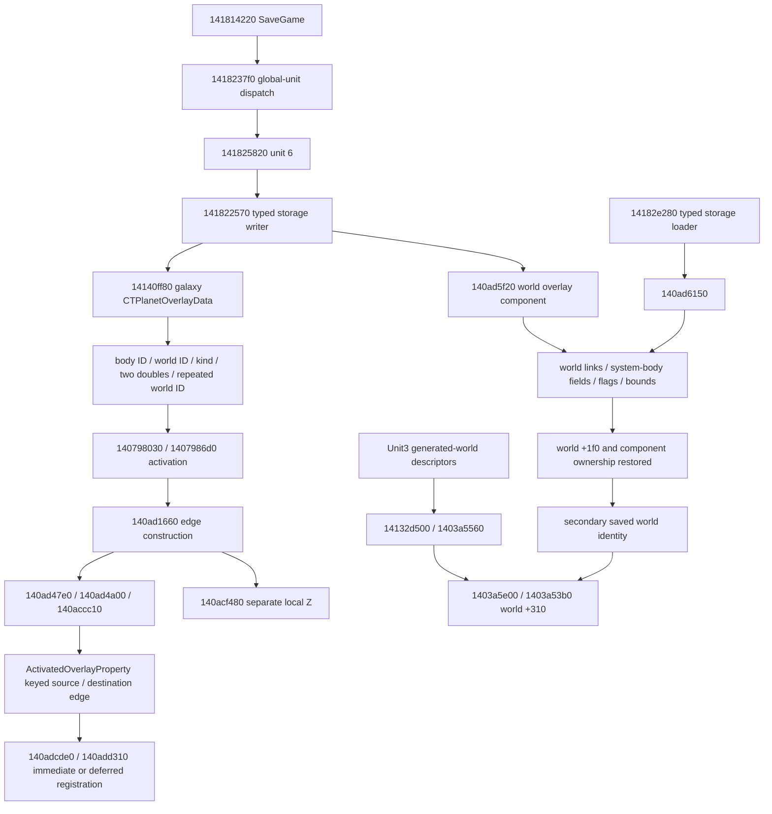
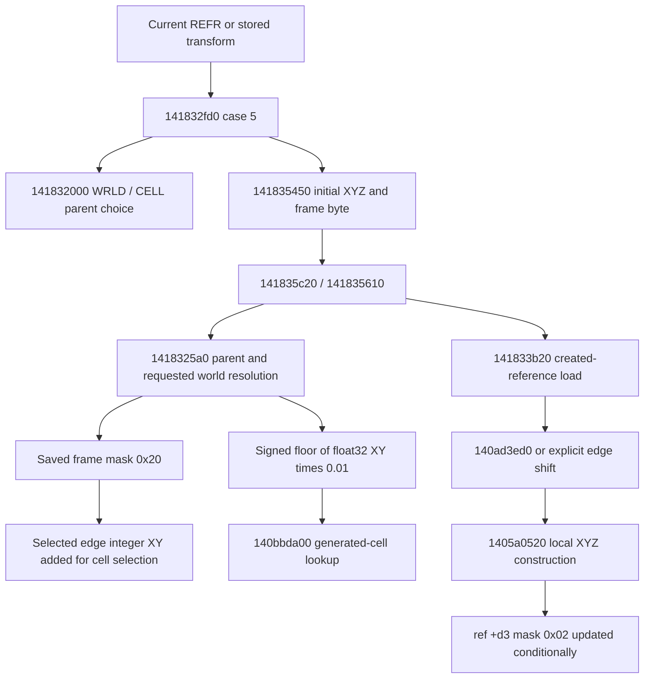

# EXP0020 — Traced save, frame and residual paths

[Continuation](../activated-overlay-static-exhaustion.md) ·
[Dependency ledger](dependency-ledger.md). Final scoped map; the ledger states
terminal dispositions and preserves earlier checkpoints.
Addresses are static VAs for pinned retail 1.16.244.0, image base `140000000`;
subtract that base for RVAs. Payload offsets refer to native objects unless
explicitly described as decoded save offsets. Raw exports remain LOCAL-ONLY.

## Persistent identity and reconstruction

The site and world component writers are explicit; the factory's optional null
metadata is not a persistence proof. The world component key is `1461dd7ec`,
the galaxy site key `1461e1d9c`, and the activated edge key `145eaac2c`.
These are separate types and must not be merged because their names contain
“world” or “overlay.” The site tuple's producer predates beacon construction.
Its wire writer copies the pair rather than calculating a beacon position.

Unit 3 separately writes active-world `+0x310`, a checksum from `140798130`,
and auxiliary lists/typed world data. Its mask `0x0c` includes a compact string
table before the length-delimited payload. Interpreting the packed active-world
value is now qualified by typed unpacker `14096fb40`: encoded X/Y are the
low two uint16 fields; tag, body index and system occupy the upper word's
low 3, next 6 and next 18 bits. `142332ea0` resolves the body and checks the
landscape identity. The four controlled samples encode the archived Kreet
origin `(1,10464,21120)` and system 88327/body 15; Save52 encodes
`(0,16992,33312)` and Jemison system 71456/body 3. This does not yet establish
which context the loader selects at every future runtime instant. The separate
descriptor array records each generated world's packed origin: body 4/key 8/ID3.
Unique typed world-component runs now join all 28 selected object parents to their
secondary descriptors, independently checked against PNDT GNAM. See the
[selected saved beacon frames](saved-center-frame.csv).

## Reference frame selection

The initial writer sets saved mask `0x20` when native `ref+0xd3` mask `0x02`
is clear. Created-reference load applies translation conditionally, based on
world/cell context and valid edges, and records whether it converted the frame.
This is not an unconditional rule that every saved `0x20` position receives the
same offset. `140ad30a0` returns the first valid containing edge in ordered key
range, with inclusive signed bounds `(xmin,xmax,ymin,ymax)`. `140ad3240` returns
the destination world and subtracts the selected integer cell shift.

The ordinary REFR conversion at virtual `+0x7f8 → 140b734c0 → 140b73310` adds
XYZ translation and changes mask `0x02`; it does not rotate local axes.
Ordinary base REFR `+0x800 → 1402b56d0` is a no-op. Actor-specific fallbacks
were separately traced and do not establish ordinary beacon behavior.

The durable saved representation uses descriptor origin for mask 20-clear and
site base for mask 20-set in the qualified active corpus. This bypasses prediction
of a future live edge's loading epoch. Origin-relative SOR-003 XY
(356.820404,2459.058594) gives cell offset(3,24) from(10464,21120);
site-relative negative-X84ede9 gives(-1,0) from(13152,45120). These use the same
signed-floor/100-unit rule with different saved bases, without per-site fitting.
Disabled mask 10 examples are retained without an active direct-site prediction.

## Terrain rebasing

`14078c5f0` compares player displacement with the threshold, computes integer
cell displacement and calls `14078c060` to queue `ShiftToTask`. Its recovered
virtual dispatch reaches `14078ce00 → 14078c190`, listener `+0x50/+0x58`, then
`14078c290` completes the transition. Mode 3 preserves the old origin/pair in
`+0x1c0/+0x1a8`; indexed displacement lives at `+0x1a0/+0x1a4`.

The traced ordinary trigger explicitly zeros `+0x1ec/+0x1f0/+0x1f4`.
`140797dc0` has a separate guarded nonzero branch through `140ad9cd0` that changes
edge shifts/bounds. A literal field census does not prove that overlapping or
indirect stores cannot supply those values. A whole-program alias proof is not
needed for the recorded saved center: none of these future runtime fields enters
the descriptor/site/saved-frame calculation. This is an explicit relevance
exclusion, not a claim that every alias was traced.
Immediate and queued reference moves (`140b4a0b0` / `1418c28b0`) carry the same
12-byte translation into reference virtual conversion.

For an unspecified later runtime instant, selected edge validity, terrain height
and rebase epoch are not unique save-derived values. `1407896d0` compares the
already resident world to choose reuse/reset; activation and cleanup change the
edge store. `140ada3a0` requires the current component source and edge+35 validity,
returning 100×edge XY and edge+30 Z when valid. A settled checkpoint observation
of world/cell IDs, edge key/validity/XY/Z, manager mode/old/current origins and own
XYZ would distinguish live alternatives. This proposed separate capture is not
authorized here. Changing loaded frames does not choose a continuous embedding.

## Fractional position producers and consumers

| Input / producer | Traced consumer | Supported conclusion |
|---|---|---|
| Current beacon XYZ + workshop float32 compensation | Durable center sum `f32(f32(P)+f32(delta))` | Save25/26 center bits agree despite changed beacon XYZ. |
| `14077fc20` local placement split | State `+0x20/+0x24/+0x28`; terrain/player/cell transfer callers | Fractional XYZ survives local placement, while the returned pair is requantized. |
| `14078d1f0` reference XYZ | `14078d660 → 142332410` | Floors float32 XY×0.01, adds indexed origin, projects the cell center; Z/fractions do not enter the pair. |
| `1407bcfb0` active player XYZ | Body-oriented point and celestial consumers | Floors XY before spherical direction/orientation/scale; not arbitrary-reference subcell ground truth. |
| ExtraLocation `0x81` pair | `140910690`, generic writer `14051ea30` case `0x81` | Cache may return directly; writer copies bits. It is not automatically exact center geography. |
| `14096f1a0` coarse candidate enumeration | `1418bb8d0 → 1418ab600 → 1418af8e0 → 140769e90` | Pair is generated/classified before content-reference creation; independent of new beacon fractions. |
| SurfaceMap local samples | `14076d500 → 14078d660 → 142332410` | Dense sampling still floors to integer planetary cells. |
| Fractional local XY | `14099ff50 → 1409a0f20 / 1409a02b0` | Bilinear local height interpolation produces a scalar Z, not a planetary direction. |
| Pattern/subdivision placement | `14096be70 / 14096bba0` asset lookup/reflection | Installed footprint orientation is distinct from a fractional planetary chart. |

The formerly open helper callbacks and additional pair-to-local caller are closed
in the [residual map](residual-map.md). The terminal blocker is a non-unique
off-grid embedding under recovered constraints, separate from an unspecified
future loaded terrain frame. Exact saved center bits, identity and selected
indexed coordinates remain reconstructed results. Continuous geographical
accuracy is not inferred from center invariance.
