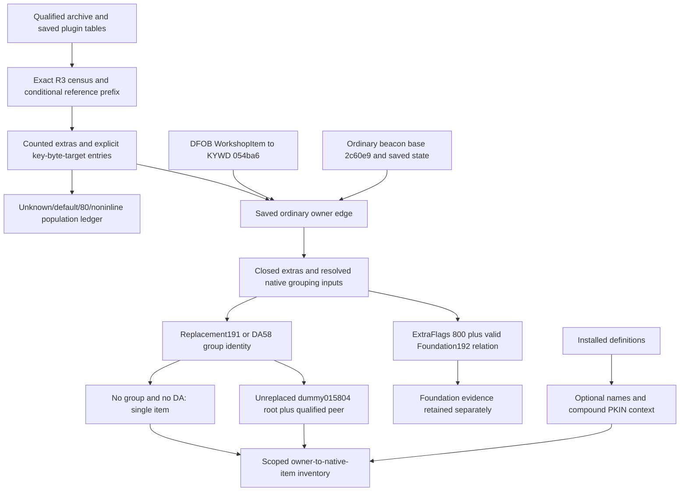

# Evidence and capability dependencies

All native VAs below use preferred image base `0x140000000`, pinned executable
SHA256 `7e9adb1414a8e1b325e5e1f097b9b17b78deb7eebeda37a333351a43a60f9d28`.
No build/address transfer or callable integration point is implied.

| Dependency | Exact static evidence and scientific limit |
|---|---|
| Workshop key | DFOB054bb8 DATA→KYWD054ba6; initializer 140157770 resolves default object 145f0b390+48→145f0b3d8. GetWorkshop 142073cf0 passes that key to 140517d60. |
| Saved entry grammar | Dispatcher 140521620→140547c90→140562ef0: counted keyword, one mode byte, target. Mode 0 becomes handle; mode 1 retains FormID. These are queued fields, not adjacent-token heuristics. |
| Construction/deletion | 1421dd600 call 1421dd641 applies key through 140f3cf40→140ba0d40 during construction. 1421de660 is deletion (`UIOutpostModeMenuDelete`); its clear operation is not construction evidence. |
| Getter boundary | 140517d60 checks Extra80 before 4C. 140547d80 resolves raw FormID or handle. A saved direct edge is not the final loaded getter if80/defaults intervene. Foundation 140f5f2d0 explicitly calls getter 192 with argument 1. |
| Extra uniqueness/order | Saver 14051ea30 uses type bitset14051ed23–ed64, emits linked-list order. Insertion 140500fd0 prepends only 0B/0D/29. DA/9C/80 can follow4C. The reader rejects duplicate types and does not infer absence at first 4C. |
| Foundation filter | 1421c71b0 calls 140f5f2d0: ExtraFlags9C bit 800 AND a resolving 192 relation. Saved form flags 800 is a different disabled bit. Missing flags/targets/80 precedence remain unresolved. |
| Group identity | 140f366c0 uses 191 replacement if present, then effective dummy self ID, otherwise DA+58. No geometric or name join. |
| Reverse membership | 140f42df0→140f44c00 enumerates reverse 4D edges with matching keyword, computes each effective groupID, compares exact requested ID. Saved forward 4C subset corroborates group peers, not every default/inherited reverse member. |
| Native item representative | 1421c71b0: group count<2 uses Single/Wire path; >=2→1421cbac0.1421cb740 selects dummy base 145ea8b00 without 191. Default initializer 1400977a0 resolves DFOB017cdb→STAT 015804. 1421cbac0 copies DA+40 PKIN and sets root through virtual+C0→140f661e0. |
| Item/member distinction | Single root 140f60db0 reads+50; PackIn root 140f686f0 reads+e0, member range 140f65fa0 uses+50/+58. Constructor 140f5b8f0 initially invalidates root. 140f5b260 is construction, distinct from existing-reference rebuild. |
| Alternate 80 |14054b1e0 parses base+u32 group object ID. 140cf72d0 hashes that ID into PKIN metadata and checks ID equality; it is not a flat array ordinal. Keyword/default runtime metadata can own members absent from saved explicit 4C. |
| Component envelope |141833b20→14181cff0→1418663f0→141867470 precedes generic self/flags 1405dfa40. Conditional flag 4 payload consumes queued references/strings before self. |

Primary local artifacts: native01–26 TSVs in `.local-work/workshop-inventory/`,
plus credited earlier `.local-work/recon/` exports; exact hashes in sources.csv.
The report separates direct fields, static contracts, controlled corroboration
and unresolved loaded behavior. No proprietary instruction/decompiler dumps are
included in authored repository material.

Future capabilities, separately briefed: resolve alternate 80/default/group metadata
and inherited bases, qualify reverse 4D reconstruction and omission semantics,
then compare an independent native Workshop item census. A loaded census requires
its own allowed actions, save protection, finite scope, flush/recovery policy and
review; none is authorized here. Category/recipe labeling may decorate the
unfiltered root inventory later. Container/display contents require separate
stack/display ownership semantics and must not create extra construction rows.
Operating state, deposits, power, output/cargo links and rates remain separate.
