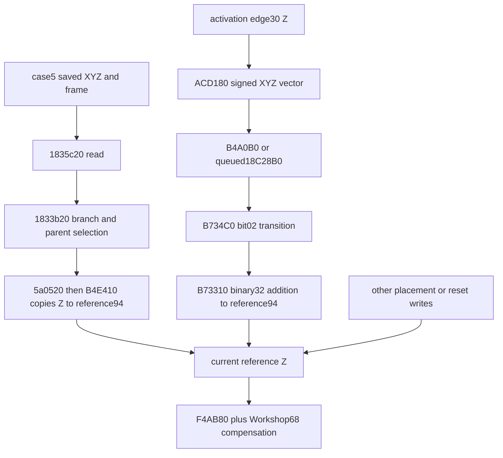

# Native Workshop Z restoration

2026-10-13, Australia/Sydney. SOR-EXP-0031 / SOR-EV-0039 continuation.
[Authorized brief](../../implementation-briefs/CODEX_BRIEF_SOR_native_workshop_Z_restoration_external_research.md).
Authored interpretation REVIEW-REQUIRED; proprietary exports, saves, memory and
private audit receipts remain LOCAL-ONLY. [Review package](review.md).

| Element | Result |
|---|---|
| Question | Why do Save25/26 center Z and fresh ordinary Workshop center Z differ? |
| Best-supported answer | **B — COMPLETE EVIDENCE-BOUND NEGATIVE**, scoped to the retained observations and identified native restoration/conversion mechanisms. The actual position writer is recoverable, but its event history and selected vertical operands are not. Saved `0x0b` bypasses the created-load edge additions; ordinary later conversion and replacement writes remain distinguishable causes that the retained bytes cannot select. No exact saved-to-observed Z formula is validated. |
| Confidence | PROVEN STATIC/SAVE/RUNTIME for the cited operations and sampled bytes; CROSS-VALIDATED identity/field joins within the qualified corpus. Causal attribution of the two differences remains OPEN. Independent reviewer ACCEPT; maintainer integration remains pending. |
| Coverage | Two geometries, forty repeated native operations in one Save25 return producer; fresh five-save audit /25 beacon fields, including relocation and mature frame variants. Twenty-three frozen predictions unchanged. No Save26 load occurred in 0.5.0. |
| Evidence | [Per-Workshop ledger](comparisons.csv), [saved fields](saved-fields.csv), [dependency ledger](dependencies.md), [public research](external-research.md), [native/source hashes](sources.csv), ignored task receipts described below. |
| Limits | No recorded reference+d3, actual restored own-parent, selected edge Z/validity at its producing invocation, or last position-writer history. No universal whole-program alias or all reference subclasses claim. |
| Next step | The [ranked acquisition design](acquisition.md) observes the actual ordinary position conversion and its signed vector with reference/frame identity. Design only; no observer or live action authorized or implemented. |

## Exact comparison and identity

All static VAs refer to retail 1.16.244.0, preferred image base `140000000`,
SHA256 `7e9adb1414a8e1b325e5e1f097b9b17b78deb7eebeda37a333351a43a60f9d28`.
RVA = static VA minus that base. Runtime VAs in the CSV belong solely to
PID 17008, creation FILETIME 134363351123063612, module base `7ff7a4950000`.
Save offsets are decompressed-stream offsets, never compressed-file offsets.
Hex float words below are four serialized little-endian bytes.

| Workshop / genuine native operation | Native reference/center Z bits and value | Save25/26 compensated Z bits and value | Diagnostic saved minus native |
|---|---|---|---|
| SOR-002 / sequence 96, callback 49, raw file 1687960 | `54296940` /3.6431474685668945 | `efd19241` /18.352506637573242 | +14.709359169006348 |
| SOR-003 / sequence 112, callback 55, raw file 1972248 | `404318c1` /-9.51641845703125 | `7220ffc1` /-31.89084243774414 | -22.37442398071289 |

The stable Workshop IDs are `f1517de43e171745` and `0efca066ee4c7b9b`.
Ordinary base 002C60E9, Kreet body 0003F59F and those captured identifiers qualify
the comparison; no raw saved-token-to-FormID equation is assumed. Save25 tokens
822821/84b985 become Save26 tokens 81ab50/81ab8f. The prior name association and
relocation control distinguish the identities. Every comparison CSV row records
its saved reference, parent, source key, record/field offsets, compensation,
native pointer/FormID and whether the save was actually loaded.

Both zero-compensation native outputs equal reference+94 exactly. For Save26
SOR-003, reference Z is `37db0cc2` (-35.21407699584961), compensation Z
`e0af5440` (+3.3232345581054688); their separately rounded sum remains
`7220ffc1`. This is the earlier moved-beacon control, not a second 0.5.0 native
geometry or observed Save26 load. Twenty repeats per identity establish stable
sampled outputs, not twenty independent restoration trials.

The query source-world key `02b20e79528028e0` and actual Q/E/callback descriptor
chain are reverified for all 40 cases. They qualify the **2D query source frame**.
The requested site worlds, enumeration cells and direct reference+b0 fields are
different joins; both direct fields are zero. The selected own-parent and vertical
frame remain UNKNOWN. Matching that key cannot fill the missing reference flag.

## Saved fields and the first live write

The framed case 5 initial body contains a shape byte, 12 XYZ bytes, optional
rotation words and a frame byte (or compact frame shorthand). Parent/base/self
identities are separate queued references. `141835450` writes the 12 bytes;
`141835c20` reads them at `141835c6e–c7d`, reconstructing frame shorthand at
`141835cd5–cff`. The frame mask 20 derives inversely from ref+d3 mask 02 in
`141832fd0` case 5 (`1418334fc–506`). It records save-time state, not capture-time
state or an equation between the two bytes' other bits.

Fresh decoding rechecks original/decoded hashes and all selected field bytes in
Save25, Save26, S1, S1C and mature HIST-0267 (Save52). The two controlled centers
are invariant across relocation; S1/S1C agree. Mature `0x2b` and disabled rows
are retained as distinct branches, not borrowed native holdouts. The site-angle
pair, typed world-component/secondary descriptor and beacon Z are distinct saved
data. Neither the angle nor the packed grid key serializes the future selected
height/activation epoch. Earlier [typed save/frame work](../static-exhaustion/call-and-dataflow.md)
supplies those independently qualified parent joins.

`141833b20` first calls the initial reader and parent/world/cell selector
`1418325a0`. Its created-reference case tests saved 20 at `141833c9f–cb0`.
For actual `0x0b`, it jumps past **both** the cell conversion
(`141833d4f–d7c`) and explicit component-edge fallback (`141833ee1–fff7`).
It constructs the reference through `1405a0520`; at `1405a14d3–da` that routine
passes input-structure+10 XYZ to `140b4e410`. The setter copies the supplied
Z to reference+94 at `140b4e4a5–ab`, with no terrain arithmetic. Thus this is
the precise point at which the restored argument becomes current reference Z.
It does **not** prove that it is the last write before the later Workshop call.

For saved 20-set, the first branch obtains XY cell displacement and Z through
`140ad3ed0 →140ad3240 →140ada240`; ADA240 chooses a typed world-component edge
and returns edge+30, or zero on absence/invalidity. The alternative explicit
lookup in the loader obtains another keyed edge+30 and performs VADDSS. Those
are separately qualified selections, not necessarily the later ADA3A0 selection.
The initial loader rewrites d3 only for saved 20-set at `1418342b1–cb`.

## Later frame conversion, height production and center consumption

The native mechanism capable of altering reference Z after that write is concrete:

`140b734c0` compares old d3 mask 02 with the requested bit, skips when equal,
otherwise calls `140b73310` with the **already signed** translation. B73310 adds
XYZ with scalar binary32 arithmetic; `140b7334b–66` writes Z. B734C0 then changes
only mask 02. `140acd180` constructs XYZ from 100×edge integer XY and edge+30 Z
at `140acd1db–202`; it collects references and uses immediate `140b4a0b0` or
queued `1418c28b0`, both reaching ordinary virtual+7f8. This is an actual
edge→reference-write dependency. A queue may make construction and application
epochs different. It was not instrumented in the preserved capture.

`141856d10` is a **preparation-output** transformation: it tests world kind,
reference+d3 mask 02, ADA760 status/validity and ADA3A0 selection, then subtracts
XYZ at `141857055–80`. It writes its output structure, not reference+94.
Finding that subtraction cannot prove the sampled reference took a corresponding
conversion. The query/grid translation is XY only; its third sampled word is
adjacent candidate-pointer data, as the [preserved correction](../ship-relocation-050/z-frame-followup.md)
demonstrates. It is excluded from every vertical formula here.

The edge height itself has identified producers. `140ad1660` derives bounds,
calls `140acf480` at `140ad1984`, and stores its result in the payload's Z.
ACF480 combines selected sample statistics/height mode, signed definition
offset (+6e), runtime fallback/configuration and optional local neighborhood
adjustment. `140ace740` obtains terrain samples through `140848660` and local
overlay samples through `140ace640`. ACE640 scales a selected uint16 array value
between component+48/+4c; `14084f2a0` selects cached terrain data and a fallback;
`140975e00` conditions its adjustment on actual nearby resident-cell state.
The [ledger](dependencies.md) distinguishes these operands and their consumers.
They are not raw beacon height-above-ground or planetary elevation definitions.
Their selected component, samples, height modes and call-time state are absent.
Asset decoding cannot choose these missing invocation-specific inputs.

Mask 02 is an operational frame/registration marker, **not an unconditional
certificate that a height translation occurred**. The additional writer census
finds constructor/reset, plugin DATA load, replacement/move, registration and
placement families. In particular `1417e2180` can set it after registration or
early exit without directly changing reference Z. [Writer classification](dependencies.md)
preserves these alternatives; no claim of an all-program alias proof follows
from a literal-displacement instruction census.

`140f4ab80` finally copies current reference XYZ and conditionally adds concrete
Workshop::ExtraData+60/+64/+68. Zero bypass preserves the reference bits. There
is no subsequent Z transform before the captured center output; the grid consumer
uses XY. Workshop compensation is a persisted displacement in the center's local
Cartesian arithmetic contract, not a newly invented frame-origin term. Its own
relocation writer/saver/loader and reset counterexample remain in the
[persistence report](../workshop-origin-beacon-relocation-persistence.md).

## Tested hypotheses and identifiability

| Hypothesis | Actual test and result |
|---|---|
| Saved Z equals native Z, or simple sign reversal | Exact two-word comparisons FAIL for both geometries. |
| Common additive Z shift | Opposite signed required additions reject one constant for these two geometries in the same query producer (non-atomic captures). This does not reject per-site height transformations. |
| Inherited 8× or 1/8 scale | Binary32 numeric comparisons FAIL for both saved center values; public BTD scaling also lacks a validated restoration join. No inference about arbitrary terrain encodings. |
| Compensation/return-buffer error | All 40 raw ref XYZ equal actual center output; compensation is zero. Rejected within sampled coverage. |
| Created-load edge addition explains saved 0b | Explicit mask 20 branch bypass rejects this as the sole transformation for these saved inputs. Later conversion survives. |
| Flag 02 always implies Z addition | Metadata/registration writers supply counterexamples to that implication. |
| XY source-key match proves XYZ | Distinct reference/world/vertical producer dependencies reject this inference. |
| Selected per-site edge translation explains native Z | Mechanism exists; event flag, signed vector, edge identity/height and call history are not observed. UNKNOWN, not falsified or validated. |
| Placement/replacement writer explains native Z | Raw setter and other applicable writer families exist; producing invocation/input absent. UNKNOWN. |

Both diagnostics `f32(native + f32(saved-native))` and
`f32(saved - f32(saved-native))` reproduce the listed numbers. That proves only
arithmetic compatibility of **differences calculated from the outputs**. It does
not measure edge+30. Replacing a fitted per-site offset with a fitted height label
would not add evidence. Even complete static code cannot recover which unrecorded
write executed or its input merely from its final four bytes: direct replacement
and one or more frame additions are observationally indistinguishable here.

This stopping point is an information boundary, not the next untraced callee:
save fields and construction setter are identified; frame/height producers,
selection, ordinary write and final consumer are traced; alternative writer
families and public leads are evaluated. The capture interval audit demonstrates
that the first discriminating flag and producing arguments were never recorded.
Tracing asset decompression or arbitrary actor/physics callees cannot supply that
missing invocation identity/history. No universal impossibility of future
offline evidence is claimed: an independently preserved load/conversion trace
with these operands would reopen the result.

## Executable contract and validation

[Isolated diagnostic](../../../save-analysis/scripts/workshop_z_diagnostic.py)
leaves previous positioning code and 23 expected predictions unchanged. It
implements the grounded scalar center, pre-construction mask 20 bypass/addition,
preparation subtraction and ordinary bit-transition addition. All require
caller-qualified inputs and finite normal/zero binary32 round-to-nearest values.
Missing branch state/height returns `UNKNOWN`; the complete saved-to-observed
operation deliberately remains `UNKNOWN`. It is a research diagnostic, not a
production dump/importer/mod or safe integration API.

[Tests](../../../save-analysis/scripts/test_workshop_z_diagnostic.py) distinguish
genuine native zero-compensation centers, the earlier independent relocation
control, and **synthetic** saved/loaded flag variants, same-state bypass,
missing-input refusal, signed zero, tie rounding/order and unsupported floats.
Synthetic restoration cases validate arithmetic/branch contracts only; there is
no genuine native positive fixture for an observed restoration invocation.
The original positioning test suites are rerun separately. Receipts retain exact
commands, outputs and source hashes; passing tests do not turn B into A.

## Execution, preservation and provenance

Offline authorized reads/exports only; no game launch/process access, debugger,
deployment, save/config/analysis edits, third-party execution from consulted
sources, staging, commit, push or external disclosure. Existing installed
Ghidra 12.1.2/JDK 21 and CPython 3.14.3/stdlib plus project-owned readers were used.
Both drives passed the 40,000,000,000-byte caller-available guard before substantial
processing. Save scratch was temporary; ignored native and audit derivatives remain.

Local task directory `.local-work/workshop-z-restoration/` retains baseline,
capture-recheck, saved-audit, uncapped native instructions, scalar/test receipts,
preservation and package manifests. Source ledger pins selected exports, logs,
inputs and derivatives. The prior 60-file seal and 41 source pins are rechecked;
all 23 frozen predictions and their inputs retain their published hashes.
The capture recheck reuses the project-owned prior audit with only new output
paths; fresh save reads independently recheck selected framing/field bytes.

Failures/corrections are retained: Windows `python` alias was inaccessible, so
the pinned CPython path was used; one Ghidra export failed on the concurrent
read-only project lock and was retried after completion; optional vtable lookups
initially treated slot 144b967b8 as a table base. Correct base 144b95fb8 and concrete
slots were then verified. Wrong lookup results were not used as REFR evidence.
The original reader capped instruction excerpts; uncapped project-owned exports
supplement those sections. The 169-hit d3 census covers textual displacement
matches in 14,392,060 existing instructions, not aliases/overlapping stores or
unknown functions. No fault/search failure is used as scientific negative proof.

Public findings and URLs/revision limits are recorded separately by the specialist
in [external research](external-research.md). Public declarations corroborate
layout but do not name the flag's bit semantics; stale offset comments and
uncertain terrain scaling changed lead evaluation. Native evidence supplies the
actual scalar contracts. Bethesda, the maintainer's captures, prior project
methods, Ghidra/CPython tools and consulted SFSE/CommonLibSF/xEdit/fo76utils work
are credited in [sources](../../SOURCES.md) and [credits](../../../CREDITS.md).
No outside implementation or licence basis was adopted.

The first scalar draft passed seven fixtures but incorrectly used compensation Z alone to choose zero-copy. Native F4AB80 checks all three components. A new mixed X-nonzero/Z-zero signed-zero counterexample exposed that omission: the draft would preserve -0, while native addition yields +0. The corrected diagnostic requires the complete vector and retains that negative fixture. Actual 050 all-zero and earlier moved-vector comparisons are unchanged. This implementer-caught correction is not attributed to the independent reviewer.
