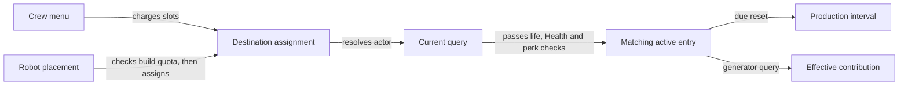

# Crew and robots

Assign people through the Crew menu. Build robots at the outpost and the
ordinary placement script assigns them there. Both can appear in the outpost's
crew count, but the menu charges human slots and Build Mode limits robot
constructions separately. A listed actor affects production or power only
when the relevant query can use that actor's current perk entries.

[Technical reference](../reference/crew-and-robots.md) ·
[Crew capacity study](../experiments/crew/report.md) and [review](../experiments/crew/review.md) ·
[Contribution study](../experiments/crew-lifecycle/report.md) and [review](../experiments/crew-lifecycle/review.md) ·
[Robot study](../experiments/robots/report.md) and [review](../experiments/robots/review.md)

## Make room for people and robots

Crew Stations add slot capacity to the beacon. The ordinary menu admits a new
assignment if the charged slots fit both the destination's effective capacity
and the player's command allowance. A sampled station assembly contributes
two slots. Player Ship Command starts from an ordinary allowance of three and
raises it to four, five, six or eight at the respective ranks. A station's
construction allowance is separate from its slot contribution.
[Capacity and assembly evidence](../experiments/crew/capacity.md)

The eight ordinary robots share a construction allowance of three per outpost,
ordinarily six with the player Outpost Management rank 2 increase. Their
placement script normally makes their human slot cost zero and disables
ordinary menu reassignment. A robot can lose its bonus while its construction
still occupies that allowance. See how [construction counts representatives](construction.md)
and how [Workshop membership identifies the destination](identity.md).

## Match the skill to the device

For ordinary crew, **Outpost Management** can shorten matching resource
production intervals. **Outpost Engineering** applies to manufactured
products. A displayed crew Geology skill has no native effect entries on this
path. Ship Aneutronic Fusion affects a ship reactor through its own ability.
Model A03 has a different perk with the same name that can add to the effective
contribution of each qualifying outpost generator.
[Crew skill study](../experiments/crew-skills/report.md) and [review](../experiments/crew-skills/review.md)

Garden helps qualifying organic production, Sanitation qualifying inorganic
production, Model A01 manufacturing and Model A02 matching ordinary production
families. Model A03 supplies the generator bonus. Security minibot, Model S01
and Model A04 have no demonstrated ordinary production timing or generator
bonus. Those five positive perk cases were the scope of the earlier catalogue.
[Full catalogue and effects](../experiments/robots/effects.md)

The ordinary timing and power paths share assignment and eligibility checks.
The arrows describe successful branches. Missing actors or entries can stop
the query even when the roster still shows an assignment. The underlying
paths are described in the [contribution study](../experiments/crew-lifecycle/native.md#assignment-to-a-real-query).

## Expect the effect at the relevant update

For example, eligible rank 3 Management from Lin and rank 3 Engineering from
Heller multiply a qualifying manufacturing interval by `0.87 × 0.77 = 0.6699`
before other modifiers. Heller's Engineering gives no inorganic timing bonus.
An existing countdown can retain its old interval until the next due reset.
Actual output also depends on power, ingredients and a receiver that can
accept it. Two eligible Model A03 robots predict `20 + 3 + 3 = 26` contribution
on a base-20 generator with no other modifiers. Fuel and allocation still
decide whether devices receive power.
[Timing examples](../experiments/crew-lifecycle/examples.md) ·
[Generator example](../experiments/robots/effects.md) · [Power](power.md) ·
[Fabrication](fabrication.md)

Assignment can precede travel. The mapped timing and power consumers have no
arrival or loaded-3D test. They still need a resolvable actor, acceptable
life state, positive Health and ready entries. A save can preserve assignment
and rank or template inputs. The game rebuilds handles and entries under
separate conditions on load. Those saved facts leave historical participation
and realized output open. The mechanism is scoped to the studied 1.16.244.0
paths and supported saved samples.
[Saved inputs](../experiments/crew-lifecycle/persistence.md) ·
[Process-storage counterexample](../experiments/crew-lifecycle/native.md#entry-storage-loss-and-return)
