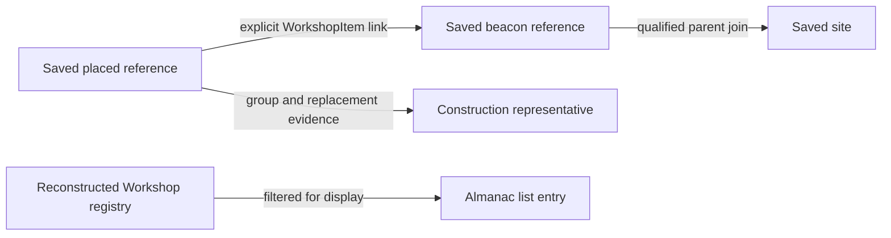

# Outpost identity and membership

**Which outpost does a placed object belong to?** For an ordinary saved
construction, follow its explicit Workshop owner link to the beacon reference.
Then identify the construction that reference represents. A single container
can be a construction by itself. A hab or beacon assembly can have several
saved references but only one construction representative. Two outposts on
the same body, even in one continuous landing area, keep separate owner links.
[Saved ownership and construction controls](../experiments/workshop-membership/report.md).

## Follow the owner, then count the construction

In the controlled Kreet beacon-only save, seven members of a [PackIn](../reference/glossary.md#packin), a compound-object
template, and a generated foundation describe one construction. Adding storage yields two construction
roots. Adding an extractor and solar generator brings the count to four.
The owner links, group and foundation relationships explain the difference
between saved references and construction roots. The presence of a template
in a PackIn definition does not establish that its instance was saved.
[Controlled actions and comparison saves](../experiments/workshop-membership/validation.md).

Conceptual relationship diagram. The owner link, physical representative,
site association and filtered UI path answer different questions. The registry
branch is shown separately because a saved owner link does not establish
registration. [Owner mechanism](../experiments/workshop-membership/report.md) ·
[Registry trace](../experiments/active-outpost-identification.md#independent-native-membership-route-and-exact-obstruction).

## What survives and what you can count

The ordinary owner relationship and the placed reference identities are
serialized. The loaded owner lookup can use alternate metadata and defaults.
The Almanac list filters a runtime registry and supplies UI entries. A beacon
base, a clear saved disabled bit and a UI entry each provide evidence about a
different state. In particular, alternate faction beacon records can omit both
the inline base and saved flags, and quest control remains unresolved for the
historical witness. [Alternate-reference and active membership limits](../experiments/active-outpost-membership-completion.md).

The Starfield 1.16.244.0 reconstruction supports **848 physical
construction roots** in the archived Save52 sample. The separate 17-site
survey covers the maintainer-qualified active ordinary population in that
save. It excludes two saved-disabled historical beacons and keeps the quest
diagnostic separate. Some retained hab assemblies have a demonstrable location
association with historical beacons, while their construction origin and
ordinary Workshop owner remain unresolved. Neither count closes that gap.
[Population correction and independent review](../experiments/workshop-population/review.md) ·
[Active-site survey scope](../experiments/resource-retained-population/d5at-active-associations.md).

To reproduce the **tracked owner-table total**, or challenge the retained-hab
interpretation, start with the [identity reference](../reference/identity.md).
For the beacon's saved site, see [position](position.md). For why one
construction can consume several units of budget, see [construction](construction.md).
An extractor's owner link alone does not establish its [production state](inorganic-production.md).
Exact original root verification uses the three named CORE saves, the
Workshop context supplement and the pinned main definitions.
[Reader access](../reference/evidence-access.md#selected-original-witnesses).

The same Workshop can have separate [crew assignments](crew-and-robots.md)
and [Locations entries](locations-ui.md).
