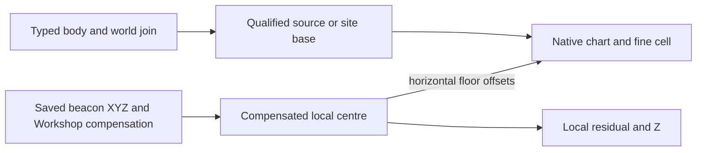

# Planetary location and position

**Can a saved outpost be located again?** For a qualified ordinary outpost,
you can identify the body and reconstruct a geographic terrain cell with
local detail. On Kreet, the saved beacon near the Lab in Save39 reconstructs
to chart 0, cell (14314, 12779). This is useful regional geography. Exact
continuous beacon longitude/latitude, planetary altitude and the currently
loaded XYZ require additional evidence.
[Coordinate controls](../experiments/coordinate-sufficiency/report.md) ·
[Independent review](../experiments/coordinate-sufficiency/review.md).

## From body to occupied cell

A planetary body identifies the surface. A worldspace provides an engine
context on that surface. One body can contain multiple saved sites, with
different parent worlds, beacon references and Workshop identities. A saved
site can carry an angular anchor and link to a generated-world descriptor.
The beacon also has local XYZ. An ordinary Workshop's saved compensation
vector can preserve the centre while the beacon moves. Save25/26 shows
exact centre invariance across one such move.
[Position model](../position-model/specification.md) · [Identity guide](identity.md).

Conceptual saved-frame derivation. The source-based frame uses the descriptor
origin. The site-based frame needs an independently qualified site cell.
The arrows do not map to the current loaded terrain manager or to a resource
generator's source-relative seed basis. [Frame contract](../position-model/specification.md#ordered-transformations).

## Why the frame matters

A fine cell is a discrete address in a chart with 49,152 positions per axis
under the tested settings. A step corresponds to approximately 100 native
local units in the lookup model. On the held-out Kreet beacon, the source
origin is (14304, 12768) and the horizontal offsets are (10, 11). In a mature
site-based sample, a negative X offset instead selects 13151, one cell below
the saved anchor at 13152. Using the source origin for that frame would give
a different answer. [Qualified conversion and counterexample](../experiments/coordinate-sufficiency/report.md#quantitative-sufficiency-and-actual-limits).

The installed terrain dependencies support recovering the same addressed
region under the same ordered definitions and terrain settings. Fresh-character
recreation and landing UI precision were unmeasured. Incidental content has a
separate seed path. Runtime sampling on Kreet verified parts of the horizontal
lookup with matched operands. The same result does not establish loaded XYZ
across caller frames, transitions, or other worlds.
[Repeatability](../experiments/coordinate-sufficiency/repeatability.md) ·
[Native comparison limits](../position-model/capabilities.md).

Use the [position reference](../reference/position.md) to repeat the Save39
cell arithmetic and find the runtime counterexample. Follow the address into
[nominal biomes](nominal-biomes.md) for discrete biome lookup, or
[resource generation](resource-generation.md) for the separate source and
generation frames.
