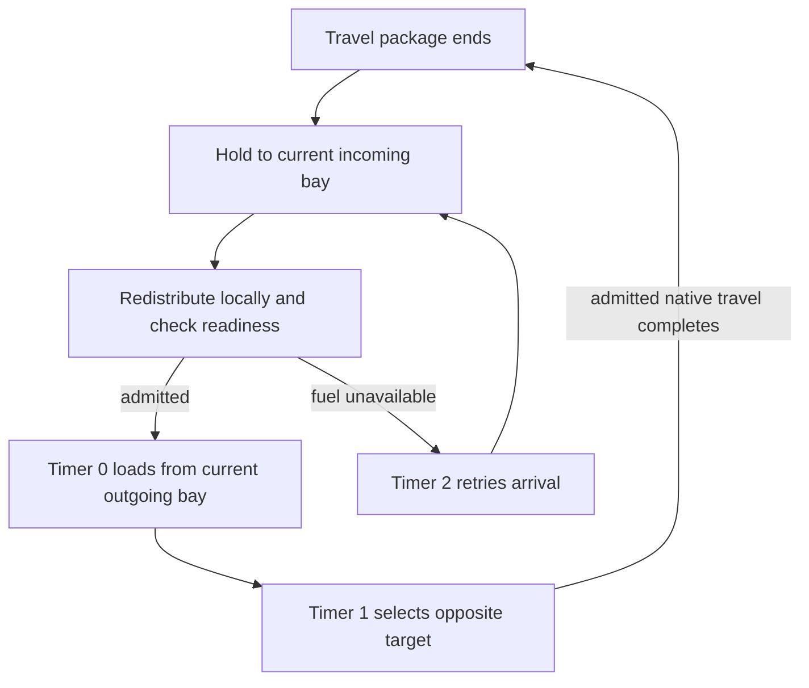

# Cargo links and fuel technical reference

[Guide](../guides/cargo.md) · [Reference index](README.md) · [Claim and evidence crosswalk](../audits/logistics-guides-d5bb/claims.md)

Scope is the pinned retail 1.16.244.0 native image, installed main definitions
and shipped ship, marker, quest and package-fragment PEX qualified by C2/C3.
Saved examples name Save52 separately. Hexadecimal native VAs are preferred
static addresses at image base `0x140000000`.
[C2 inputs](../experiments/cargo-links/transport/sources.csv) · [C3 inputs](../experiments/cargo-links/fuel/sources.csv).

## Endpoint and stage ownership

On confirmed change, menu close applies reciprocal marker links and sends
the change event. The marker can clear the old pair before starting
creation. [Configuration trace](../experiments/cargo-links/configuration-ui/native.md#terminal-eligibility-and-pairing) · [Configuration review](../experiments/cargo-links/configuration-ui/review.md).
A successful guarded quest CreateCargoLink installs the paired incoming, outgoing and landing
marker links on one ship and links both pad markers to it. Endpoint01/02 is
creation orientation. The ship script writes Current before departure and
the destination AV `0x2457AF` selects the Travel package branch. Current is
the selected landing target during flight. Both package end fragments call
ArriveAtOutpost. Light and animation callbacks update presentation separately.
[Creation and cycle](../experiments/cargo-links/transport/cycle.md#roles-and-authoritative-transitions).



This is the ordinary stage cycle, excluding clearing, disabled bindings and
movement failure branches. Arrival makes one incoming transfer attempt and
then requests the local flush. Even if the flush opens room, ordinary arrival
does not attempt a second unload in that invocation. Failed fuel readiness
arms timer 2, which can unload more if room has opened. With readiness
satisfied, timer 0 requests local refill and repeats
outgoing-to-hold transfer until the count stops changing. Timer 1 switches
the target and evaluates the package. No minimum stock or successful full
unload is required. A disabled ship can exit a callback without rearming.
[Stage and failure cases](../experiments/cargo-links/transport/lifecycle.md#distinct-operating-and-failure-states).

The ordinary quest TransferCargo calls RemoveAllItems with capacity
respect. The native wrapper reaches `0x140B61610` for source eligibility,
receiver fit and partial-count planning. Constrained transfers can sort
by descending value/mass and track planned weight across item rows.
Source virtual slot `0x458` removes the bounded count and passes the
removed amount to the receiver path. This per-call plan supplies no
reservation across simultaneous transfers.
The hold's effective capacity path `0x14211B700` combines CarryWeight and
CarryWeightShielded with conditional perk entry AA context. A compartment's
base 300 and current hold capacity have different authorities. Refused
stock remains aboard under ordinary capacity refusal. Load and unload use
the same hold, which can carry retained and newly loaded exports together.
[Shipment operation](../experiments/cargo-links/transport/inventory.md#shipment-operation-and-native-admission) · [Original C2 review](../experiments/cargo-links/transport/review.md).

## Clocks and native completion

| Owner | What advances and what can stall |
| --- | --- |
| Ship script and game-time VM heap | Shipped defaults for load, departure and fuel retry are 30/15/30 seconds, cached after conversion with the initializing ground TimeScale. Native `0x1420FB880` converts requested hours to integer ticks with a minimum request and arms at current clock plus duration. A tick is 0.001 game day. |
| VM dispatch | `0x141FB3710` skips game-time service during explicit wait/sleep. Once eligible, `0x1420F9F90` pops an unpaused due entry and queues the bound event. The handler may run later. The next arm uses its own current epoch, with no repeating missed-stage ledger. |
| Travel package and pathing | Separate target resolution, movement admission, process state, path request and completion. The detached controller uses thresholded accumulated movement delta. Full flight depends on geometry, profiles and actions. |
| Workshop producer | Engine elapsed time, row interval, remaining time and eligibility drive production and fuel use independently of the VM freight stages. |

At ground setting 15, the mapped conversion yields 5/2/5 ticks. At prompt
tick-aligned dispatch and unchanged live TimeScale 15, 5 and 2 ticks correspond
to 28.8 and 11.52 wall seconds. Live TimeScale 5 triples those equivalents
without changing the cached deadlines' durations in ticks. Flight and queue
latency are additional. The accepted transit continuation qualifies both
controller paths and conditional detached budgets. It supplies no universal
retail time, equal physical flight durations or empirical tolerance.
[Exact conversion](../experiments/cargo-links/transport/timing.md#script-authority-and-native-deadline) · [Native transit](../experiments/cargo-links/transport/transit.md) · [Continuation review](../experiments/cargo-links/transport/transit-review.md).

## Fuel readiness and accepted cycles

The installed marker registers resource IRES `0x21E6FF` with recipe COBJ
`0x214C92`, which resolves ingredient IRES `0x0057F5` to He-3 MISC
`0x00558E`. The recipe requires five units and has a null product. GLOB
`0x217854` supplies roughly 0.03 hours, yielding 108 base engine scheduler
seconds in binary32. Perk context, effective rate and registered quantity
affect cycles. The marker has no demonstrated separate input inventory.
The incoming local graph can combine reachable source units, including
eligible stock in a linked cargo incoming bay.

Ship readiness accepts either eligible non-mission pad. Mode 0 can pass an
otherwise eligible charged pad without rechecking ingredients. It can also
pass an uncharged pad with a complete accessible recipe before any debit.
The scheduler uses mode 1 to recheck even when charged. For due eligible
work, the planner caps cycles by whole recipes and prepares removals on the
actual source inventories. Successful ordinary removals consume five units
per accepted cycle. The scheduler updates the charge AV, with charge 2
marking charged and charge 1 uncharged, through its native reason path.
This AV, halt state, readiness at arrival and accepted source removals
describe separate state. Ordinary unfueled ships bypass the readiness test.
[Native chain](../experiments/cargo-links/fuel/native.md#actual-causal-chain) · [Endpoint cases](../experiments/cargo-links/fuel/stages.md) · [Elapsed examples](../experiments/cargo-links/fuel/time.md) · [C3 receipt-controlled review](../experiments/cargo-links/fuel/review.md).

## Recovery and saved authority

Graphically unloaded movement can progress through the bound ship and
resolvable endpoint/native package paths. Failed resolutions and lost
bindings do not establish deferred work that must later run. Clear/retarget
recovers the old hold to the home ship up to capacity, then the remaining
stock to the player when recovery succeeds. It clears bindings, halts
applicable markers, retires the old ship and cancels timers. Already executing
callbacks are a separate concurrency limit.

Save52 has qualified separate marker, bay and ship-hold identities.
The Feynman I and VII-b principal pair shares save-era ship `0xFF02DC37`,
with an explicit empty hold and Current targeting Feynman I's landing
reference `0xFF03444B`. The stocked ordinary ship `0xFF019341` contains
558 He-3 units and three Gold units. In that hold the He-3 is freight.
The Current link and destination AV give selection, not prior movement. The
native timer serializer writes bound script, ID, remaining deadline and
pause state and the loader reconstructs relative timing. The mutable ship
properties and native Travel/FlyLand state have their own channels. C3's
selected producer rows and ExtraBF charge are distinct from those timers.
Specific saved ship VM timer binding and historical transfer chronology
remain unqualified. [C2 saved joins](../experiments/cargo-links/transport/saves.md) · [Restoration and clearing](../experiments/cargo-links/transport/lifecycle.md#wait-fast-travel-and-reload) · [C3 saved inputs](../experiments/cargo-links/fuel/saves.md).

## Repeat the worked round trip

Use the hypothetical single eligible item, unit weight 1, capacity 300
and initial operands from the [C2 worked model](../experiments/cargo-links/transport/cycle.md#worked-partially-blocked-round-trip).
Assume adequate hold and origin incoming space, admitted stages and no other
mutations. This is a model of a return, with no captured historical voyage.

```powershell
$initial = 100 + 280 + 40
$receivedAtB = [math]::Min(100, 300 - 280)
$returned = 100 - $receivedAtB
$receivedAtA = $returned + 40
$receivedAtB, $returned, $receivedAtA, (280 + $receivedAtB + $receivedAtA -eq $initial)
[math]::Truncate((30 / 3600 * 15) * (1000 / 24))
[math]::Truncate((15 / 3600 * 15) * (1000 / 24))
$interval = [BitConverter]::ToSingle([Convert]::FromHexString('8fc2f53c'))
[single]($interval * 3600)
[math]::Floor((4 + 6) / 5)
```

Expect 20 delivered at B, 80 retained from A, 120 delivered at A including
the opposite 40, conservation true and default load/departure ticks 5/2.
The two remaining results are 108 base scheduler seconds and two whole
recipes from the illustrative 4+6 reachable units. Use the GLOB bytes
and five-unit recipe in the [C3 definition table](../experiments/cargo-links/fuel/native.md#identity-and-local-evidence).
The clock arithmetic uses sufficient precision for these operands. The
worked counts cannot certify runtime fit, dispatch, travel or actual fuel
withdrawal.
