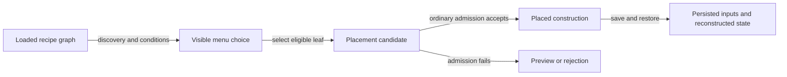

# Construction and placement reference

[Guide](../guides/construction.md) · [Glossary](glossary.md) ·
[Selected claims](../history/claims.md#construction)

The inspected native routes use Starfield 1.16.244.0. Addresses are
preferred static VAs at image base `0x140000000`. Sampled physical main-ESM
records and one add-on control do not reconstruct the winning load order.
Historical saves and screenshots have separate provenance.
[Function register](../function-register.md) · [State register](../state-register.md).

## Catalogue and conditions

| Stage | Entities, inputs and output |
| --- | --- |
| Discovery | DFOB `0x00058607` selects category FLST `0x00058606`. The loaded COBJ walk at `0x140f4d630` requires the first FNAM keyword in that list. BNAM is not a substitute. The 204 physical main-ESM roots precede context filtering. |
| Grouping | CNAM can target a form, list or nested recipe route. Flag `0x04000000` can preserve a list as one node with leaf variants. The chair root `0x00296338` targets a 35-entry list. Child `0x00100c57` has no FNAM and still appears in the traversable definition graph. |
| Conditions | CTDA uses player/Workshop context and per-entry run-on rules. The restricted retry keeps some unmet HasPerk, GetPerkRank and IsResearchComplete candidates visible as unearned. Quest/global/context failures have no general bypass. Specialized resource and organic selectors add contextual gates. |
| Selection and action | The selected leaf drives preview and candidate inputs. The ordinary CommitEvent handlers require accepted frame status `0x02` before creation and accounting. Selection, eligibility and successful placement are separate. No universal low-level atomic recheck was established. |

[Definition chain](../experiments/build-catalogue/catalogue.md) ·
[Conditions and preview](../experiments/build-catalogue/eligibility.md) ·
[Independent review](../experiments/build-catalogue/review.md).

Conceptual ordinary path. The gates include progression, materials,
quota, budget and spatial validation. A displayed lock or preview can stop
before commit. CHANGE and script-specific routes are outside the diagram.
[Commit trace](../experiments/build-catalogue/eligibility.md#preview-versus-transaction).

## Deployment and quotas

Deployment tests the player's remaining allowance and the body's condition
form. Ordinary placement spends one slot and removal restores one.
Planetary Habitation changes base 8 to 12/16/20/24 and permits additional
environmental extremes by rank. A beacon census cannot supply the saved
effective player actor value. A COBJ JNAM quota instead compares the current
selected Workshop's construction representatives that share the exact
limit GLOB with its nonnegative floored value. Cargo pads share one
group and turrets another. A no-JNAM recipe skips this gate and can fail
other gates. Quota rejection uses status `0x1f`. The mapped admission path
does not evict existing items above a lowered quota. Perk removal and
scripted over-limit restoration were not tested.
[Limits](../experiments/limits/report.md) ·
[Tracked review record](../experiments/limits/review.md).

Save52/HIST-0267 corroborates mixed regular and inter-system pad groups.
The two saved turret actors are from HIST-0255. The original decoder stopped
at an unsupported extra before reaching their owner links. The later Extra
`0xe6` trace and saved joins resolved both actors to one beacon, without
establishing a complete turret count or loaded state.
[Original sample comparison](../experiments/limits/saves.md#actual-turret-actors) ·
[Owner-join correction](../experiments/outpost-defense/persistence.md#l1-historical-turret-owner-gap-closed-for-the-pair) ·
[Correction review](../experiments/outpost-defense/review.md).

## Scalar budget

When budgeting is enabled, the ordinary gate accepts when `U + C <= M`.
`U` is current effective WorkshopCurrentBudget and `C` is the cached
candidate charge at build context offset `0x78`. `M` is the selected
Workshop's positive effective WorkshopBudgetBaseline actor value (AVIF
`0x00319872`) when valid. Otherwise the gate uses
`fBudgetBaseline:Workshop`, with compiled default 2,500.
`bBudgetEnabled=false` bypasses the comparison. Rejection uses status
`0x1e` on the mapped path.

Charge calculation starts from a base cost of one under the default
setting. The installed main ESM sets the four actor, container, light and
navmesh surcharges to zero. PackIns sum eligible effective-form charges.
The path uses form and property inputs without counting rendered triangles.
A rounded full meter can precede the cap because the HUD displays a cached
usage/allowance fraction and rounds its frame selection.

On successful ordinary creation with budgeting enabled and positive charge,
the accounting helper writes `U + C` into the usage base. On ordinary
deletion, the helper writes `max(U - C, 0)` into the base when the special
argument is zero, budgeting is enabled and the recalculated charge is positive.
A special removal branch skips that debit. Load restores the saved base
and rebuilds existing items without charging them as new placements.
An override can affect a later debit or refund. Actual override and
reload behavior outside the traced paths remains untested.
[Native budget inputs and accounting](../experiments/build-budget/native.md#allowance-admission-and-action) ·
[Budget report](../experiments/build-budget/report.md) ·
[Tracked assessment and local verdict route](../experiments/build-budget/review.md).

The original independent budget review accepted the bounded offline study.
Its verbatim return is local. The tracked assessment identifies the
verified controls and scope. [RC1 capability C09](rc1/capability-access.md) ·
[RC1 independent reconciliation review](rc1/review.md).

The manual Kreet corpus records Extra `0xbf` base values 7, 8, 10 and 9
for WorkshopCurrentBudget AV `0x00000399` at beacon-only, storage,
extractor-plus-solar and extractor-removal checkpoints. The +2 action
combines two items. Adjacent controls, linking, renaming and moving the solar
preserve the corresponding base. Two disabled historical beacons retain
310 and 198 despite zero surviving direct owner edges. This separates the
stored usage from both a root census and active status. Effective loaded
values, override changes and the historic meter epoch remain unmeasured.
[Saved fields and offsets](../experiments/build-budget/saves.md).

## Territory and scenery

The selected world and frame must qualify for the ordinary territory test.
Radius mode requires `dx² + dy² <= R²` and separately requires candidate Z
at or below the upper-height limit. The installed
ordinary beacon supplies `R = 150` native units. Effective definitions and
other descriptor modes can change the test. The mapped status `0x0a`
indicates outside buildable area. Location ancestry and encounter permission
can reject positions inside the radius with status `0x16`. Display clipping
uses loaded disallowed cell/location rectangles.

Support is a separate test. Status `0x04` denotes an intersection.
Candidate-size-dependent clearing applies eligibility filters and supplies
a transient ignore set to physics. Precise clipping, photograph-specific
attribution and saved rejected candidate geometry were not recovered.
[Spatial native trace](../experiments/spatial-placement/native.md) ·
[Review and current wording correction](../experiments/spatial-placement/review.md).

Confirmation can set mask `0x04` at reference offset `0xd3` and mark
change mask `0x01000000` (CHANGE_REFR_WORKSHOP_BULLDOZED). That mask is
separate from the saved disabled/deleted form flags. The loader restores
the state, and cleanup including ordinary move/delete reevaluation can clear
it. The two Kreet sequences contain 0/1/4 and 0/1/12 REFR rows with the
channel. Those are state counts without rock identities or a travel/reload
control. [Persistence and negative attribution](../experiments/spatial-placement/persistence.md).

## Variants and exceptional state

The ordinary Four Wall Hab component's SNBH points to STBH `0x001e8d95`.
Manual CHANGE uses condition-eligible grouped entries and its own action
path, without the COBJ ingredient transaction in the mapped branch. Snap
connection changes use ungrouped automatic rules. PackIn replacement
generates pieces at the anchor and links them back through `0x00000191`
with Workshop ownership propagated. The separate non-PackIn base override
can preserve reference identity and save the original base in Extra
`0xb4`. It does not explain the sampled wall PackIns.
[Mechanism and alternatives](../experiments/construction-variants/report.md) ·
[Independent review](../experiments/construction-variants/review.md).

HIST-0210 ties four component anchors to one hab group and retains DA
source/group metadata, 4C owner/replacement links, anchor flags and a DE
snap connection. These channels support the saved configuration. They
do not specify its action history or rendered reload. Foundation/stair
generation and damage/model stages use separate rules. The zero direct
serialization mask for material Extra `0xb5` leaves arbitrary decal
persistence unestablished. Attachments and modded overrides require their
own evidence. [Exact save witness and channel table](../experiments/construction-variants/saves.md).

## Inspect and challenge

Filter the tracked [recipe census](../experiments/limits/recipes.csv) by
`limit_global`: expect two rows for `00190d57` (cargo) and seven for
`000f7c96` (turrets). This checks the physical main-file grouping. It
does not run the native count or determine the current effective threshold.
For a challenge, follow the [budget counterexample](../experiments/build-budget/saves.md#persisted-history-is-not-a-population-oracle)
and [tracked budget assessment](../experiments/build-budget/review.md), or the
[scenery state and reload gap](../experiments/spatial-placement/persistence.md).

**PUBLICATION DEPENDENCY — EVIDENCE ACCESS PENDING** for primary saved budget,
scenery and variant witnesses and original photograph inspection at the
claimed tier. Tracked summaries and definitions are inspectable. Source replay
requires lawful pinned native/ESM/interface inputs, qualified save and image
witnesses or approved sufficient derivatives. Proposed F1 inputs remain
**PENDING RELEASE**. Photographed-event attribution and paired CHANGE/reload
remain untested even with the historical inputs.
