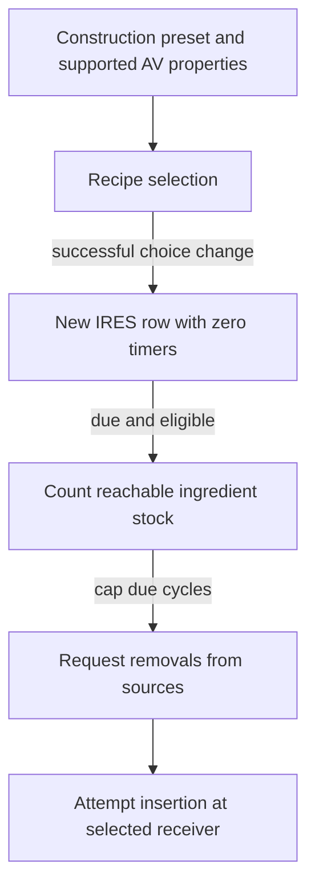

# Fabrication technical reference

Ordinary fabricators have construction-linked product presets and a
family-wide set of supported resource properties. Generic recipe selection
uses that set. A due production check depends on current stock reachable
through local input links. This is the reported STATIC contract for
Starfield 1.16.244.0, with main-file catalogue and representative saved
corroboration. Addresses use preferred static VAs, image base
`0x140000000`. [Report](../experiments/fabricators/report.md) ·
[Source ledger](../experiments/fabricators/sources.csv) ·
[Guide](../guides/fabrication.md) · [Glossary](glossary.md).

## Catalogue, identities and selection

The main-file definition walk selects CONT with Builders `0x002731a0` and
manufactured `0x0023ceb6` category keywords. The 45 qualified definitions
include 30 ordinary construction-linked presets. The ordinary construction
chain goes from a COBJ through its family FLST choice and PKIN to an
operational CONT through a template CELL child REFR. Each ordinary family
supports its own full catalogue. The ordinary 11/10/9 product split counts
distinct supported output recipes per family. An exceptional tier-3 Comm
Relay base exists outside that construction and property set. Comm Relay is
an ordinary simple product. [Definitions and exceptions](../experiments/fabricators/definitions.md#population-and-construction-relationships).

| Identity | Role in the ordinary path |
| --- | --- |
| Construction COBJ and FLST | Choose a supported building variant under construction conditions. |
| CONT base and placed producer | The base supplies supported resource properties and a preset. The placed child reference owns effective instance selection and has a distinct identity from the assembly representative. |
| AVIF and IRES | The AV property can be present at value zero and support a recipe. A positive selected value identifies configured production. IRES keys the Workshop producer map and links the recipe. |
| Production COBJ and output MISC | COBJ FormID is the builder menu row ID. Its ingredient records carry input IRES identities and counts. Its product field identifies the output form. Input IRES and corresponding resource AVIF remain distinct from item FormIDs and saved producer identities. |

`0x140f859d0` takes OrganicResourceType zero on the ordinary fabricator
branch. Callback `0x140f8be60` requires AVIF category 9 and bit 1 clear
at AVIF `+0x15c`, then follows its IRES backpointer at `+0x148`.
Common admission `0x140f85f80` needs a recipe, AV and base property
presence. The generic callback supplies a known flag. Some recipe records
carry Special Projects conditions. The mapped generic admission, apply,
input-cap and creation branches do not themselves evaluate that condition
list. Construction research is a separate gate. The organic menu's
auto-selection branch for type 1 or 2 does not initialize ordinary
fabricator presets. [Native catalogue and UI](../experiments/fabricators/native.md#catalogue-and-current-configuration).

## Reconfiguration, input graph and delivery



A successful recipe change replaces the row. A later qualified due check
counts reachable stock, caps cycles, requests removals and attempts insertion.
Link pruning, failure to resolve and acceptance at the destination are
outside this diagram. [Choice and row mutation](../experiments/fabricators/native.md#choice-application-timer-replacement-and-persistence) ·
[Input and insertion](../experiments/fabricators/native.md#operating-eligibility-and-actual-request).

The builder's change event carries the COBJ ID. `0x141583410` requires
resolved old/new model associations and Workshop. It sets old AV to zero,
deregisters old IRES, sets new AV to 1 and registers the new row with zero
remaining time and interval. Registration revalidates incoming sources against
recipe compatibility. Outgoing validation tests the whole supported candidate
vector and prunes at most the first incompatible membership per invocation.
A null destination filter and a present empty filter behave differently
(accept and reject on the qualified filter path). Stale associations and
failed owner resolution are distinct from a successful change.

The transfer registry maps destination handle to a set of source handles.
`0x140f80af0` finds direct outgoing destinations. `0x140f881c0` instead
walks and deduplicates resolved incoming references from the consumer. A
buffer can have more incoming links. A local cargo arrival inventory ends
the local graph's account of remote stock origin. An admissible link can
show structural compatibility with one ingredient. Production checks usable
quantities for all ingredients. [Connection contract](../experiments/fabricators/native.md#connections-and-upstream-input-contract) ·
[Saved paths and counterexamples](../experiments/fabricators/saves.md#upstream-chains-multiple-candidates-and-boundaries).

`0x140f7d120` separates applicable power, halt and one-cycle input checks.
For due cycles the creator `0x140f7d6a0` calls `0x140f7f6f0` to bound the
request by each ingredient's integer stock / requirement quotient and the
due count. It requests source removals before attempting insertion at the
selected compatible receiver or producer buffer. The ordinary branch has
no NNAM multiplication. All 30 ordinary recipes have NNAM 1. Insertion
capacity and bookkeeping affect acceptance, and the producer's event does
not independently measure the inventory delta.

The shared row clock uses engine elapsed seconds with separate frame,
wait and travel callers. A positive interval and enough elapsed use
truncated elapsed / interval. Otherwise subtracting elapsed from the
countdown can make one cycle due. Resource GLOB hours × 3600, eligible A1
actor/player entries and positive effective HarvesterRateMult govern
duration. Manufacturing timer conditions differ from inorganic-only perk
conditions. The definition-only duration for Adaptive Frame is about
7.920000 engine elapsed seconds per cycle at AV 1 with no timer modifiers.
The conditional nominal request is one unit per cycle or about 7.576 per
engine elapsed minute with sufficient inputs and otherwise eligible
operation. This is derived arithmetic. Effective elapsed updates, stock
and delivered counts were unobserved.
[Clock and rate](../experiments/fabricators/native.md#shared-clock-and-conditional-rate) ·
[Modifier eligibility](../experiments/fabricators/reuse.md#manufacturing-boundary-modifiers) ·
[Worked recipes](../experiments/fabricators/definitions.md#definition-based-worked-cases).

## Saved state and tracked catalogue check

The mapped selection setter can persist the changed resource AV in ExtraBF.
ExtraWorkshop saves the IRES map key, producer identity/base and row
bookkeeping separately. The local transfer map is a third channel. The
loader restores identities and scalars with resolution, and the runtime
rechecks current conditions.

HIST-0036 has 17 saved producer rows with bases whose definition presets
agree with their IRES keys. None has an explicit selected-AV override
in its saved ExtraBF. For example, saved Semimetal Wafer producer
`0xff022310` reaches the registered Zero Wire source `0xff038411`
through buffer `0xff03841e` in the reverse input walk. That path
establishes a supplier relationship within the inspected saved graph.
Its stock, current power, modifiers and accepted item counts are unknown.
[Saved corroboration](../experiments/fabricators/saves.md#representative-state-and-direct-connection-corroboration) ·
[Independent review](../experiments/fabricators/review.md#independent-review01-and-final-package).

Count [facilities.csv](../experiments/fabricators/facilities.csv) rows, then
filter `ordinary=True` and group by `tier`. The 45/30 split gives 11/10/9
ordinary bases by tier. Group [recipes.csv](../experiments/fabricators/recipes.csv)
by `ordinary_tiers` for the same ordinary recipe counts. Compare the
Comm Relay bases marked ordinary and exceptional in the facility table.
For Adaptive Frame, look up IRES `00245775` and check the recipe's Iron
and Aluminum inputs and its `seconds` column before calculating
`60 / seconds`. This reproduces the table aggregation and nominal
one-unit rate, with no primary ESM replay or historical stock recovery.

**PUBLICATION DEPENDENCY — EVIDENCE ACCESS PENDING** for primary
verification of the historical saved joins and the original native evidence.
[Selected claims](../history/claims.md#fabrication).

Run from the checkout root in PowerShell 7.

```powershell
$facilities = Import-Csv docs/experiments/fabricators/facilities.csv
$facilities.Count
$facilities | Where-Object ordinary -eq 'True' | Group-Object tier | ForEach-Object { "Tier $($_.Name) $($_.Count)" }
$facilities | Where-Object edid -like '*CommRelay' | ForEach-Object { "$($_.formid) ordinary=$($_.ordinary)" }
$recipes = Import-Csv docs/experiments/fabricators/recipes.csv
$recipes | Where-Object ordinary_tiers | Group-Object ordinary_tiers | ForEach-Object { "Tier $($_.Name) $($_.Count)" }
$frame = $recipes | Where-Object ires -eq '00245775'
$frame.inputs
60 / [double]$frame.seconds
```
