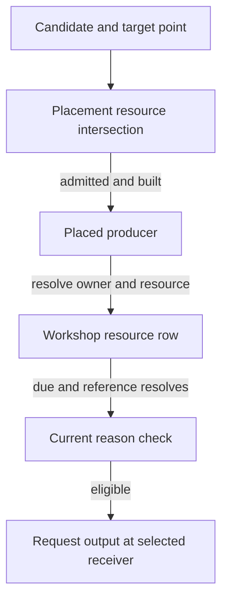

# Inorganic production technical reference

The ordinary inorganic placement check intersects resources at a point with
the candidate's effective properties. Registration creates a different
association, keyed by the resource in the Workshop. Due production uses that
key. The reported Starfield 1.16.244.0 native interpretation is STATIC and
scoped to the inspected path. The definition tables and saved joins supply
separate evidence. Native addresses here are preferred static VAs with image
base `0x140000000`. [Original report](../experiments/inorganic-extractors/report.md) ·
[Original independent review](../experiments/inorganic-extractors/review.md) ·
[Source ledger](../experiments/inorganic-extractors/sources.csv) ·
[Guide](../guides/inorganic-production.md) · [Glossary](glossary.md).

## Definition and placement

The installed catalogue selects CONT with category KYWD
`Starfield.esm:0x008406`. Native `0x140f7c9f0` consumes the resolved
OutpostCategoryHarvesters default object. Builder and fueled-object
predicates are separate. Solid, liquid and gas family keywords classify
ordinary examples, but three Tetrafluorides bases lack the usual family
keys and have gas models. Model and resource properties support size/family
classification for the documented cases. A universal native numeric tier
has not been established. The installed census contains 159 qualified
bases, including five expansion X-Tech definitions. The interval study
covers the 154 main-file bases. Atmospheric properties, liquid-water
SkipResourceVeinCheck and certain X-Tech bypass properties qualify the
ordinary point rule. [Definitions](../experiments/inorganic-extractors/definitions.md) ·
[Corrected main-file and installed scopes](../experiments/inorganic-extractors/resource-intervals.md#definition-coverage-and-exceptions).

The iron CONT `0x05ef19` carries resource AVIF `0x05ef18`. IRES
`0x0057c7` links that AVIF through NAM1 and its recipe `0x05ef53`
through NAM2. The COBJ CNAM names MISC `0x00556e`. The placed reference,
base, AV, resource, recipe and product have distinct identities. On the
ordinary non-bypass placement branch `0x140f3f9a0` calls `0x140f7c290`,
which intersects point-admitted resources from `0x14079df70` with
effective resource candidates from `0x1409e8700`. Empty intersection
returns status `0x17`. The separate registration enumerator
`0x1409e9150` follows effective resource properties and the AVIF's
resource pointer. The resource key has no retained region or point field.
[Placement and registration derivation](../experiments/resource-retained-population/d5ah-extractor-continuity.md#placement-and-registration-use-distinct-resource-operations) ·
[Geographic scope](resource-generation.md).



The diagram follows a successful ordinary placement and later production
check. The point intersection gates the new placement. Registration then
supplies the resource row. A due update resolves the producer and checks
the current reason before requesting output. Bypasses, other construction
gates and insertion outcomes are omitted.
[Continuity path](../experiments/resource-retained-population/d5ah-extractor-continuity.md#unload-return-and-production).

## Scheduling, current state and delivery

| Decision | Native scope and consequence |
| --- | --- |
| Registered capability | ExtraWorkshop type `0xBC` owns the resource map at `+0x20`. Its array rows (stride `0x1c`) hold a handle, base FormID, bookkeeping, registration iterations, binary32 remaining time and interval, and a cached eligibility byte. Ordinary registration `0x140f7dfa0` reads the base resource AV via vtable offset `+0x18`, rounds it up into the iteration field at row `+0x0c` and starts the timers at zero. |
| Current eligibility | `0x140f7d120` returns reason zero for current eligibility. ExtraFlags type `0x9C` mask `0x40` supplies power on applicable branches (failure reason 5). The production-halt predicate checks the reference and qualifying group members (reason 9). Capacity, state and other predicates can also intervene. |
| Due decision | `0x140f7ef20` visits registered resolvable Workshops and calls `0x140f7f1e0` for their rows. With elapsed at least a positive interval, the ordinary finite-input calculation truncates elapsed / interval. Otherwise elapsed is subtracted from remaining time and crossing zero can give one due cycle. Reason is rechecked and timer state refreshed. Engine elapsed seconds include qualified wait/travel paths. |
| Request and insertion | `0x140f7d6a0` resolves the row's IRES and recipe, then requests creation via a selected compatible receiver or producer fallback. The receiver choice can bypass intermediate stores. A due count, request or ItemProduced event is insufficient evidence of accepted inventory change. |

The updater rechecks current reason for each registered iteration and
passes the same due count to the creator for each eligible iteration.
One iteration on the ordinary direct-item path requests one product per
due cycle. The nominal presentation helper reads the current effective
resource AV, which can differ from the registration-time base value.
[Requested quantity and nominal helper](../experiments/inorganic-extractors/arithmetic-production.md#definition-derived-base-production).

IRES NAM3 selects the interval GLOB, with a fallback setting on the mapped
base helper. Binary32 hours × 3600 yields the base seconds. Entry point
`0xA1` adjusts that duration for eligible assigned actors and player
conditions. The effective positive HarvesterRateMult then multiplies duration,
with 1 substituted for nonpositive values. The loaded AV can differ from its
definition-only default-plus-property value. Neither the raw PRPS delta nor
COBJ NNAM alone gives an accepted output count. Separate local stock movement
and production insertion have different capacity rules. See the local
output-link study and [technical reference](storage-and-output-links.md).
[Native reasons and row offsets](../experiments/inorganic-extractors/native.md) ·
[Time inputs](../experiments/inorganic-extractors/arithmetic-clocks.md) ·
[Arithmetic and insertion](../experiments/inorganic-extractors/arithmetic-production.md#requested-versus-realized-items) ·
[Local links and review](../experiments/local-output-links/review.md).

## Saved channels and return

The row saver and loader (`0x140f50660`, `0x140f515a0`,
`0x140f50880`) preserve resource and producer identities and row scalars.
The serialized row body after the identities is 17 bytes, with eligibility
before its two binary32 timers. The runtime ordering differs. An unresolved
resource can prevent map entry publication and a failed producer resolution
can leave a sentinel. The global registered-Workshop set and transfer edges
restore separately. Due processing uses current power and other gates. Power
bit persistence was unclassified in the original extractor report and is
qualified separately in the [power reference](power.md#saved-edges-flags-and-load-authority).

Controlled iron placement and deletion with no-action controls gave positive
and negative associations. Save52 supplied 63 qualified producer joins. The
ionic-liquid example `DYNAMIC:0xff041387` joins to a medium producer base and
the explicit saved owner. On a false object-loaded event matching rows can
remain while pending bookkeeping is cleared. A true event refreshes eligibility
and can dispatch pending work for an eligible matching handle. Failed handle
resolution or an ineligible reason does not establish a recoverable output debt.
The conditional producer-continuity result leaves the actual paired geometry
change and accepted output unobserved.
[Save, loader and event evidence](../experiments/resource-retained-population/d5ah-extractor-continuity.md#what-is-serialized-and-reconstructed) ·
[Owner check](../experiments/resource-retained-population/d5ah-extractor-owner.md) ·
[Original reviews](../experiments/inorganic-extractors/review.md) and
[continuity challenge](../experiments/resource-retained-population/d5ah-review.md#independent-substantive-and-editorial-disposition).

## Repeat a tracked interval check

On the definition-only fallback with no instance override, extra
property, effective modifier or active timer perk, small solids have
duration factor 1. Other qualified small definitions use 2, medium
uses approximately 0.8, and large uses 0.5. These factors multiply the
resource's base interval. They do not change the ordinary definition
quantity of one registration iteration in this baseline.
[Size factors and scope](../experiments/inorganic-extractors/resource-intervals.md#size-factors-a-substantive-small-tier-exception).

Filter [resource-intervals.csv](../experiments/inorganic-extractors/resource-intervals.csv)
to scope `main-game CONT-linked`, group by `base_seconds` and count rows.
For 36, 54, 72, 90 and 108 engine elapsed seconds per cycle the counts are
10, 9, 11, 13 and 2 of 45 linked resources. The two IRES-only rows have
intervals but no linked main-file extractor. Decode Iron and Helium3's
`hours_binary32_bytes_le` as
little-endian binary32 and multiply by 3600 in binary32. In
[extractor-sizes.csv](../experiments/inorganic-extractors/extractor-sizes.csv),
use bases `05ef19` and `06ac84` and add default 1 to the tracked property
(absent contributes zero). Multiply the base seconds by each factor to
recover 36 and 72. Argon's 54 seconds challenges an interval inferred from
its rarity label. Small gas challenges the uniform small-factor-1 model.
[Interval evidence and review](../experiments/inorganic-extractors/resource-intervals-review.md) ·
[Arithmetic review](../experiments/inorganic-extractors/arithmetic-review.md).

Run the same check from the checkout root in PowerShell 7 on a
little-endian host.

```powershell
$intervals = Import-Csv docs/experiments/inorganic-extractors/resource-intervals.csv |
    Where-Object scope -eq 'main-game CONT-linked'
$intervals | Group-Object base_seconds | Sort-Object { [double]$_.Name } |
    Select-Object Name, Count
$sizes = Import-Csv docs/experiments/inorganic-extractors/extractor-sizes.csv
foreach ($base in '05ef19', '06ac84') {
    $size = $sizes | Where-Object base_formid -eq $base
    $resource = $intervals | Where-Object resource -eq $size.resource
    $hours = [BitConverter]::ToSingle([Convert]::FromHexString($resource.hours_binary32_bytes_le), 0)
    $property = if ($size.rate_property -eq 'absent') { 0 } else { [single]$size.rate_property }
    $seconds = [single]([single]($hours * 3600) * [single](1 + $property))
    "$($resource.resource) $seconds engine elapsed seconds"
}
```

This is tracked-table arithmetic at the stated build and no-override,
no-perk baseline. Actual elapsed update sequences, current modifiers and
accepted counts are outside the check.

**PUBLICATION DEPENDENCY — EVIDENCE ACCESS PENDING** for primary historical
saved joins and verification of the original native witness.
[Claim and access crosswalk](../audits/README.md#archive-lookup) (`audits.zip :: docs/audits/production-guides-d5ba/claims.md`).
