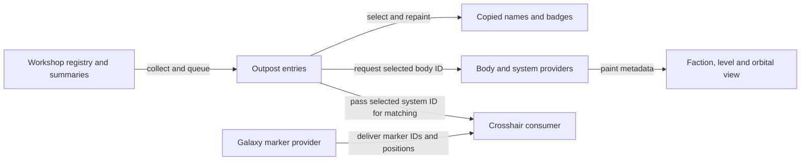

# Locations outpost panel technical reference

[Reader guide](../guides/locations-ui.md) ·
[Claim and evidence map](../audits/remaining-guides-d5bc/claims.md) ·
[LO1 original field inventory](../experiments/locations-outpost/field-lineage.md) and
[independent review](../experiments/locations-outpost/review.md)

The installed retail 1.16.244.0 native/compiled/definition mapping is
STATIC. [Provenance and controls](../experiments/locations-outpost/methods.md#baseline-and-identity)
pin inputs. Native locators use preferred static VA at base `0x140000000`.
The entry's reference FormID, body component ID and system ID occupy
different lanes. The component IDs used for markers and selection are not
save-local references or native pointers.

## Collector and refresh lanes

`0x141360e80` resolves handles from the Workshop registry and requires an
ACTI base, the Workshop keyword and ExtraBC. A positive reference keyword
query using WorkshopUseDecorateTextKeyword_DO excludes the reference when
the default resolves to a keyword. Its installed DFOB `0x003e4f4a` points to
KYWD `0x003e4f4b`. The collector requests and pumps summary work before
copying lanes. That pump cannot establish a settled state across all providers.
There is no separate scan of saved beacons or explicit active-player ownership
test in row admission.
[Collector and exclusion](../experiments/locations-outpost/native-and-ui.md#snapshot-numerator-and-maximum)

Entry collection and delivery, selected entry repaint, selected metadata
and the galaxy marker provider are separate lanes. The crosshair consumer
matches the selected entry's system ID to a marker ID and uses that marker's
position. UI service events and favorites have other writers.
[Refresh evidence](../experiments/locations-outpost/native-and-ui.md#refresh-boundaries)

| Field | Source owner and identity | Refresh and UI consumer | Evidence and challenge |
| --- | --- | --- | --- |
| List and detail names, body subtitle | Registry reference, cached ExtraBC name, body context from ExtraPlanetContent81 or reference lookup | Collector builds aOutpostListA. m1279 initializes entries and writes count text, m1005 paints list names, and m1270 paints the selected name and subtitle | STATIC, inherited name writer plus traced adapters. Selection does not reread a rename. |
| Cargo Links | Workshop summary from qualifying resolved, non-disabled local reverse WorkshopItem endpoint members with target and active-link keywords | Summary request mask 4, copied iCargoLinks, m1270 | STATIC inherited BM2 computation plus LO1 adapter. Counts endpoints, not built-pad quota or realized freight. |
| Crew | Owner CrewExtraData E2 handle-list length, zero when absent | Mask 8, copied iCrewCount, m1270 | STATIC inherited count plus adapter. No per-actor resolution here. Robots can share the list. |
| Outposts Built | Unfiltered list entryCount from admitted rows and player base OutpostMaxDeployed, truncated to integer | Collection supplies aOutpostListA and iMaxOutposts. m1279 assembles count text | STATIC. Missing/wrong-type maximum default gives zero. Ordinary base progression is 8/12/16/20/24. Placement uses effective remaining allowance. |
| Power, production and budget | ExtraBC summary lanes from electrical, nominal production and construction-accounting writers | Copied metrics, m1270. Budget ratio selects a frame on a 100-frame installed meter | STATIC producer reuse and UI binding. No per-selection graph traversal, realized throughput or new accounting. |
| Faction and level | Containing system location, owner walk with preferred effective owner before definition owner. FACT yields localized name and type keyword. Mapped location level is LCTN DATA byte 5 | Selected body request supplies LocationsBodyInfoData, m1285 paints values, m1286 paints level class | STATIC plus installed definition controls. Missing/non-FACT gives NONE and type −1. Missing level location gives zero. Seven installed emblem labels cover fewer cases than the helper can request. |
| Markers and orbital view | Projected system-position array and selected entry uSystemID. Body provider supplies hierarchy, colors, relative size, scan state and focused body ID | m1263/m1173 place markers from the delivered array. m1268/m1175/m1171 match uSystemID to marker uBodyID and position the crosshairs. m1264 consumes the system provider, rebuilding on root change or updating the selected-body highlight | STATIC. No beacon-coordinate or terrain photograph input on these paths. Historical pixels and unsupported labels remain unqualified. |

See [BM2 summary producers](../experiments/build-catalogue/ui.md#footer-gaps-investigated),
[LO1 native paths](../experiments/locations-outpost/native-and-ui.md) and
[Stored Resources reference](stored-resources.md) for the separate inventory
aggregation and delivery contract.

## Challenge the apparent snapshot

A Crew badge can retain the length copied from E2 while a later actor query
would fail resolution or find no active entries. A populated Cargo Links
badge can coexist with a route whose operation still depends on ship and
fuel state. A selection repaint can use those same copied lanes while its
body metadata arrives separately. Screenshots support the reported visible
values without recovering raw inputs, matching clocks or a complete saved
population. [Original evidence and limits](../experiments/locations-outpost/report.md) ·
[Crew eligibility](crew-and-robots.md) · [Cargo state](cargo.md)

**PUBLICATION DEPENDENCY — EVIDENCE ACCESS PENDING.** The authored field table
supports a tracked lineage check. Decisive original native, installed
metadata and compiled UI witnesses have separate access requirements.
