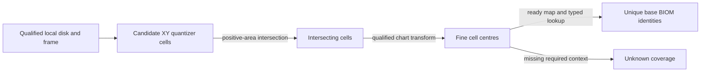

# Nominal biome reference

[Guide](../guides/nominal-biomes.md) · [Position reference](position.md) ·
[Claim crosswalk](../audits/foundation-d5az/claims.csv)

## Inputs and decision path

Require a typed ordinary beacon/Workshop, body PNDT, qualified local
compensated centre and saved frame, radius definition and resolved map.
The ordinary beacon ACTI `0x002c60e9` supplies radius 150 in native units.
Use the descriptor origin for frame `0x0b` and the qualified site cell
for frame `0x2b`. For the priority Feynman V site, these bases differ:
descriptor (0, 25152, 32448) and site (0, 25124, 32446).
[Source and frame evidence](../experiments/outpost-biomes/report.md#causal-result).

Conceptual traversal. The input is a nominal horizontal disk in native local
units. The output is a set of identities with cell witnesses. The diagram
has no plotted geometry and does not represent an effective-area polygon.
[Nominal traversal and completeness](../experiments/outpost-biomes/nominal.md).

## Quantizer cells and raster lookup

1. On each local XY axis the mapped lookup uses
   `Q(x) = floor(f32(x * f32(0.01)))` on binary32 input. For continuous
   overlap under the round-to-nearest model, the boundary `L(q)` is the
   dyadic midpoint between adjacent inputs bracketing the transition to
   `Q >= q`. Ideal 100-unit boundaries are an approximation. Enumerate the
   Cartesian product of intervals reachable within the disk's bounding
   square, including boundary candidates for the exact test.
2. For each rectangle, compute the shortest componentwise distances
   `dx` and `dy` from the centre to its closure. Keep it when
   `dx² + dy² < R²`. This admits contained cells and positive caps and
   excludes zero-area tangencies. The intervals partition the plane up
   to shared edges. Each retained cell gets one label, so their label
   union is complete within the qualified model.
3. Transform each integer offset through the native chart hierarchy. Use
   the v2 seam normalization and resulting tag, with the published
   demonstrator confined to interior footprints. The lookup uses
   `u = (I + 0.5)/N - 0.5` and `v = (J + 0.5)/N - 0.5`, with installed
   `N = 49152`. For tags 2/3 negate both axes and select face 0/1.
4. For the three pinned 256×256 maps in interior tags 0/1, use
   `column = I // 192` and `row = 255 - J // 192`. The general native
   lookup floors and clamps the normalized column and reversed row.
   Resolve the little-endian uint32 through the map's plugin context
   as a BIOM. Deduplicate qualified FormIDs and retain the addresses.

[Exact numerical derivation and synthetic boundary controls](../experiments/outpost-biomes/nominal.md) ·
[Reviewed interior scope](../experiments/outpost-biomes/review.md).

## Native and persistence boundaries

On Starfield 1.16.244.0, preferred image base `0x140000000`,
`0x140478350` requests the body-name-derived BiomeMapDB entry.
`0x14078ee90` chooses the manager descriptor, transforms the Int2 and
requires the selected map to be ready before the raster lookup at
`0x1423390f0`. The version-5 samples have two 256×256 faces, each with a
BIOM array and a separate byte mask array. The native loader can substitute
defaults in some invalid map/form cases. The research calculation withholds
coverage when the required effective map or identity cannot be established.
The mapped identity lookup consumes one pixel. The mask nibble, coast/water
checks, environmental overrides and visual material blend have separate paths.
[Build, format, VAs and consumers](../experiments/outpost-biomes/native.md).

Saved site identity, initial XYZ and compensation are persisted operands.
Map and radius are definition-derived in the scoped examples. The loaded
manager/frame and eligibility state are reconstructed or transient.
To compute effective biome coverage under a fixed base field, intersect
each qualifying cell and disk with the actual eligible territory before
taking the union. L3's loaded location/encounter operands are missing for
that calculation. Its clipped displayed border cannot provide them.
BIOM RNAM leads to RSGD definitions, but source configuration, masks and
generation state separately determine inorganic regions. Organic facility
selection uses planet species and knowledge. [Effective footprint and resource consumers](../experiments/outpost-biomes/effective-and-resources.md) ·
[Resource reference](resource-generation.md).

## Inspect and challenge

In the tracked [cell table](../experiments/outpost-biomes/cells.csv), filter
`sample = HIST-0267`, `token = 83388f`. Group the 14 rows by `biome`.
Expect 12 for `0x000fc61c` and two for `0x00145440`. Recompute the
recorded columns and rows with the integer formulas above. For these
face-0 rows, the map-member byte offset is
`34 + 4*(256*row + column)`, in bytes relative to the extracted member.
This checks tracked tally and raster arithmetic. The other Feynman site is
the [same-body negative control](../experiments/outpost-biomes/saves.md#priority-controls),
with a pixel boundary but one identity.

**PUBLICATION DEPENDENCY — EVIDENCE ACCESS PENDING** for primary historical
frame and source-map replay. The [source pins](../experiments/outpost-biomes/sources.csv)
identify the original maps and saved inputs. A primary replay needs lawful
pinned installed members, qualified saved evidence and the documented method
or an approved derivative. Seam/corner footprints and restored retail map/frame
equivalence are outside the tested claims.
