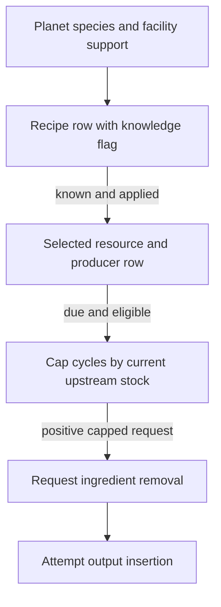

# Organic production technical reference

Planet-keyed domesticable species supply candidates, scanner knowledge
controls selection, and the selected resource drives a separate current
ingredient check. The native and installed UI contracts are STATIC on the
reported Starfield 1.16.244.0 build. The definition catalogue and six Save52
greenhouse joins supply separate evidence. Addresses use preferred static
VAs with image base `0x140000000`. [Report](../experiments/organic-facilities/report.md) ·
[Source ledger](../experiments/organic-facilities/sources.csv) ·
[Guide](../guides/organic-production.md) · [Glossary](glossary.md).

## Facility, species and knowledge

Six main-file construction recipes produce PKIN assemblies. Their template
CELLs contain the operational CONT child references, three greenhouse and
three husbandry. The shared Builders category and Organic keyword support
the definition census. The native selector `0x140f859d0` uses
OrganicResourceType `Starfield.esm:0x00000387`, value 1 for flora and 2
for fauna. Each flora base has 30 resource AV properties, each fauna base
90, initially zero. Higher-tier construction uses Horticulture or
Domestication conditions. [Facility table and construction gates](../experiments/organic-facilities/definitions.md#facility-enumeration-and-construction).

| Stage | Consumed identity and operation |
| --- | --- |
| Species candidates | Workshop Extra81 supplies a planet key, or the fallback derives planetary context. The selector ranges the manager's planet records under its read protocol. It consumes neither a facility-local biome nor a current wild actor list. |
| Flora | Resolves FLOR and species/resource rows. Resource fallback can expand a list, and a source item can resolve to an IRES through recipe product equality. This is a first-match normalization with its own qualifications. |
| Fauna | Resolves NPC_ and enumerates resource properties via the species and template context. The selector takes the first successful supported candidate for a fauna row. Multiple ambiguous resources need separate qualification. |
| Domesticability and support | Direct or inherited OutpostCanDomesticate qualifies the species. Admission requires an IRES with recipe and a resource AV present in the base sheet, even when its value is zero. It folds duplicates by IRES and ORs knowledge. |
| Knowledge | `0x14130a3e0` reads planet, species and HandScannerAnyDomesticate category membership. The mapped missing default-object case defaults to known. The ordinary selector uses the stored result. |

The scanner's condition-filtered category list requires domesticability and
an active nonzero Botany (flora) or Zoology (fauna) rank for this category.
On the mapped positive-count branch the reveal prefix is
`trunc(N × min(c / S, 1))`, with binary32 operands, where `N` is eligible
category count, `c` is scan count and `S` is required count. A guard hides
the final category while `c < S`. Flora's domesticability category is
second last in its applicable list, fauna's last. A rounded displayed
percentage is a separate calculation. Cache timing and actual unlock
thresholds were not observed in a live series.
[Species path](../experiments/organic-facilities/native.md#candidate-producer-planet-species-domesticability-and-knowledge) ·
[Knowledge writer](../experiments/organic-facilities/native.md#knowledge-acquisition-the-indirect-skill-and-scan-gate).

## From visible row to accepted inventory



The ordinary manual selection route builds a recipe row, applies an eligible
choice and creates a scheduling row. On a due production check it caps
cycles, requests source removals and attempts insertion. The diagram omits
auto-selection, link revalidation, reference failures and actual insertion
acceptance. [Menu and apply evidence](../experiments/organic-facilities/native.md#ui-producer-consumer-and-choice-mutation) ·
[Input cap evidence](../experiments/organic-facilities/native.md#input-cap-consumption-and-production-status).

The builder UI requests candidates with require-known false. It emits COBJ
FormID as row ID and carries separate knowledge and currently-built flags.
The installed SWF enables create only for a known, non-current row and
shows the scanning requirement for an unknown row. Stock is absent from
that UI predicate. Menu construction can select the first known candidate
when no known candidate has a positive resource AV. Manual apply
`0x141583410` requires old/new model associations and a resolved Workshop.
It zeros the old resource AV, deregisters, sets the new AV to 1 and registers
the new resource with zero timers. Incoming compatibility uses the new
recipe and outgoing compatibility uses the whole candidate set. At most
the first incompatible outgoing membership is pruned per invocation.

Current reason `0x140f7d120` separately checks applicable power, halt and
input sufficiency (reasons 5, 9 and 7 respectively on those branches).
`0x140f7f6f0` walks incoming local references via `0x140f881c0`. For each
COBJ ingredient it totals usable stock, then limits due cycles by the
integer floor of stock / required quantity and the requested count.
The creation path requests removals from resolved sources before attempting
ordinary insertion. Shared elapsed update, effective duration and receiver
selection apply. Recipe requirements and nominal times are definition-derived.
Current knowledge, effective rate, actual stock and accepted output were
outside the reported observations.
[Shared timer and modifier scope](../experiments/organic-facilities/reuse.md) ·
[Local paths](../experiments/organic-facilities/links.md) ·
[Independent review](../experiments/organic-facilities/review.md#independent-review02-acceptance-and-final-review-artifacts).

## Saved selection and separate restoration

The reference's ExtraBF AV state preserves the selected base value using
the masked-value writer `0x1419aec20` and reader `0x1419aeff0`.
ExtraWorkshop separately preserves resource-keyed row identities, bookkeeping,
countdown, interval and cached eligibility. Local transfer edges use
their own restoration. The script OrganicResourceAV used for representative
plants and animals is another channel. A menu candidate vector is transient.
A restored saved value does not establish current provider/override state
or knowledge-manager cache state.

Save52 shows six greenhouse rows with saved AV 1 agreeing with the IRES keys
and six saved upstream Water paths. The example
`0xff01a746` → `0xff01a752` → `0xff01a810` goes from extractor through liquid
storage to greenhouse. The inspected positive subset
does not establish saved husbandry coverage or a post-load live result.
[Saved selected values](../experiments/organic-facilities/native.md#persistence-and-authority) ·
[Saved topology and provenance](../experiments/organic-facilities/links.md).

## Repeat a tracked recipe check

Group [recipes.csv](../experiments/organic-facilities/recipes.csv) by
`input_ires_quantities`. Of 90 main-file rows, 30 require Water ×1 alone,
30 add Fiber ×2 and 30 add Nutrient ×2. Find IRES `000777e6` and `00224640`.
Both make MISC `000777fd` and have a base interval of 36 engine elapsed
seconds, but use different recipe IDs and inputs. Thus matching the output
MISC cannot identify the feed requirement. The recipe table cannot reconstruct
an actual menu, a live scan event or inventory throughput.
[Definition and species cross-checks](../experiments/organic-facilities/definitions.md#recipe-enumeration-and-inputs) ·
[Original E2 review](../experiments/organic-facilities/review.md#independent-review02-acceptance-and-final-review-artifacts).

Run from the checkout root in PowerShell 7.

```powershell
$recipes = Import-Csv docs/experiments/organic-facilities/recipes.csv
$recipes | Group-Object input_ires_quantities | ForEach-Object { "$($_.Name) $($_.Count)" }
$recipes | Where-Object ires -in '000777e6', '00224640' |
    ForEach-Object { "$($_.ires) $($_.recipe) $($_.product_misc) $($_.nominal_seconds) $($_.input_ires_quantities)" }
```

**PUBLICATION DEPENDENCY — EVIDENCE ACCESS PENDING** for primary
verification of the six historical Save52 greenhouse joins and the
original native and UI evidence.
[Claim and access crosswalk](../audits/production-guides-d5ba/claims.md).
