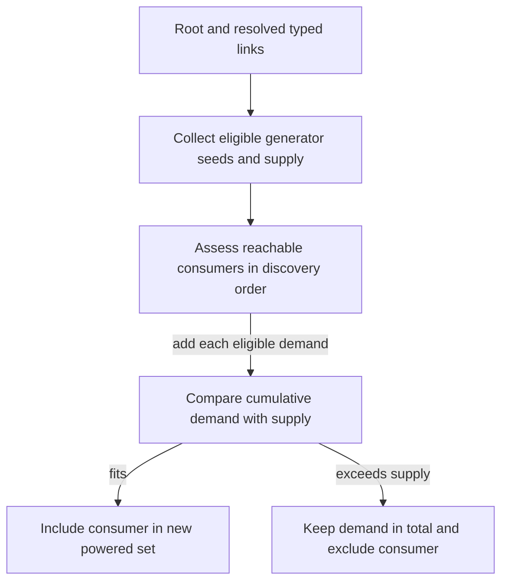

# Power and generator fuel technical reference

Construction selects a generator definition. Current effective contribution
and typed graph reachability determine supply, and cumulative demand in
discovery order determines the new powered set. Restored flags supply the
old set for comparison in the examined load worker. The mapped native and
main-file build is Starfield 1.16.244.0. Historical Save29 bytes and
operator reload observations have their own provenance. Addresses are
preferred static VAs with image base `0x140000000`.
[Power report](../experiments/power/report.md) ·
[Source ledger](../experiments/power/sources.csv) ·
[Guide](../guides/power.md) · [Glossary](glossary.md).

## Ratings, effective contribution and fuel

| Ordinary family | Nominal PowerGenerated by qualified construction choice |
| --- | --- |
| Solar array and dome | Array 2 / 4 / 6 / 8 for Deep Freeze, Frozen or Cold, Temperate or Hot, Scorched or Inferno. Dome 4 / 8 / 12 / 16 on the same groups. |
| Wind and advanced wind | Basic 3 / 6 / 10, advanced 6 / 14 / 25, for Thin, Standard and High or Extreme pressure. Both construction recipes exclude no atmosphere. |
| Reactor and advanced reactor | 30 and 100 on their operational child bases. Fuel rods in construction costs do not establish recurring fuel usage. |
| Fueled generator | 20 on ACTI `Starfield.esm:0x002b063a`. Charge can suppress effective generation. |

The 17 variants and their conditions are main-file definitions. The wind
exporter's zero on no atmosphere represents failed construction eligibility.
Its missing-pressure value 6 is exporter policy. The inspected lists have no
matching unconditional native fallback. Native precedence for contradictory
planet keywords is unqualified. [Construction and environment](../experiments/power/definitions.md#planet-selection-and-exporter-exceptions).

`0x140669880` reads base PowerGenerated plus the three current modifier
slots, in order 2, 1, 0. If the preliminary sum is positive, eligible
assigned crew entry point `0xDB` applies to the base and the modifier
values are added to that result. The helper clamps to zero. The qualified
crew entries add to generation. The mapped ordinary path lacks solar
time-of-day, weather and wind-event operands. Fuel, graph admission and
mod-added behavior have separate boundaries.
[Contribution and crew](../experiments/power/fuel.md#current-generator-contribution).

The fueled ACTI's resource AV `0x002b063b` points through IRES `0x002b0638`
to COBJ `0x002b0639`. It requires one He-3 IRES `0x000057f5` per
ordinary cycle admitted by the input cap, with a null product. Exactly
one usable unit qualifies the one-cycle input threshold. The linked interval GLOB
`0x002b0637` yields 36 engine elapsed seconds per cycle before effective
timer modifiers. The ordinary consumption path requests removal from local
incoming resource sources and skips inventory insertion for the null
product. The cited study did not measure the inventory decrement.
Electrical connections carry a separate relation.

At the due check an Uncharged generator with reason zero can enter the
fuel-removal request path, restore PowerGenerated and request graph refresh.
A Charged generator with reason 7 (input shortage) receives a negative base-generation modifier
in slot 2, refreshes the graph and changes to Uncharged. Other nonzero
reasons do not establish the same transition. Charge writes use the
persisted AV setter, while reevaluation depends on current time and inputs.
This bounds the ordinary generator path. Cargo-link Helium-3 and voyages
belong to the [cargo reference](cargo.md#fuel-readiness-and-accepted-cycles).
[Fuel and charge](../experiments/power/fuel.md) ·
[One-unit threshold](../experiments/power/followup.md#c-bounded-fuel-threshold) ·
[Cargo transport study](../experiments/cargo-links/transport/report.md).

## Typed graph and allocation

ExtraPowerLinks (ExtraCB) belongs to each reference and holds an ordered
array of reference FormID and u32 connection word pairs. Words 1, 2 and 3
respectively have demonstrated simple membership, automatic and explicit
connection uses. Word 0 has a qualified spline-mediated path. The words
are compared by value. A drawn cable, spline object, Workshop owner edge
and resource-transfer edge have distinct roles. Both endpoints of an
ordinary explicit connection must pass the effective admission predicate.
The selection caller adds assembly, world and owner constraints. An
explicit receiver with a live word-3 edge, or ordinary radiating generator
with a non-simple edge, can restrict direct word-1 crossings. A simple
beacon component can then be separate from a wired component.
[Admission](../experiments/power/native.md#authoritative-pair-admission-and-construction-caller) ·
[Graph and partition](../experiments/power/native.md#traversal-and-graph-partition).



Generation traversal supplies eligible seeds and total supply. The separate
assessment expands the vector, accumulating eligible demand and including
only consumers whose cumulative demand fits. Rejected demand still counts.
The diagram abstracts root fallback, transition overrides and later
application of differences. [Allocation and ordering](../experiments/power/followup.md#a-roots-generation-seeds-and-assessment).

Generation traversal at `0x140671f70` deduplicates generators. Its default
queue implementation inserts and promotes to the front, correcting the
preliminary FIFO-like description. Recursive traversal uses forward order
and can differ. Allocation at `0x14066b100` starts from the seed vector,
with a specified no-generator root/Workshop fallback. It expands in forward
index order with its own visited set. The current root, resolved CB order,
seed order and admissibility matter. It adds **base PowerRequired** as
binary32 and keeps that demand in the total even when the new consumer
does not fit. At supply 10 and eligible order 6, 6, 1, only the first fits.
At order 1, 6, 6, the first two fit. The mapped partition and assessment
have no global wired-first or unwired-first sort.
[Exact deficit instructions](../experiments/power/native.md#deficit-allocation-and-the-mixed-case) ·
[Independent follow-up review](../experiments/power/review.md#focused-allocation-orderswitch-follow-up).

The switch open-state getter `0x1405cdc70` accounts for pending state,
ExtraAction fallback, animation or an interface override. Applicable
state 1 or a matching invocation override can skip assessment and
expansion through a switch. Generation collection has separate gates,
and an alternate path can still reach a consumer. On qualified REFR
paths change mask `0x400000` participates in default-open reconstruction.
Mask `0x800000` preserves the current difference from default. Load can
rebuild ExtraAction mask `0x04` from default XOR saved difference. This
conditional interpretation does not demonstrate historical switch pose
or independently observed toggle ground truth.
[Switch getter and persistence](../experiments/power/followup.md#b-switch-getter-transitions-and-persistence).

## Saved edges, flags and load authority

ExtraCB serializes reference identities and connection words in array
order. Load remaps the identities for current traversal. FormIDs differ
from current traversal handles. Extra9C preserves mask `0x40` as a
powered snapshot. After restoration, a
qualified object-loaded event can call the scheduler and allocator.
The examined worker `0x14066fa50` builds a new set independently and
applies changes against the old set. Setter `0x14066abc0` writes mask
`0x40` for changed members, refreshes producer eligibility and emits
power events. Current generator availability, switch state, root
and effective values can differ from saved snapshots. UI summary
caches have separate paths.
[Saved representations](../experiments/power/saved.md#save-versus-runtime-contract-matrix) ·
[Load and order](../experiments/power/availability.md#load-reconstruction-qualification-2026-10-17).

In Save29, the beacon stores solar, extractor #1, extractor #2 in that
order, with reciprocal simple links. All four possible admitted object
roots reach the same sole generator in the fixed graph. The consumer
walk visits #1 then #2, so base supply 6 and demands 5, 5 give the new
set containing #1 only. The three reported fresh-process reloads agree.
Restoration alone (R) also matches that result. Deterministic reconstruction
(C) is the STRONG working explanation because the relevant ordinary load
path can independently pick that result. The intersection stays unchanged
after comparison, which supplies no satisfactory-old-winner preference
for the conditional retention model (H). The actual invocation history
and effective operands were unrecorded. Universal settled-load convergence
remains unestablished.
[Historical reload report](../experiments/power/save29-test-plan.md) ·
[Competing models](../experiments/power/save29-authority.md#hypothesis-assessment-and-direct-answers) ·
[Independent Save29 review](../experiments/power/save29-authority-review.md).

## Repeat a tracked allocation check

Read the four [Save29 CB rows](../experiments/power/save29-authority.md#grounded-saved-graph).
Read solar `002031e1` and iron extractor `0005ef19` in the
[definition CSV](../experiments/power/catalogue.csv) for supply 6 and demand
5 respectively, in game power units. Start assessment at the sole
generator, follow the beacon's forward target order and compare cumulative
5 then 10 with supply 6. Swap just the two consumer positions in this
projection to make #2 the winner. Starting from any of the four saved
object roots yields the same sole seed under the stated resolution and
eligibility conditions. Varying the old bit set changes the difference
writes in the projection without changing the winner.

This check uses tracked operands and exact small-integer arithmetic at
the 1.16.244.0 definition/native baseline. It does not rerun the allocator
or recover the original event timeline.

**PUBLICATION DEPENDENCY — EVIDENCE ACCESS PENDING** for primary Save29,
the historical reload evidence and original native evidence at the
original-witness tier.
[Order derivation and limits](../experiments/power/save29-authority.md#ordering-provenance-and-bounded-save29-derivation) ·
[Claim and access crosswalk](../audits/README.md#archive-lookup) (`audits.zip :: docs/audits/production-guides-d5ba/claims.md`).

Run from the checkout root in PowerShell 7. The script reads the
beacon's stored target order from the report and projects the two
consumer orders from the sole generator seed.

```powershell
$catalogue = Import-Csv docs/experiments/power/catalogue.csv
$supply = [int]($catalogue | Where-Object formid -eq '002031e1').generation
$demand = [int]($catalogue | Where-Object formid -eq '0005ef19').demand
$row = Select-String '^\| Beacon ' docs/experiments/power/save29-authority.md
$targets = [regex]::Match($row.Line, '; `([0-9a-f,]+)` / `1,1,1`').Groups[1].Value.Split(',')
$first, $second = $targets[1], $targets[2]
foreach ($order in (,@($first, $second)) + (,@($second, $first))) {
    $total = 0
    foreach ($consumer in $order) {
        $total += $demand
        if ($total -le $supply) { "Winner $consumer" }
    }
}
```
