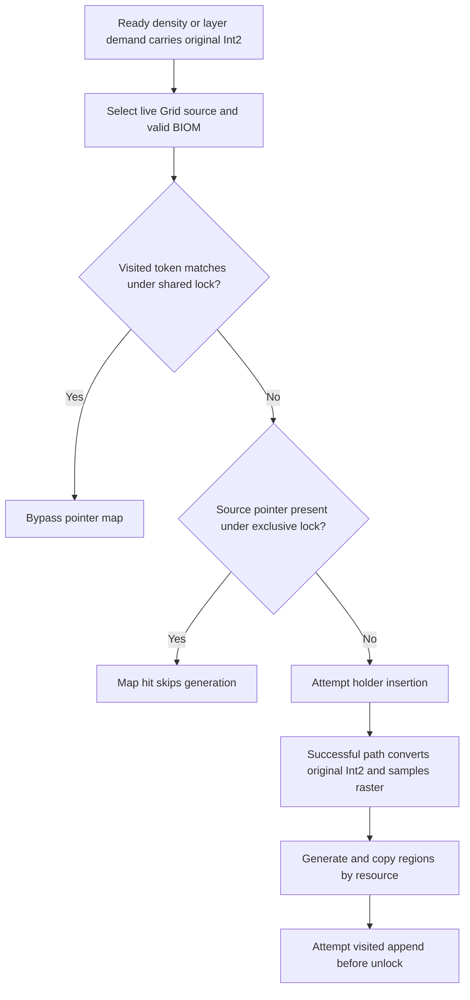
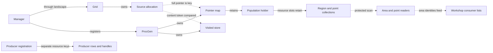
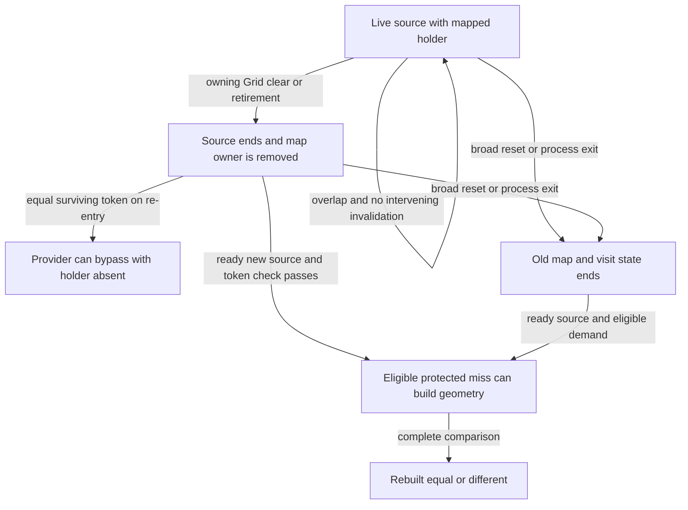

# Resource generation technical reference

[Reader guide](../guides/resource-generation.md) · [Reference index](README.md) ·
[Project glossary](glossary.md) · [Selected claims](../history/claims.md#resource-generation)

The first eligible protected miss on the live source pointer controls
ordinary construction. Its original request supplies the raster query.
Source identity and frame, definition order, seed inputs and clipping
constrain the resulting geometry separately.

## Build and identity domains

The pinned Starfield **1.16.244.0** executable has SHA-256
`7e9adb1414a8e1b325e5e1f097b9b17b78deb7eebeda37a333351a43a60f9d28`
and preferred image base `0x140000000`. Locators below are preferred
static VAs. Subtract the image base for an RVA. Add the actual loaded base
to the RVA for a runtime VA. Member offsets are hexadecimal bytes from
the named object. Save offsets require their own stream domain. Descriptive
names are research labels unless the source pins a native name.
[Build and input identities](evidence-access.md#build-and-input-identities) ·
[Function register](../function-register.md) · [State register](../state-register.md).

| Domain | Representation and scope |
| --- | --- |
| Geographic source key | Research tuple of chart, fine anchor coordinates and terrain identity, scoped by body/frame. Feynman V example `0:37536:20928:0029d20e`. It can recur across allocations. |
| Body and terrain | FormIDs of distinct typed definitions. The Feynman V body is `0x0005e0de`. Biome and resource forms have separate IDs. |
| Saved outpost identity | Saved placed-reference identity joined to body, descriptor and Workshop association under framing and remap rules. Indexed source association cannot certify physical deposit membership. |
| Grid and source allocation | Live Grid owner and separately allocated source. Publication identifies a birth. A raw pointer or deduplication return cannot establish a fresh birth or extend lifetime. |
| Source token | Content-derived visited comparison operand at source `+0x68`. It can compare equal after reallocation. |
| Map key and slot | Full live source pointer. Rehash or erase can move a slot. Numeric pointer equality across lifetimes cannot identify an allocation. |
| Holder and collections | Map-owned reference to a holder, whose per-resource FormID slots retain nested collections. Outstanding references can delay destruction after map erase. |
| Original request | Signed coordinate pair (Int2) carried by density and layer jobs. It needs its frame and differs from the source anchor and generator cell key. |
| Mask | Low nibble of the sampled raster byte. It controls ordinary numeric rarity comparisons and has a separate domain from resource identities and observer geometry classes. |
| Native frame | Consumed owner/descriptor, axes, phase and conversion context. A source-planar comparison origin is a separately qualified geometry representation. |
| Capture identity | Observer UUID, sequence or allocation label scoped to schema and session. Equal counters across processes convey no lifetime continuity. |
| Producer reference and handle | Saved placed-reference identity can resolve to a current handle in the resource-keyed producer row. The base FormID and resource key identify separate forms. |

[Source input contract](../experiments/resource-retained-population/d5aq-mask-method.md) ·
[Native ownership](../experiments/resource-retained-population/d5ah-lifecycle-matrix.md#owners-readers-and-release-boundaries) ·
[Active-site associations](../experiments/resource-retained-population/d5at-active-associations.md) ·
[Producer serialization](../experiments/resource-retained-population/d5ah-extractor-continuity.md#what-is-serialized-and-reconstructed).

## Request and sampling decisions



*Figure 1. Ordinary provider decisions.* Shared visit and exclusive map
lookup are separate critical sections. The table qualifies the successful
miss path. Alternate entry, allocation failure, cleanup and extra passes
are outside the schematic.
[Native path](../experiments/resource-retained-population/d5w-normal-path-model.md#arbitration-original-query-authority-and-retention) ·
[Review](../experiments/resource-retained-population/d5w-review.md).

| Decision | Native locator | Consequence |
| --- | --- | --- |
| Admit work | Layer caller `0x1407b526a`, density caller `0x1407a1a3c`, provider `0x14079f860` | Layer has a spanning manager reader. Detached density can reuse aggregate `+0x08` and skip provider. Grid selection follows actual slots and contributor rules. |
| Check visit | Shared ProcGen protection in `0x14079fc37..0x14079fcd4` | Match skips lookup. Shared protection is released before exclusive acquisition. Two requests can both observe unvisited. |
| Look up pointer | Acquire `0x14079fcb3`, lookup `0x14079fccb`, miss branch `0x14079fcd4` | Hit skips generation and append and can reuse partial output. |
| Construct on miss | Insert `0x14079fdf9`, convert `0x14079fea1..0x14079febe`, generate `0x14079ff18` | The successful path generates synchronously under exclusive protection. Holder, region or point allocation failure can prevent useful or complete output. |
| Mark visited | Append `0x14079ff3e`, release `0x14079ffa5` | No full-output validation before append. Failed reserve can leave the source unmarked. |

B2 records `(4,-1)` passing the visit check earlier, then `(5,0)`
reaching the constructing miss and sampling `0x3`. The first request
later hits the map. Its retail mask was unsampled. The record cannot
apportion pre-ownership delay between callback/observer time and lock
contention. N2 supplies a contrary history with one target unvisited
path and no recorded target pending-writer overtake. Readiness, worker
service and lock admission constrain which original request reaches the
miss. The exclusive helper admits competing writers by compare-and-exchange
rather than a ticket. Pending writers alone do not block new readers.
Registration order and a common terrain transform cannot identify
a canonical winner.
[B2 chronology](../experiments/resource-retained-population/d5ac-target-lookup-chronology.md) ·
[D5AE scheduler constraints](../experiments/resource-retained-population/d5ae-scheduler-causality.md) and [review](../experiments/resource-retained-population/d5ae-review.md) ·
[D5AF lock admission](../experiments/resource-retained-population/d5af-prelock-causality.md) and [review](../experiments/resource-retained-population/d5af-review.md) ·
[D5AG report](../experiments/resource-retained-population/d5ag-report.md) and [review](../experiments/resource-retained-population/d5ag-review.md) ·
[N2 report](../experiments/resource-retained-population/d5ao-n2-report.md) and [review](../experiments/resource-retained-population/d5ao-n2-review.md).

## Owners, locks and consumers



*Figure 2. Owners and readers.* Solid arrows show ownership, retention
or registration. Dashed arrows show key, comparison or read relationships.
Consumer lists and producer rows have separate lifetimes.
[Ownership and release controls](../experiments/resource-retained-population/d5ah-lifecycle-matrix.md#owners-readers-and-release-boundaries) ·
[Review](../experiments/resource-retained-population/d5ah-review.md).

Manager `+0x130` and the module vector bind registered ProcGen.
The Grid owns published source allocations. Retaining the Grid does
not pin every member. ProcGen `+0x40` is the audited shared/exclusive
protection domain. Area reader `0x1421e07d0` and point reader
`0x14079df70` scan under shared protection. The point callback also
retains a collection during traversal. A layer manager reader spans
preparation and provider use against another thread's manager-exclusive
shift. Detached density inherits no finished preparation reader. An
actual ambient terrain reader can protect a cooperatively nested call
under qualified conditions, but B2 did not capture that context. The
detached-density retirement gap rules out a blanket lifetime guarantee.
[D5S lifetime model](../experiments/resource-retained-population/d5s-query-winner-model.md) and [review](../experiments/resource-retained-population/d5s-review.md) ·
[Conditional terrain protection](../experiments/resource-retained-population/d5ag-terrain-resource-map.md#preparation-terrain-work-and-conditional-protection).

A holder's `0x18`-byte slots use a u32 resource FormID and collection
pointer at slot `+0x08`. A collection holds count, capacity and data at
`+0x08/+0x0c/+0x10`. The `0x30`-byte native regions own
`0x10`-byte points. Deep copy and final release have distinct paths from
generation scratch and map-slot movement. A collection can outlive its
source and the map reference if another genuine reference survives.
Snapshot wire strides belong to a different representation.
[Native destructors](../experiments/resource-retained-population/d5ah-lifecycle-matrix.md#native-release-addendum) ·
[Snapshot schema](../experiments/resource-retained-population/d5ar-snapshot-schema.md).

## Lifecycle and actual action mapping



*Figure 3. Retention and reconstruction.* The diagram follows the target
source and the old stores. After narrow retirement, an equal surviving
token bypasses lookup. Without a matching token, later eligible demand can
reach a new miss even without a broad reset. A continuity witness plus actual
protected use establishes reuse. Outstanding collection references and
incomplete copies have their own lifetimes and outcomes.
[Transition controls](../experiments/resource-retained-population/d5ah-lifecycle-matrix.md#transition-matrix) ·
[Action evidence](../experiments/resource-retained-population/d5av-player-action-matrix.md).

| Transition | Audited native predicate and result | Player-action mapping |
| --- | --- | --- |
| Below threshold | Mode 2, no blocking transition and both translated absolute displacements below the setting-derived threshold at `0x14078c5f0`. The branch preserves existing ownership. | Conditional for local movement. No isolated complete retail interval. |
| Shift with overlap | Manager-exclusive `0x14078ce00` shifts the Grid. Overlap preserves the source. ProcGen shift slots do no work. | Conditional on receiver and overlap. |
| Nonoverlap retirement | Predicate `0x140987080` selects loss of overlap. Source ends and its map entry is erased if present. Visits survive this operation. | Conditional. Return with an equal surviving token can bypass without a holder. A ready source with no matching token can reach a new miss if the other gates pass. |
| Grid clear | `0x1409829b0` clears the addressed Grid's sources and matching entries. Visits survive this operation. | D5AJ observed unrelated Grid clears while the target survived. |
| Broad reset | True `0x140788e70` and false `0x140789850` dispatch ProcGen slot `+0x18` and clear both stores under exclusive protection. Landscape/Grid teardown has separate edges. | Conditional on actual owner, component or cell operands. The manager allocation can survive. |
| Same-process return | Travel can reach focus update, installation, direct reset or early exit. Later cell/focus paths can still intervene. | Unknown for a generic same-area, interplanetary or intersystem trip. |
| D5AK Episode A | Installer, true reset, owning Grid clear and exact erase followed by ProcGen clear. Further installer/reset and clear precede return generation. | Observed on one Feynman V → Lodge exterior marker → Feynman V trip. Initiating caller and installer operands were unmeasured. |
| Save write | Audited type-3/type-7 writers supply no population invalidation witness. | A save alone establishes neither retention nor resampling. |
| Full in-process load | Complementary type-3 revert/reader branches clear both stores for valid ordinary objects and stable `bAvoidClearOnReload`. Restored inputs and later demand can rebuild. | Static and save evidence. No isolated warm load-to-sample/full-output pair. |
| Restart | Old allocations end. Bootstrap can create a new manager when the singleton is absent. | D5AL observes an equal rebuild in a new process. D5AS observes two classes. Separate processes alone cannot certify equal effective inputs. |
| Consumer scan or cached list | Protected traversal can use the resident map. A cached list can be reused separately. D5AK observes completed scans with complete target resident, without per-region admission proof. | Reopening Build Mode cannot identify the branch or prove retention across the entire action. |

[D5V report](../experiments/resource-retained-population/d5v-report.md) and [review](../experiments/resource-retained-population/d5v-review.md) ·
[Disjoint Grid clears](../experiments/resource-retained-population/d5aj-invalidation-matrix.md#correct-the-receiver-domain-before-scoping-a-fence) ·
[D5AV conditional adjudication](../experiments/resource-retained-population/d5av-cache-decision-matrix.md) ·
[Unqualified Build Mode trigger](../experiments/resource-retained-population/d5ar-pilot03-trigger-followup.md).

## Generation inputs and frames

| Operand | Data flow and qualified controls |
| --- | --- |
| Descriptor and Grid | Actual chart and coarse/sub/fine words feed selection and recomposition. C1 consumes chart 0, coarse `(195,109)`, sub `(8,0)`, fine `(0,0)`, anchor `(37536,20928)`. The fixed lattice has 49,152 fine cells per face axis. |
| Original query and raster | `0x14078d660` converts the original Int2 via `0x14096f5c0`. The function at `0x142332410` projects it. `0x142339340` samples the valid two-face atlas and extracts its low nibble. In the C1 interior the face cell is anchor plus original Int2. Both arithmetic branches agree at all 196 coordinates. Changed phase, chart or raster readiness can invalidate the comparison. |
| Ordered definitions | Source biome form (BIOM) `0x00145440` resolves effective resource-generation data (RSGD) `0x00258050` in C1. Owner, definition order and effective settings are distinct inputs from the sampled byte. |
| Ordinary weight | At the mapped resource call `0x14079be20`, numeric mask 8 or mask below IRES rarity at `+0x110` selects the inactive multiplier. Other cases select binary32 1. Inactive rarities outside the mapped 0–5 table retain zero. A change to an earlier weight can affect later retained regions even when the later resource's own weight is fixed. [Weight dataflow](../experiments/resource-retained-population/d5q-call-dataflow-map.md) · [Competition control](../experiments/resource-retained-population/d5ag-geometry-controls.md#equivalence-and-counterexamples). |
| Seed | `0x14078d7b0` supplies the packed source-origin-plus-cell key. `0x14079a330` folds its bytes and manager-owner u32 through CRC to initialize the generation random state. The stage comparison fixes seed-cell frame and order. The PCM seed is a separate input. |
| Origin and clip | Fixed controls use source-planar origin `(-200,-200)`, clip centre `(300,300,0)`, half extent `(700,700,0)` and 144 cells per resource in the native stage frame. Changing the native generation origin can change seed inputs. These coordinates supply no outpost overlay. |
| Extra passes | Special can sample original geography again and use high bits. The fixed main-file contract positively excludes applicable Special and Everywhere passes. Different components can invalidate equality even with the same low nibble. Atmosphere and Water products are separate. |

[Input and adverse-control method](../experiments/resource-retained-population/d5aq-mask-method.md) ·
[D5T report](../experiments/resource-retained-population/d5t-report.md) and [review](../experiments/resource-retained-population/d5t-review.md) ·
[Terrain inputs](../experiments/resource-retained-population/d5ag-terrain-findings.md) ·
[Coordinate contract](../experiments/resource-retained-population/d5v-coordinate-contract.md).

## Output frames and consumer operands

| Boundary | Representation and comparison |
| --- | --- |
| Generated source geometry | Native regions carry binary32 XYZR bounds and ordered 16-byte XYZW points in the qualified planar basis. Point W is width. Native X/Y are engine axes, with 100 native units per fine-cell step in the named interior contract. The source-planar comparison supplies no metre or compass mapping. |
| Workshop area reader | The area descriptor supplies indexed binary32 XYZ and a domain. The mapped callback adds the current indexed translation when in range. Radius and upper-height operands are separate. The ordinary installed beacon's 150-native-unit radius is a default definition value, subject to effective overrides and separate border and height rules. |
| Natural extractor point reader | The placement path copies the candidate's current raw XYZ into `0x14079df70`. Predicate `0x142346b30` tests XY against resident geometry without the area descriptor's indexed translation at this edge. One same-frame control reports Ionic Liquids in both supplied area results, while a fixed point admits it only in the mask-3 geometry. This is a native point-predicate result with supplied geometry. Full placement has additional gates. [Fixed-point result](../experiments/resource-retained-population/d5w-report.md#q3--three-stability-levels). A saved XYZ or matching body alone cannot join these operands. |

[Native domains and radius](../experiments/resource-retained-population/d5v-coordinate-contract.md#native-domains-and-owners) ·
[Area and point controls](../experiments/resource-retained-population/d5v-lifecycle-consumer-map.md#native-geometry--area-catalogue-and-extractor-decisions) ·
[Region requirements and review](../experiments/native-availability-map/region-review.md).

## Complete geometry and the observed series

| Record | Qualified comparison or observation | What it supports |
| --- | --- | --- |
| D5AQ C1 [report](../experiments/resource-retained-population/d5aq-report.md) / [review](../experiments/resource-retained-population/d5aq-review.md) | 196 typed coordinate pairs, 28 at mask `0x0`, 168 at `0x3`. N2 alone directly sampled among these rows. Native peer-front `(-2,-2)` and owner-back `(10,11)` continuations exhibit both classes under qualified startup premises. | Native feasibility for both classes. Individual winner feasibility and winner distribution remain open. |
| D5AG [controls](../experiments/resource-retained-population/d5ag-geometry-controls.md) / [review](../experiments/resource-retained-population/d5ag-review.md) | Fixed `(4,-1)` → `0x0`, `(4,1)` and `(5,0)` → `0x3`. Complete output is 74 regions / 193 points versus 78 / 180. Both mask-3 outputs agree. | Consequential variation under fixed remaining inputs. The losing B2 retail query remains unsampled. |
| D5AK A0/A1 [report](../experiments/resource-retained-population/d5ak-a-report.md#source-identity-complete-bytes-and-lifetime-result) / [review](../experiments/resource-retained-population/d5ak-a-review.md) | Old source and contents ended. Original queries `(8,3)` and `(-1,11)` both directly sample `0x3`. The complete 5,090-byte envelope-inclusive comparison agrees. | Rebuilt identical within one process. Allocation IDs 932 and 30579 are observer labels. |
| D5AL A0/B0 [report](../experiments/resource-retained-population/d5al-b-report.md#exact-baseline-and-represented-content) / [review](../experiments/resource-retained-population/d5al-b-review.md) | Fresh process with pinned Save52 starting inputs, new source and protected miss, B0 `(0,0)` → `0x3`. Complete 5,090-byte normalization agrees with A0. | Equal independent reconstruction. Equal allocation counters convey no cross-process continuity. |
| D5AO N2 [report](../experiments/resource-retained-population/d5ao-n2-report.md#direct-target-chain-and-surviving-content) / [review](../experiments/resource-retained-population/d5ao-n2-review.md) | Events 3961 and 3962 bind original `(-2,11)` and `0x3`. Earlier B2 directly sampled `(5,0)` → `0x3`. | Direct sample evidence. Five direct constructors across four sessions cannot establish invariant or frequency. |
| D5AS [series](../experiments/resource-retained-population/d5as-series-closeout.md#frozen-roster-and-comparisons) / [selected evidence tier](../first-release-scope.md#resource-generation-cut) | 30 qualified fresh-process observations. Two match the complete 4,966-byte mask-0 body. The other 28 match the 4,858-byte mask-3 body. Zero other qualified. | Two complete source/frame classes. The operator reported a Save52 load-and-visit procedure. Per-start loaded save and effective inputs were unverified. Generating mask and winner are unknown. The original pre-freeze eligibility review receipt is private. |
| D5AT [survey](../experiments/resource-retained-population/d5at-active-associations.md) / [selected evidence tier](../first-release-scope.md#resource-generation-cut) | 17 active ordinary Save52 sites, 335 installed relationships and 65 separate alternate relations. Grid support and conditional density/layer counts have separate denominators. | Indexed source association and conditional inputs. Outside C1, completed visit cohorts and retail winners remain unmeasured. The earlier original-contract review is private and its historical BLOCKED disposition stands. |

The D5AS source-planar comparison uses origin `(-200,-200)`. A0's
older envelope adds 232 bytes of framed source and frame metadata before
the 4,858-byte body. The body sorts resource identities, preserves region
and point order, retains the first 21 region header bytes and all 16 bytes
of each point, and excludes region header padding `0x15..0x17`. Matching
counts alone would miss changes in point words. Complete source-frame
equality cannot certify outpost area membership or identical effective
historical inputs.
[Canonical comparison and controls](../experiments/resource-retained-population/d5as-producer-profile.md#pilot-and-byte-domains) ·
[Original envelope](../experiments/resource-retained-population/d5ai-geometry-schema.md).

A separate D5U source admits three different ordinary masks and three
distinct complete populations under its qualified input contract. The two
classes at the studied Feynman V source set no general upper bound.
[D5U comparison](../experiments/resource-retained-population/d5u-report.md) and
[review](../experiments/resource-retained-population/d5u-review.md).

## Saved reconstruction and outpost consumers

| State | Save and runtime boundary |
| --- | --- |
| Context and generated-world descriptors | Ordinary global type 3 carries context comparison, descriptors and components. Drain precedes revert. The stable setting selects the complementary revert or manager-reader clearing branch. Matching context alone does not preserve the live map through this graph. |
| PlanetContentManager (PCM) | Global type 7 restores the seed, planet-data (PNDT) keyed content and world-keyed placements before destination preparation. Resolution/filtering affect restored contents. Save52 type 9 selects the Lodge interior. Queued preparation can outlast load return. |
| Source geometry and visits | Transient for the audited channels. The writer/reader and clear graph explain reconstruction from inputs. Other hypothetical derived save representations are outside the audit. |
| Workshop availability | Area scan admits identities. The UI folds spatial and atmospheric lists and separately appends matching entries from the biome list for selected water. Cached lists, actual UI inputs and displayed timing differ. In one Kreet 0.7.0 preview session, all 346 observed folds matched final row associations. These repeated folds do not represent 346 distinct geometries, and the session observed no selected-water append. [Original runtime report](../experiments/continuous-beacon-preview/live-scientific-report.md) and [independent review](../experiments/continuous-beacon-preview/review.md). |
| Point placement | Natural extractor placement at `0x140f3f9a0` reaches `0x140f7c290` after applicable bypass checks. It intersects point-admitted resources from `0x14079df70` with effective produced resources. |
| Established producer | Registration uses effective properties. Serialization carries the resource key, placed identity, separate base and bookkeeping. Restore resolves and remaps identities. The current due-cycle path uses the registered key subject to power, halt, eligibility, resolution and destination capacity before actual insertion. The mapped path does not rerun placement selection. |

[Save-state matrix](../experiments/resource-retained-population/d5ad-save-state-matrix.md) ·
[Load chronology](../experiments/resource-retained-population/d5ad-load-chronology.md) and [review](../experiments/resource-retained-population/d5ad-review.md) ·
[Availability contract](../experiments/native-availability-map/output-contract.md) and [review](../experiments/native-availability-map/output-review.md) ·
[Extractor continuity](../experiments/resource-retained-population/d5ah-extractor-continuity.md) and [review](../experiments/resource-retained-population/d5ah-review.md).
An actual producing extractor across a measured changed-geometry transition
remains untested.

## Reproduction and access

| Route | Available input and verification boundary |
| --- | --- |
| Tracked arithmetic | Recount unique coordinates and mask shares from the [C1 CSV](../experiments/resource-retained-population/d5aq-request-mask-map.csv) with the command below. The [D5AT rankings](../experiments/resource-retained-population/d5at/active-rankings.csv) also support table arithmetic. |
| Native and definition reconstruction | The [Build and input identities](evidence-access.md#build-and-input-identities), [source pins](../experiments/resource-retained-population/d5aq-sources.csv) and [method](../experiments/resource-retained-population/d5aq-mask-method.md) identify lawful separately installed pinned files, owned methods and additional private inputs. The [conditional D5AG fixed-stage reader](evidence-access.md#fixed-native-geometry) is narrower than D5AQ Option C, which remains deferred. |
| Save52 reconstruction | B4-F040 / HIST-0267 is a [Selected CORE member](../history/save-identifiers.md#b4-f1-core) without a hosted URL. Full regeneration needs pinned installed-main inputs and a qualified descriptor/grid method. Save bytes cannot supply a historical event epoch. |

The [D5BV selection](../../research/evidence-data/evidence-closure-d5bv/routes.json)
binds 68 distinct routes and 126 claim-to-route joins to their original
qualifications. A checkout supports authored mechanism inspection and table
comparisons. Original collection and unselected historical comparators remain
attributed to their reports and reviews. CORE F040 supplies the exact Save52
witness for the selected saved comparison. The saved witness cannot identify
historical execution order or live state after load.

The selected derivatives remain pending release. [D5AS](evidence-access.md#d5as-complete-body-comparison)
checks complete recorded geometry bodies against fixed references, with
acquisition and eligibility attributed to the original investigation.
[C19](evidence-access.md#c19-callback-comparison) checks the 346 recorded native
callback folds. Upstream preview chronology, unique producer ancestry and
Flash render timing remain outside that check. The
[D5BH, D5BI and D5BO projections](evidence-access.md#projected-event-evidence)
support the named Episode A/B, N2 and B2 comparisons within their recorded
histories. Those histories do not establish winner probabilities.

`P-AG-FIXTURE` is the [conditional fixed-native-stage route](evidence-access.md#fixed-native-geometry).
It requires exact D5AS reference operands, lawful matching EXE, main ESM and
PlanetData BA2, a qualified host and separate execution authority. The D5AS
body comparison can use the precomputed archive independently. D5AQ Option C
remains held. D5AG's original Q2/Q3 scheduling and lifecycle questions and
parent question remain BLOCKED under the [recorded decision](../DECISIONS.md#d5bv-practical-resource-generation-predictability--2026-11-11).

From the repository root, set PowerShell variable `$python` to your
Python 3 executable. This reads
one tracked CSV and prints counts without writing any files.

```powershell
@'
from collections import Counter
from csv import DictReader
from pathlib import Path

path = Path("docs/experiments/resource-retained-population/d5aq-request-mask-map.csv")
with path.open(encoding="utf-8", newline="") as source:
    rows = list(DictReader(source))
coords = {(int(row["original_x"]), int(row["original_y"])) for row in rows}
masks = Counter(row["mask"] for row in rows)
assert len(rows) == 196
assert coords == {(x, y) for x in range(-2, 12) for y in range(-2, 12)}
assert masks == {"0x0": 28, "0x3": 168}
for mask, count in sorted(masks.items()):
    print(f"{mask} {count}/{len(rows)} ({count / len(rows):.2%})")
'@ | & $python -B -
```

Expected rows are `0x0`, 28, 14.29% and `0x3`, 168, 85.71%.
The test checks the tracked census arithmetic. Native samples, historical
geometry classes and winner probabilities require different evidence.

## Historical limits and challenges

The [original checklist](../experiments/resource-retained-population/resource-generation-gameplay-checklist.md)
and [D5R report](../experiments/resource-retained-population/d5r-report.md)
and [review](../experiments/resource-retained-population/d5r-review.md)
preserve the earlier scope. Under D5AU's prospective scope, the proposed
checklist disposition answers GC-10 at the protected-miss scope and
retires the usual-winner subquestion, which remains unmeasured. GC-31
has both equal and differing qualified retail geometry. The proposals
retire GC-06, GC-24 and GC-33 for the current objective. The action ingress,
first-refresh and readiness gaps remain historical. GC-34 and D5AV's
GC-35, GC-36 and GC-37 have conditional answers at their proposed scopes.
[D5AU decisions](../experiments/resource-retained-population/d5au-gap-closure-decisions.md#decision-matrix) ·
[D5AV decisions](../experiments/resource-retained-population/d5av-cache-decision-matrix.md).

GC-35, GC-36 and GC-37 are answered conditionally under the independently reviewed D5AV
scope. The conclusions establish native mechanisms and qualified gameplay
transitions, but not universal player-action rules. They preserve the
distinction between static consequences under the stated operands and an
observed complete transition. The older D1 disappearing deposit report retains
its incident-attribution gap.
[D1 case](../experiments/disappearing-deposits/report.md) ·
[original review](../experiments/disappearing-deposits/review.md) ·
[subsequent research on changing deposits](../experiments/disappearing-deposits/subsequent-research.md).

The strongest unresolved action contrast is a same-area warm return with
measured target lifetime, first eligible decision and complete geometry on
both sides. Existing evidence cannot supply that interval. For cold-start
qualification, the [excluded D5AS capture](../experiments/resource-retained-population/d5as-series-closeout.md#acquisition-and-exclusions)
shows why full source identification comes before outcome classification.
