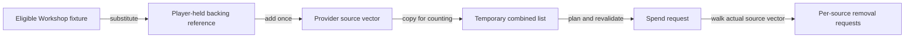

# Shared Outpost Storage technical reference

[Guide](../guides/shared-storage.md) · [Reference index](README.md) · [Claim and evidence crosswalk](../audits/logistics-guides-d5bb/claims.md)

STATIC scope is retail 1.16.244.0 with the pinned installed main ESM and
`SFBGS00D.esm` add-on. Native VAs are preferred static addresses at image
base `0x140000000`. Add-on local IDs, file-encoded IDs, save reference tokens
and runtime handles have different domains. [Sources](../experiments/shared-outpost-storage/sources.csv) · [Methods and native locators](../experiments/shared-outpost-storage/methods.md).

## Fixture admission and backing ownership

Add-on COBJ local `0x02AF79` builds CONT local `0x02AF77`. Its location
condition requires `LocationOrParentHasKeyword(0x319847) == 0` in the
main-master domain. Its two rank conditions require equality at rank 4
for Outpost Management and Outpost Engineering. The selected Workshop
quota is one, with the ordinary placement and accounting gates still
applicable. The fixture registers through ordinary WorkshopItem membership.
The installed definition supplies base CarryWeight 5000, build-container
value 1 and both output-link prohibitions at 1. These are definition
operands. [Construction prerequisites and controls](../experiments/shared-outpost-storage/prerequisites.md).

The installed default-object binding supplies add-on stash keyword local
`0x04D338`. Native `0x140B64DA0` tests that keyword on the reference.
The player creation path `0x1405A3CC0` initializes the backing reference
when player object offset `0x1008` is null. ContainerMenu preparation
`0x1414681D0` substitutes that backing reference, copying effective
capacity/name context as applicable. The fixture keeps its own transform
and owner. The adjacent player inventory at `0x1000` and the provider's
temporary counting reference are separate objects. The mapped player
reset path has its own lifetime, distinct from removal of a fixture.
[Recognition, direct access and lifetime](../experiments/shared-outpost-storage/shared-inventory.md).

## Providers, counts and removal



This schematic follows a qualifying fixture into bench ingredient work.
The same vector can contain bench, ship and player stock. The counting
copy owns no authoritative items. Spending uses the actual source vector
and makes separate requests. Direct container access substitutes the same
backing target without building this ingredient vector.
[Consumer entry points](../experiments/shared-outpost-storage/consumers.md#entry-points-and-actual-source-lists).

| Consumer | Sources in forward order and owning path |
| --- | --- |
| Crafting and research | Provider `0x1417F6FA0` takes the actual bench, explicit linked crafting container, selected ship, eligible members of the bench's Workshop or linked Workshop fallback, then player. Research AddMaterial rebuilds the provider before planning. |
| Construction | `0x1421A7060` checks availability and `0x1421A7950` spends using a separate vector with selected ship, eligible members of the specified Workshop, then player. Placement calls the spender after its own admission. |
| Direct access | Recognition substitutes the player's backing reference for the selected fixture. No generic remote store or ship chest enumeration occurs. |
| Other systems | [Fabrication](fabrication.md) follows its directed local ingredient graph. [Cargo](cargo.md) transfers among physical bays and hold. [Locations](stored-resources.md) shares the eligible-member rule for reporting and does not spend. |

The Workshop callback requires resolution, TESContainer capability and
effective OutpostBuildContainer (main AVIF `0x00F65A`) nonzero. Reverse
Workshop membership supplies candidates. Recognized fixtures contribute
the backing reference once after deduplication. The selected ship comes
from a qualified registry/context with fallback. Its ordinary cargo
interface supplies inventory without separately scanning captain's lockers
or other ship chests. Saved membership and nominal base properties cannot
prove effective source admission. For example, the examined outgoing
cargo definitions omit the build-container property and fail this gate
when effective zero. Ordinary chest `0x2779FC` can pass with effective 1
despite both local-link prohibitions. [Source and consumer matrix](../experiments/shared-outpost-storage/consumers.md#sourceconsumer-matrix).

The bench provider copies and sums source rows. Ingredient matching can
also use crafting-resource component data, so the requested material
amount can differ from a raw same-form count. Planning and revalidation
prepare virtual removal requests. `0x1417FB210` walks the actual vector
forward and requests the minimum of remaining requirement and available
amount through source virtual slot `0x458`. Construction has its own
equivalent forward loop. Workshop-member order is unqualified. A prepared
request, the subsequent mutation and realized aggregate depletion are
distinct. Individual inventory locks supply no demonstrated global atomic
transaction across the copy, plan and sequential mutations.
[Spend and mutation limits](../experiments/shared-outpost-storage/consumers.md#counts-ingredient-plans-and-actual-depletion).

## Player save channel and historical fixtures

Player writer `0x141A46940` serializes the second internal inventory
list from player offset `0x1008`, via `0x140B2DBD0` and the inventory
writer. Loader `0x141A48F50` reads the second list from buffer version
`0x92` onward and restores it into the reconstructed backing object.
The serialized list carries inventory data, and the loaded pointer
has its own lifetime. Fixture identities and Workshop relationships
persist separately. Source vectors and counting copies are transient.

HIST-0018, HIST-0036 and HIST-0257 have independently joined fixture
and beacon references. The fixture record can lack a conventional
inventory-change branch while giving access to shared stock in the
native path. Exact saved backing quantities remain unparsed. Fixture
presence, saved item data and currently spendable stock require separate
evidence. [Writer and loader](../experiments/shared-outpost-storage/shared-inventory.md#saveload-authority-and-remote-meaning) · [Historical joins](../experiments/shared-outpost-storage/saves.md) · [Original independent ACCEPT](../experiments/shared-outpost-storage/review.md).

## Repeat the tracked fixture census

From the repository root, run the following over the tracked SD2 derivative.

```powershell
$rows = Import-Csv docs/experiments/shared-outpost-storage/corpus.csv
$positive = $rows | Where-Object { [int]$_.special_inline_base_records -gt 0 }
$rows.Count
$positive.Count
($positive | Measure-Object special_inline_base_records -Sum).Sum
```

Expect 278 locators, 124 positive saves and 1,499 recognized inline-base
fixture records. The locator roster includes 147 supported saves, 108
unsupported saves and 23 missing inputs. This recomputes an existing
derivative. It cannot reopen
the historical originals, decode backing quantities or establish loaded
eligibility and spend. [Census scope](../experiments/shared-outpost-storage/saves.md#broad-search).
