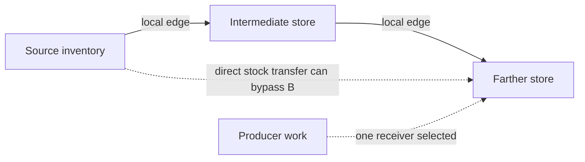

# Storage and local output links technical reference

[Guide](../guides/storage-and-output-links.md) · [Reference index](README.md) · [Claim and evidence crosswalk](../audits/logistics-guides-d5bb/claims.md)

The native paths below are STATIC for the pinned retail 1.16.244.0 image
and installed main definitions. Addresses are preferred static VAs at image
base `0x140000000`. Offsets on a reference or vtable refer to separate runtime
layouts. The historical saves have separate sample and reader qualifications.
[S1 provenance and locators](../experiments/storage/native.md) · [S2 functions](../experiments/local-output-links/functions.csv).

## Definition, effective capacity and pair gates

| Operand | Ordinary authority and effect |
| --- | --- |
| Store capability and contents | The placed reference's base supplies TESContainer capability. The reference inventory at offset `0xA0` supplies materialized stock. Some readers walk base entries when no list has materialized. Multiple matching item forms and stacks can coexist. |
| CarryWeight | The non-actor capacity getter resolves the effective AV, including supported ExtraBF base overrides and modifiers, ExtraE1 and base-sheet fallback. `0x140F7C210` tests effective capacity at or below current weight from `0x140B69760`. |
| Dedicated families | Solid, Liquid, Gas and Warehouse have 75/150/300 base weight by size. Installed Transfer Container `0x2CE194` is 200, with a separate ship-access keyword. Qualified ordinary pad templates use incoming `0x219173` and outgoing `0x219171` at 300 each. Mission bases and effective overrides have separate scope. |
| ONAM | The CONT loader resolves ONAM into the definition at offset `0x258`. For the mapped product check, absent accepts, present-empty rejects and populated tests exact forms or item keywords. Ordinary dedicated lists use ResourceTypeSolid, ResourceTypeLiquid, ResourceTypeGas and ResourceTypeManufactured. Pair compatibility and actual item admission are separate tests. |
| Outgoing and incoming | `0x140F83F60` checks effective outgoing prohibition and source capability. `0x140F84470` validates the ordered pair, including same-reference/compound and invalid destination exclusions, incoming prohibition, compatibility and topology. The add wrapper `0x140F85760` attempts insertion on a zero result. |

Ordinary decorative chest controls set both effective prohibition defaults to
1. A changed definition or override changes the native operands. The cargo
incoming child blocks incoming links and can be a sender. The outgoing child
can be a receiver and sender, subject to pair checks. Its freight behavior
depends on the [ship transfer stages](cargo.md#endpoint-and-stage-ownership).
The fuel marker can accept a recipe link through compatibility without a
demonstrated physical input store. Manual menu and forced/script insertion
have distinct gates. The generic fit helper's positive-capacity branch,
player exception and nonpositive-capacity handling also preclude a universal
nominal bound. [S1 native gates](../experiments/storage/native.md#separate-source-and-pair-gates) · [Capacity continuation](../experiments/storage/capacity-native.md) · [Reviews](../experiments/storage/review.md) and [capacity review](../experiments/storage/capacity-review.md).

## Graph, movement and creation



Solid arrows depict a hypothetical saved topology. Dashed arrows depict two
distinct possible actions. No arrow gives a throughput or a completed event.
The ordinary mover can insert from A into C without inserting into B.
Producer work can create a batch at C without subtracting that batch from A.
[Native movement and delivery](../experiments/local-output-links/native.md#existing-stock-planning-and-mutation).

The manager records incoming adjacency by destination handle. Its forward
cache seeds with self and adds resolvable downstream stores with container
capability, excluding harvester, builder and fueled-input categories from
ordinary relay traversal. It deduplicates handles. A saved
enumeration or first-created edge does not establish the current vector
order. `0x140F84D70` visits stock and `0x140F84FC0` prepares descriptors. The
visitor resolves candidates, rejects incompatible or insufficient-one-unit
space and scans the retained vector backward. With ordinary positive item
weight, it plans up to the floor of free weight divided by item weight per
candidate, bounded by remaining source units. The source virtual slot
`0x458` requests removal, with shortage bounding the removed count passed
to the receiver add path. The split requests and resulting inserts have no
global rollback guarantee. The planning pass does not reserve cumulative
weight across different item rows. For two 20-unit rows at 0.5 each, W=60
and C=75, each can plan against the original 15 free, giving W=80 if both
inserts complete. [Actual cross-item comparison and traces](../experiments/local-output-links/traces.md#multi-item-counterexample-to-a-whole-batch-capacity-guarantee).

A successful qualified add may flush the source and upstream containers
when the destination passes the ordinary-store gate. The script-facing
refill wrapper can look upstream for sources, then invoke the same downstream
mover. A reciprocal edge, if admitted, is a separate directed path. The
observed code paths for a container-changed event and cache rebuild update
state without running the mover. [Trigger and event locators](../experiments/local-output-links/native.md#actual-movement-triggers-and-scheduler-boundary).

`0x140F7D510` tests the producer fallback and searches the forward vector
for one compatible ordinary receiver with W<C. `0x140F7D6A0` requests fresh
output at that one receiver. Builder input caps can restrict the due count.
The incoming graph walker `0x140F881C0` supplies source references to the
ingredient planner, which can withdraw actual ingredients before output
insertion. [Fabricator input authority](fabrication.md) · [Generator fuel](power.md).
A nominal capacity reached after selection or a whole-batch insertion can
give a different result from existing-stock floor-fit planning.

## Persistence and remote update

| Channel | Persisted authority and live use |
| --- | --- |
| Reference contents | Qualified REFR inventory tail with item identity, compact stack count, per-stack extras and signed quantities. `0x1406447C0` writes and `0x1406448B0` restores. Omitted inventory branch, explicit empty list and unsupported extras are distinct. |
| Direction and membership | Writer `0x140F7E6F0` saves a destination reference then its counted incoming source references in the global transfer envelope. Loader `0x140F7EA10` rebuilds handle sets. Extra4C WorkshopItem association and the Workshop registry are separate. Forward vectors and descriptors are derived or temporary. |
| Production | ExtraWorkshop rows save producer/base identities, pending/iterations, cached eligibility byte, then remaining/interval floats. These are wire fields, distinct from runtime row offsets. The scheduler resolves the Workshop and producer and evaluates current state. |

When the Workshop and producer resolve, a due row can create output without
loaded 3D. If the entire Workshop fails resolution, its rows are skipped.
A failing producer handle can receive pending bookkeeping and a sentinel,
with ordinary future sentinel recovery unestablished. The matched object-load
event can clear existing pending even if current eligibility prevents output.
The elapsed branch can truncate full interval counts and drop overshoot.
Neither registration, elapsed time nor pending guarantees delivery.
[Saved graph and row contracts](../experiments/local-output-links/saves.md) · [Lifecycle](../experiments/local-output-links/lifecycle.md) · [Original S2 correction and review](../experiments/local-output-links/review.md#retained-failures-and-corrections).

## Repeat a tracked capacity check

From the repository root, run this PowerShell check on the installed-definition
summary. The count is limited to the dedicated store rows. Compare with the
[worked movement cases](../experiments/local-output-links/traces.md).

```powershell
$rows = Import-Csv docs/experiments/storage/catalogue.csv
$rows | Where-Object editorid -match '^OutpostStorage(Solid|Liquid|Gas|Warehouse)01(Sm|Med|Large)$' |
    Group-Object capacity_fallback | Sort-Object { [double]$_.Name } |
    Select-Object Name,Count
[math]::Floor((75 - 74.5) / 0.5)
74.5 + 3 * 0.5
```

Expect four definitions at each of 75/150/300, then 1 unit and 76 weight.
The arithmetic compares two explicit planning models. It does not recover a
live effective value or reproduce the exact native call.
